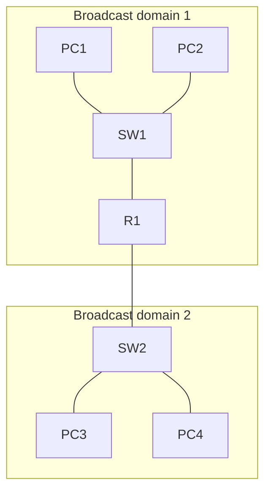

# Day 1 — Network devices

## References

### Videos

- [Network devices, day 1](https://www.youtube.com/watch?v=H8W9oMNSuwo) — Jeremy's IT Lab
- [Packet Tracer introduction, day 1 lab](https://www.youtube.com/watch?v=a1Im6GYaSno)
- [Kurose and Ross, chapter videos](https://gaia.cs.umass.edu/kurose_ross/videos/1/)

### Articles

- [Packet Traveling, key players](https://www.practicalnetworking.net/series/packet-traveling/key-players/)

## Diagram



Each switch port is its own collision domain. The router is the boundary between the two broadcast domains.


A network is a set of devices that can exchange data. Day 1 is the cast list: who creates data, who moves it inside one LAN, and who moves it between LANs.

## Two jobs for hosts

A **host** is anything with an IP address that sends or receives application data. PCs, phones, printers, and servers are hosts.

- A **client** starts a request (a laptop opening a web page).
- A **server** answers it (the machine holding that page).

The same host can be a client in one conversation and a server in another. A file server that checks for its own updates is both.

## The devices that move traffic

| Device | Layer it decides on | What it looks at | What problem it solves |
|--------|---------------------|------------------|------------------------|
| Hub | Physical | Nothing; it repeats the electrical signal | Obsolete way to join cables |
| Switch | Data link | Destination MAC address | Connects many hosts in one LAN |
| Router | Network | Destination IP address | Connects separate networks |
| Firewall | Policy on several layers | Addresses, ports, connection state, sometimes the application | Allows or blocks traffic by rule |
| Access point | Data link (bridges wireless to Ethernet) | 802.11 frames, then Ethernet frames | Joins Wi-Fi clients to the wired LAN |
| Wireless LAN controller | Control of access points | CAPWAP tunnels from lightweight APs | One place to configure many APs |

### Hub

A hub repeats every bit out of every port. If two devices transmit together, the signals collide and both must retry. Every port on a hub shares one **collision domain**. Hubs are half duplex only. You will not design with them. You still need the idea, because “what a switch improves on” is the hub.

### Switch

A switch receives a frame, looks at the destination MAC, and sends it out only the port where that MAC was learned. Each switch port is its own collision domain. With full duplex, a host can send and receive at the same time, so collisions stop happening on that link.

By default, a switch does **not** look at the IP address. A broadcast frame (destination MAC all Fs) is flooded out every port in the same VLAN. So a basic switch is one **broadcast domain** per VLAN. Day 16 splits that.

A **Layer 3 switch** can also route between VLANs. It is still a switch for frames on each VLAN. Routing is an extra function, configured later with VLAN interfaces.

### Router

A router forwards **packets** using the destination IP and its routing table. Each router interface is a separate network, a separate broadcast domain, and a separate collision domain.

Routers do not forward Ethernet broadcasts or ARP requests. That is why a broadcast storm on one LAN stays on that LAN, and why every LAN needs its own default gateway.

### Firewall

A firewall sits on the path and permits or denies traffic. A **stateful** firewall remembers that a PC opened a connection, so the return packets are allowed without a second, opposite rule.

A **next-generation firewall** can also identify the application (for example, allow a specific web app and block another that both use TCP port 443).

Related, and easy to mix up:

- An **IDS** (intrusion detection system) watches copies of traffic and raises an alert.
- An **IPS** (intrusion prevention system) sits inline and can drop the attack traffic.

### Wireless

An **autonomous AP** is configured on its own. A **lightweight AP** is configured by a **wireless LAN controller (WLC)**. The AP tunnels client traffic to the controller with CAPWAP. From the switch’s point of view the AP is just another Ethernet device that needs power and a VLAN.

## Collision domain vs broadcast domain

These two phrases show up on every fundamentals quiz. Use this rule:

- A **collision domain** ends at a switch port or a router interface. A hub does not end it.
- A **broadcast domain** ends at a router interface (or at a VLAN boundary on a switch). A switch does not end it, unless you create separate VLANs.

### Worked example

```text
[PC1] [PC2] [PC3] [PC4]
   \    |    |    /
        [SW1]
          |
        [R1]
          |
        [SW2]
   /    |    |    \
[PC5] [PC6] [PC7] [PC8]
```

No VLANs. Every link is a switch port to one device, or the single link from a switch up to the router.

**Collision domains: 10**

- 4 links from SW1 to PCs
- 1 link from SW1 to R1
- 1 link from R1 to SW2
- 4 links from SW2 to PCs

The router interface and the switch port on the same cable are the **same** collision domain. Do not count both ends.

**Broadcast domains: 2**

- Everything on SW1, including PC1–PC4. A broadcast from PC1 reaches PC2, PC3, PC4, and R1’s left interface. R1 does not flood it onward.
- Everything on SW2, including PC5–PC8.

If SW1 were a hub, PC1–PC4 and the link toward R1 would collapse into **one** collision domain. The broadcast-domain count would stay 2, because the router is what stops broadcasts.

### One more case people miss

Four PCs on one switch, no router:

- Collision domains: 4 (one per port that has a PC).
- Broadcast domains: 1.

Add a second VLAN and put two PCs in each VLAN (day 16):

- Collision domains: still 4.
- Broadcast domains: 2, even though there is no router yet. Those two groups cannot reach each other until something routes between the VLANs (day 17).

## What each device does with a message

PC1 pings PC8 in the diagram above.

1. PC1 builds an IP packet destined to PC8.
2. PC8 is not on PC1’s subnet, so PC1 addresses the Ethernet frame to **R1**, the default gateway.
3. SW1 forwards that frame to the port where R1’s MAC was learned. The other PCs do not get a copy.
4. R1 strips the frame, looks up PC8’s IP, and builds a **new** frame toward SW2.
5. SW2 delivers the new frame to PC8.

The IP source and destination stay PC1 and PC8 for the whole trip. The MAC source and destination are rewritten at the router. Day 12 walks this in full detail.

## Check yourself

1. Which device creates a separate broadcast domain on each of its interfaces?
2. A 48-port switch has 20 PCs connected and no VLANs. How many collision domains contain those PCs? How many broadcast domains does the switch have?
3. Why can two PCs on a full-duplex switch port send at the same time without colliding?
4. What is the difference between an autonomous AP and a lightweight AP?
5. A firewall allows a PC’s web request out, and the web server’s reply comes back with no explicit “inbound” rule for that reply. What firewall behavior makes the reply succeed?

## Answers

1. A router (a Layer 3 switch does the same once it is routing between VLANs).
2. 20 collision domains for those PC links. 1 broadcast domain.
3. The link has only two devices, and transmit uses a different pair from receive, so their signals never share the wire at the same time.
4. An autonomous AP holds its own configuration. A lightweight AP gets its configuration from a WLC and tunnels traffic with CAPWAP.
5. The firewall is stateful. It remembers the outbound connection and permits the matching return traffic.
