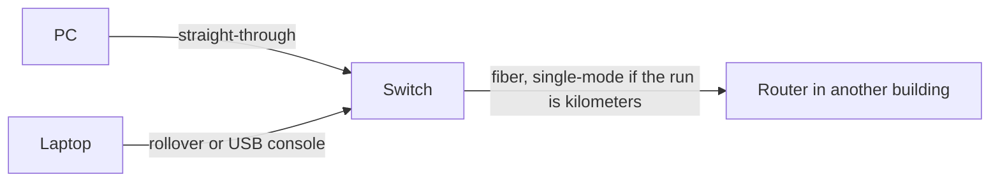

# Day 2 — Interfaces and cables

## References

### Videos

- [Interfaces and cables, day 2](https://www.youtube.com/watch?v=ieTH5lVhNaY) — Jeremy's IT Lab
- [Connecting devices, day 2 lab](https://www.youtube.com/watch?v=K6Qt23sY68Y)

### Articles

- [Packet Traveling series](https://www.practicalnetworking.net/series/packet-traveling/packet-traveling/) — what those cables are carrying

## Diagram

Day 1 named the devices. Day 2 is the cable between them: copper or fiber, which pinout, how far it can run, and how a phone or an AP gets power from the switch.

## Reading an Ethernet name

`1000BASE-T` splits into three parts:

| Piece | Meaning | In this example |
|-------|---------|-----------------|
| Number | Speed in megabits per second | 1000 Mbps = 1 Gbps |
| BASE | Baseband: the cable carries one signal at a time | Almost every LAN standard |
| Suffix | Medium | T = twisted pair |

Other suffixes you should recognize:

| Standard | Medium | Typical distance | Use |
|----------|--------|------------------|-----|
| 1000BASE-T | Cat5e or better, 4 pairs | 100 m | Ordinary gigabit to a desk |
| 1000BASE-SX | Multimode fiber, short wavelength | About 550 m | Inside a building |
| 1000BASE-LX | Single-mode fiber, long wavelength | About 5 km | Between buildings |
| 10GBASE-T | Cat6a (Cat6 only for shorter runs) | 100 m on Cat6a | 10 Gbps on copper |
| 10GBASE-SR | Multimode fiber | Hundreds of meters, depends on fiber grade | Short 10 Gbps fiber |
| 10GBASE-LR | Single-mode fiber | About 10 km | Longer 10 Gbps fiber |

Copper Ethernet is specified to **100 meters** including the patch cords at both ends. Beyond that, use fiber or another switch.

## Copper: the pairs inside the jacket

**UTP** (unshielded twisted pair) is the normal office cable. Four pairs are twisted so that interference picked up on one wire is cancelled by the twist of its partner.

**STP** (shielded twisted pair) adds foil or braid. It is used where electrical noise is high. The shield has to be grounded correctly or it makes things worse.

Both end in an **RJ-45** plug. Two pinout standards exist: **T568A** and **T568B**. A building should pick one and stick to it. T568B is the usual choice in new installs. Electrically, a straight-through cable works either way as long as both ends match.

### Categories

| Cable | What you can plan on |
|-------|----------------------|
| Cat5 | 100 Mbps to 100 m. Too old for new work. |
| Cat5e | 1 Gbps to 100 m. The minimum for gigabit. |
| Cat6 | 1 Gbps to 100 m, and 10 Gbps only to about 55 m. |
| Cat6a | 10 Gbps to 100 m. |
| Cat8 | 25 or 40 Gbps to about 30 m. Data-center copper, not desk runs. |

Gigabit and faster use **all four pairs**. Fast Ethernet (100BASE-TX) uses only two pairs: pins 1-2 transmit and pins 3-6 receive, from the PC’s point of view.

## Straight-through, crossover, rollover

**Straight-through.** Both ends wired the same (both T568B, or both T568A). This is the cable from a PC to a switch, and from a router to a switch. Unlike devices: one side is DTE-like (PC, router) and the other is the switch.

**Crossover.** One end T568A and the other T568B, so the transmit pair lands on the other device’s receive pair. Used between **like** devices when they cannot sort this out themselves: switch to switch, PC to PC, router to router.

**Auto-MDIX** makes the port swap transmit and receive in hardware. Modern Cisco switch ports have it. If **both** ends support Auto-MDIX, or even one end does on many platforms, a straight-through cable works for switch-to-switch as well. Exams still ask the classic rule: unlike devices use straight-through, like devices use crossover. In a lab, check whether the port is actually linking before you blame the idea.

**Rollover (console) cable.** Pins reversed end to end. This is **not** an Ethernet cable. It connects a PC’s serial adapter to the router's or switch’s **console** port so you can reach the CLI before the device has an IP address. Many current devices also accept a USB console cable. Day 4 uses that port.

## Fiber

Fiber carries light, so it is immune to electrical interference and runs much farther than 100 m.

| | Multimode | Single-mode |
|--|-----------|-------------|
| Core | Wider (50 or 62.5 µm) | Narrow (about 9 µm) |
| Light source | LED or VCSEL | Laser |
| Distance | Short: same room up to a few hundred meters | Long: kilometers |
| Jacket color you will see | Orange or aqua | Yellow |
| Typical optic | SX, SR | LX, LR |

Two strands are the usual pair: one transmits, one receives. If a link stays down and the fibers are crossed the wrong way, swap the pair (or use the equipment’s auto feature where it exists).

### Connectors and slots

- **LC** is the small connector on most SFPs. You will use this the most.
- **SC** is the older square push-pull connector.
- **ST** is the older round bayonet connector.

An **SFP** is a small pluggable optic for 1 Gbps. **SFP+** is the 10 Gbps size of the same idea. You match the optic to the fiber: SX/SR into multimode, LX/LR into single-mode.

## Duplex and speed, in one paragraph

**Half duplex** means one direction at a time. Hubs are half duplex, and collisions are normal there.

**Full duplex** means both directions at once. Switch-to-host links should be full duplex, and collisions should be zero.

Speed and duplex are negotiated when both sides are set to **auto**. Day 9 covers what breaks when one side is hardcoded.

## PoE: power on the same copper cable

A VoIP phone, AP, or camera often has no power brick. The switch supplies DC power on the Ethernet cable.

| Standard | Name | Power from the switch | About what the device receives |
|----------|------|----------------------|--------------------------------|
| 802.3af | PoE | 15.4 W | 12.95 W |
| 802.3at | PoE+ | 30 W | 25.5 W |
| 802.3bt Type 3 | PoE++ | 60 W | about 51 W |
| 802.3bt Type 4 | PoE++ | 90–100 W | about 71 W |

The device receives less than the switch supplies because the cable drops some power.

Two ways to inject power:

- **Endspan.** The switch itself is the power source. This is the normal design.
- **Midspan.** A power injector sits in the cable between a non-PoE switch and the device.

The switch and the device negotiate. A non-PoE laptop on a PoE port is not fed 48 V by accident; power is applied only after the device identifies itself.

### Worked example

You are cabling one small office:

- 24 PCs, each within 40 m of the closet, need 1 Gbps.
- 2 APs in the ceiling, each drawing about 20 W.
- The closet switch uplinks to a router in another building, 2 km of fiber already in the ground. The fiber is yellow.

Choices:

- PCs: Cat5e or Cat6, straight-through, RJ-45, 1000BASE-T. Cat5e is enough at 1 Gbps and 40 m.
- APs: same copper, but the switch ports must be **PoE+** (802.3at, 30 W). Standard PoE at 15.4 W is short of a 20 W draw.
- Uplink: yellow jacket means single-mode, so use **1000BASE-LX** (or a 10 Gbps LR optic if you need 10 Gbps), LC connectors into SFP slots. Copper cannot cover 2 km.

## Check yourself

1. Which cable joins a PC to a switch: straight-through, crossover, or rollover?
2. You must run 10 Gbps for 90 m on copper. Which category do you specify?
3. A link from switch to switch is single-mode fiber. Which of SX and LX matches?
4. An AP needs 25 W at the device. Is 802.3af enough?
5. Why does a console cable not help you ping the switch?

## Answers

1. Straight-through.
2. Cat6a. Cat6 is specified for 10 Gbps only to about 55 m.
3. LX (long wavelength). SX is multimode, short reach.
4. No. 802.3af delivers about 12.95 W at the device. Use PoE+ (802.3at), which delivers about 25.5 W.
5. A rollover console cable carries the CLI session, not Ethernet frames. It has no IP path. You use it to configure the switch, including an IP address later, from a serial or USB console connection.
