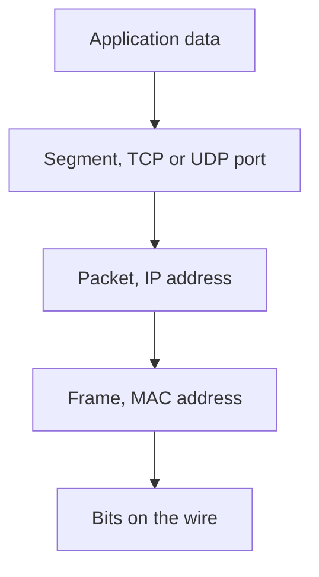

# Day 3 — The TCP/IP model

## References

### Videos

- [TCP/IP model, day 3](https://www.youtube.com/watch?v=yM-XNq9ADlI) — Jeremy's IT Lab
- [OSI model lab, day 3](https://www.youtube.com/watch?v=7nmYoL0t2tU)
- [Kurose and Ross, chapter videos](https://gaia.cs.umass.edu/kurose_ross/videos/1/)

### Articles

- [Packet Traveling](https://www.practicalnetworking.net/series/packet-traveling/packet-traveling/)
- Kurose notes on the same [lectures site](https://www-net.cs.umass.edu/kurose_ross/lectures.php)

## Diagram




Every later topic sits on this stack. MPLS, VLANs, and routing all answer the same question: which layer is acting, and what is the name of the chunk of data at that layer?

Jeremy teaches the **TCP/IP model** as the one that matches real protocols, and the **OSI model** as the one exam questions still use. You need both, and you need the map between them.

## The two models

```text
OSI (7)              TCP/IP (4)           What you actually configure
-----------------    -----------------    ---------------------------------
7 Application \ 
6 Presentation |     Application          HTTP, DNS, SSH, DHCP
5 Session      /
4 Transport          Transport            TCP, UDP
3 Network            Internet             IPv4, IPv6, ICMP
2 Data Link     \    Network Access       Ethernet, Wi-Fi, ARP, switches
1 Physical      /                         Cables, bits, SFPs
```

OSI layers 5, 6, and 7 are one **Application** layer in TCP/IP. OSI layers 1 and 2 are one **Network Access** (or Link) layer in TCP/IP.

When a question says “Layer 3”, it means the OSI network layer: IP. “Layer 2” means Ethernet switching. “Layer 4” means TCP or UDP. People use OSI numbers even when they are thinking in TCP/IP.

## What each layer is for

**Application.** The program’s data and the protocol that program speaks. A browser speaks HTTP. The browser does not know about MAC addresses.

**Transport.** Gets data between the right **processes** on two hosts. It does this with port numbers. TCP also repairs loss and controls speed. UDP does not.

**Internet.** Gets a packet from the source host to the destination host across many networks. IP addresses live here. Routers work here.

**Network access.** Gets a frame across one link. MAC addresses, switches, cables, and fiber live here. A switch does not have to understand IP to do its job.

## PDUs: the name of the data at each layer

| TCP/IP layer | OSI layers | PDU name | Address used |
|--------------|------------|----------|----------------|
| Application | 5–7 | Data | — |
| Transport | 4 | Segment (TCP) or datagram (UDP) | Port number |
| Internet | 3 | Packet | IP address |
| Network access | 2 | Frame | MAC address |
| Network access | 1 | Bits | — |

People say “packet” loosely for all of these. In notes and on exams, use the precise name when the layer matters.

## Encapsulation, with a real message

A user sends “hello” in a chat app from PC1 to a server.

1. **Application** hands the bytes to the transport layer.
2. **TCP** adds a header: source port 51514, destination port 443. The unit is now a **segment**.
3. **IP** adds a header: source 192.168.1.10, destination 203.0.113.5. The unit is now a **packet**.
4. **Ethernet** adds a header and a trailer: source MAC of PC1, destination MAC of the default gateway (the server is remote). The unit is now a **frame**.
5. The NIC transmits **bits** on the wire.

The receiving host strips the headers in reverse. That is **de-encapsulation**.

Adjacent layers on the **same** host serve each other: TCP asks IP to deliver this segment. The same layer on **different** hosts is the logical conversation: PC1’s TCP talks to the server’s TCP, even though the bytes physically pass through IP and Ethernet.

### What changes on the way

Across one hop:

- The **frame** is rebuilt at every router. Source and destination MAC belong to the current link only.
- The **packet’s** source and destination IP stay the two hosts, until [NAT](../03-routing/09-nat.md) rewrites them.
- The **segment** is untouched by routers. Routers do not look at ports unless they are filtering or translating. TCP’s own reliability rules are in [TCP reliability](17-tcp-reliability.md).

This is the whole plot of day 12. Learn it here first.

## TCP and UDP

| | TCP | UDP |
|--|-----|-----|
| Setup | Three-way handshake before data | None |
| Reliability | Retransmits lost segments, acknowledges data | Best effort |
| Order | Sequence numbers put bytes back in order | No ordering |
| Speed control | Flow control and congestion control | Sends as fast as the app wants |
| Header | 20 bytes, often more | 8 bytes |
| Typical uses | Web (HTTP/HTTPS), SSH, email | DNS queries, DHCP, voice, video, SNMP traps |

**TCP handshake.**

1. Client sends SYN.
2. Server sends SYN-ACK.
3. Client sends ACK.

Then data flows. Ending the connection uses FIN flags. You do not need every state name yet. You do need to recognize SYN and the three steps.

**When UDP is the right choice.** A DNS query fits in one message. Retransmitting is cheaper to do in the application (just ask again) than in the transport layer. A phone call would rather drop a syllable than pause to recover a packet from 200 ms ago.

## Port numbers

A port identifies the application on a host. The pair that identifies a conversation is:

`source IP, source port, destination IP, destination port, protocol (TCP or UDP)`

| Range | Name | Who uses it |
|-------|------|-------------|
| 0–1023 | Well-known | Server applications (80, 443, 22, …) |
| 1024–49151 | Registered | Other registered services |
| 49152–65535 | Ephemeral / dynamic | The client’s temporary source port |

Memorize these server ports:

| Port | Protocol | Application |
|------|----------|-------------|
| 20, 21 | TCP | FTP (20 is data, 21 is control) |
| 22 | TCP | SSH |
| 23 | TCP | Telnet |
| 25 | TCP | SMTP |
| 53 | UDP and TCP | DNS (queries are usually UDP; zone transfers and large answers use TCP) |
| 67, 68 | UDP | DHCP (67 server, 68 client) |
| 69 | UDP | TFTP |
| 80 | TCP | HTTP |
| 110 | TCP | POP3 |
| 123 | UDP | NTP |
| 443 | TCP | HTTPS |
| 161, 162 | UDP | SNMP (161 polls, 162 traps) |

### Worked example

A PC at 10.0.0.8 opens `https://example.com`, which resolves to 93.184.216.34.

- Destination port: **443** (the HTTPS server).
- Source port: some ephemeral port, for example **51820**.
- Transport protocol: **TCP**, so there is a handshake before the HTTP request.
- Destination IP: **93.184.216.34**. Source IP: **10.0.0.8**.
- On the PC’s LAN, the frame’s destination MAC is the **default gateway**, not the web server. The server is on another network. The PC has no ARP entry for a machine it cannot reach at Layer 2.

The return packets swap the ports and IPs: source port 443, destination port 51820, source IP 93.184.216.34, destination IP 10.0.0.8.

## Protocols you will meet in the next two weeks, by layer

| Protocol | Layer | Role |
|----------|-------|------|
| Ethernet | Network access | Framing and MAC addressing on a LAN |
| ARP | Between 2 and 3 | “Who has this IP? Tell me your MAC.” Day 6. |
| IPv4 | Internet | Host addressing and routing. Days 7–11. |
| ICMP | Internet | Ping and “destination unreachable” / “time exceeded” errors. It is not TCP or UDP. |
| TCP, UDP | Transport | Delivery between applications |

ARP is the one that does not sit neatly in a single OSI box. Treat it as the helper that connects an IP address (Layer 3) to a MAC address (Layer 2) **on the local link**.

## Check yourself

1. A switch forwards using which OSI layer, and which address?
2. Name the PDU at OSI layers 4, 3, and 2.
3. Which TCP/IP layer combines OSI layers 1 and 2?
4. A query to a DNS server is one short request and one short reply, and the client will just retry if it is lost. Which transport protocol fits, and which port is the server listening on?
5. A packet crosses three routers. How many times is the Ethernet header rebuilt, and do the IP addresses change?

## Answers

1. Layer 2, the destination MAC address.
2. Segment, packet, frame.
3. Network Access (Link).
4. UDP, port 53.
5. The source host builds the first Ethernet header. Each of the three routers strips that header and builds a new one for the next link, so the path is four frames and three rebuilds. The IP source and destination stay the original hosts. Each router also decrements TTL, which is an IP header field you will study on day 10.
