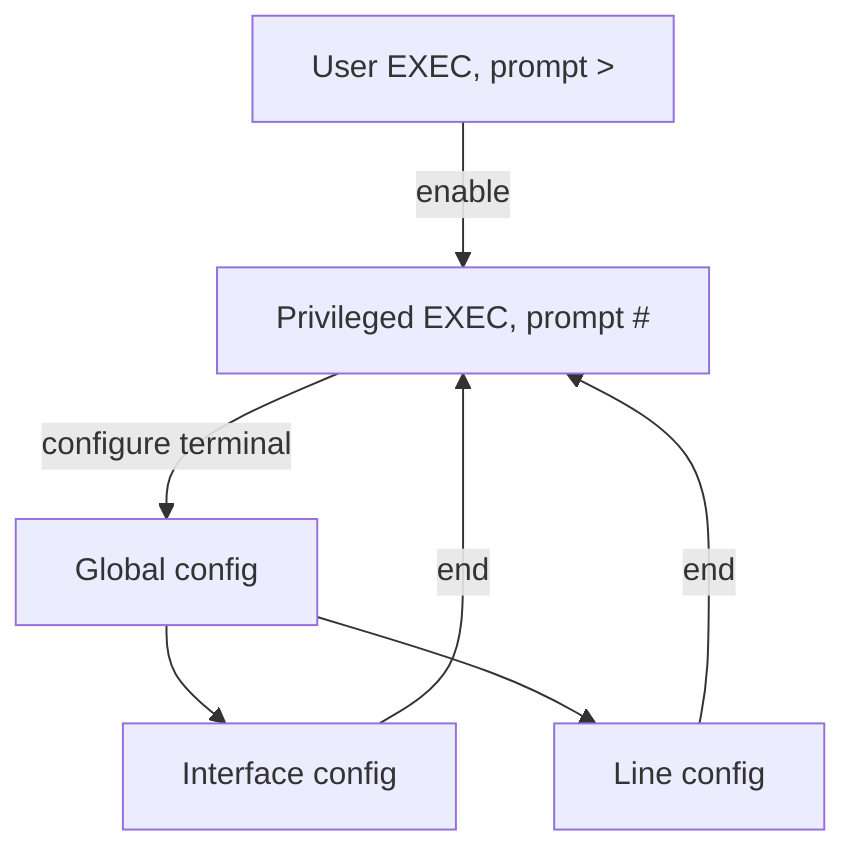

# Day 4 — Intro to the CLI

## References

### Videos

- [Intro to the CLI, day 4](https://www.youtube.com/watch?v=IYbtai7Nu2g) — Jeremy's IT Lab
- [Basic device security, day 4 lab](https://www.youtube.com/watch?v=SDocmq1c05s)

### Articles

- [Jeremy's CCNA notes](https://www.jeremysitlab.com/ccna-resources/)

## Diagram




Cisco IOS is configured from a text command line. Day 4 is navigation: which mode you are in, how to protect the device, and how to make the configuration survive a reload. Every later lab assumes this.

## How you connect before the device has an IP

Use the **console** port and a rollover or USB console cable (day 2). Console access does not need the network to be working. That is the point: you can fix a device that has no route, no VLAN, and no address.

Once the device is reachable, you can also use the **VTY** lines (virtual terminal). Those are Telnet and SSH sessions. SSH comes later in the course. The VTY lines still need a password now, or they refuse remote login.

## Modes

The prompt tells you the mode. Commands from the wrong mode fail even when they are spelled correctly.

```text
SW1>                  User EXEC. Look, do not change. Limited show commands.
   enable
SW1#                  Privileged EXEC. All show commands, save, reload, debug.
   configure terminal
SW1(config)#          Global configuration. Changes that affect the whole device.
   interface g0/1
SW1(config-if)#       Interface configuration.
   exit
SW1(config)#          Back up one level.
   line console 0
SW1(config-line)#     Line configuration (console or VTY).
   end
SW1#                  end, or Ctrl+Z, jumps straight to privileged EXEC.
```

`exit` climbs one level. `end` returns to privileged EXEC from any configuration mode.

From configuration mode you can still look at the device without leaving:

```text
SW1(config)# do show ip interface brief
```

`do` runs a privileged EXEC command from inside configuration modes.

## Help and shortcuts

- `?` lists commands valid at this spot. `show ?` lists arguments to `show`.
- Tab completes a unique keyword. `conf t` is enough for `configure terminal`.
- `no` in front of a command removes it. `no ip domain-lookup` turns off DNS lookups that make typos feel like the CLI has frozen.
- Up arrow recalls the previous command.

Useful editing keys:

| Key | Action |
|-----|--------|
| Ctrl+A | Start of the line |
| Ctrl+E | End of the line |
| Ctrl+C | Abandon the current line |
| Ctrl+Z | Same as `end` |
| Ctrl+Shift+6 | Interrupt a stuck lookup or ping |

## A complete first-time setup

This is the day 4 lab pattern: name the device, set an enable secret, lock console and VTY, encrypt leftover plaintext passwords, set a banner, and save.

```text
Switch> enable
Switch# configure terminal
Switch(config)# hostname SW1
SW1(config)# enable secret class
SW1(config)# service password-encryption
SW1(config)# banner motd #Authorized users only. All sessions are logged.#
SW1(config)# line console 0
SW1(config-line)# password cisco
SW1(config-line)# login
SW1(config-line)# logging synchronous
SW1(config-line)# exec-timeout 5 0
SW1(config-line)# exit
SW1(config)# line vty 0 15
SW1(config-line)# password cisco
SW1(config-line)# login
SW1(config-line)# exec-timeout 5 0
SW1(config-line)# end
SW1# copy running-config startup-config
```

What each piece does:

- **hostname** changes the prompt and the name you see in CDP and in logs.
- **enable secret** sets the password for `enable`. It is stored as a hash. Use this, not `enable password`.
- **service password-encryption** scrambles plaintext passwords (line passwords, `enable password`) so a shoulder-surfer reading `show running-config` does not see them. The cipher is weak (type 7). It is not a substitute for `secret`.
- **banner motd** is shown before login. The character after `motd` is the delimiter. The text ends at the next copy of that character. Do not use a character that appears inside the message.
- **line console 0** is the physical console. **line vty 0 15** is 16 remote sessions.
- **login** means “ask for the password configured on this line.”
- **logging synchronous** reprints your half-typed command after a log message, so the log does not split what you are typing.
- **exec-timeout 5 0** logs an idle session out after 5 minutes and 0 seconds. `exec-timeout 0 0` means never time out, which is convenient in a lab and careless in production.
- **copy running-config startup-config** saves. `write memory` and `wr` do the same thing.

### Worked example: why `enable secret` matters

Configure both, secret last:

```text
SW1(config)# enable password cisco
SW1(config)# enable secret class
```

IOS uses the **secret** and ignores the older password. In the running config you will see the password encrypted only because of `service password-encryption` (it looks like `password 7 0822455D0A16`), and the secret as a hash (`secret 5 $1$...` or a newer hash type). The type 5 or better hash is what you want for the enable password.

If you configure only `enable password` and forget `service password-encryption`, `show running-config` prints `cisco` in clear text.

### Local users, when you are ready

The lab sometimes uses a username instead of a shared line password:

```text
SW1(config)# username admin secret cisco
SW1(config)# line vty 0 15
SW1(config-line)# login local
```

`login local` checks the username database. `login` by itself checks the line password. A line with neither `login` nor `login local` will not authenticate the way you expect. A VTY line with no password and plain `login` refuses the connection: there is nothing to check.

## Running config vs startup config

| | Running config | Startup config |
|--|----------------|----------------|
| Where | RAM | NVRAM, a file named `startup-config` |
| When it is used | Right now | Loaded at the next boot |
| Survives reload? | No | Yes |
| Command | `show running-config` | `show startup-config` |

If you change the running config and reload without saving, the change is gone.

```text
SW1# reload
```

IOS warns you if the running config is not saved. You can save from that prompt, or cancel.

To return a lab device to an empty startup config:

```text
SW1# erase startup-config
SW1# reload
```

On a switch, VLANs also live in `vlan.dat` in flash. Erasing the startup config does not delete VLANs. That becomes important on day 16. The full wipe is `erase startup-config` and `delete flash:vlan.dat`, then reload.

## Commands you will type every lab

```text
SW1# show running-config
SW1# show startup-config
SW1# show version
SW1# show ip interface brief
```

`show version` gives the IOS version, the model, the uptime, and how the last reload happened. It also shows the configuration register. Leave that register alone until a later troubleshooting day. The value `0x2102` means “boot normally and load the startup config.”

`show ip interface brief` is the fastest health check: every interface, its IP, and whether the physical line and the protocol are up. Day 8 explains the two status columns.

## Check yourself

1. Which mode is the prompt `SW1(config-if)#`, and which command returns you to `SW1#` in one step?
2. You configured `enable secret class` and `enable password cisco`. Which password does `enable` accept?
3. You set a console password, reloaded, and the password is gone. What did you skip?
4. What does `service password-encryption` actually protect, and what is its limit?
5. From `SW1(config-line)#`, how do you run `show ip interface brief` without leaving configuration mode?

## Answers

1. Interface configuration mode. `end` (or Ctrl+Z).
2. `class`. The secret wins over `enable password`.
3. `copy running-config startup-config` (or `write memory`). The password existed only in the running config.
4. It hides plaintext passwords in the configuration file with a weak type 7 cipher. Anyone with the ciphertext can reverse it. Secrets stored with a one-way hash do not rely on this command.
5. `do show ip interface brief`.
