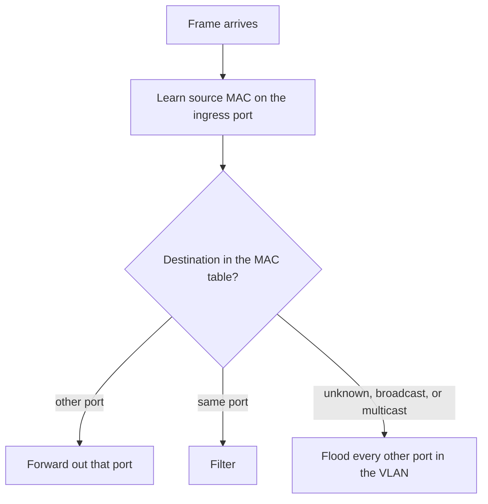

# Day 5 — Ethernet LAN switching, part 1

## References

### Videos

- [Ethernet LAN switching, part 1, day 5](https://www.youtube.com/watch?v=u2n762WG0Vo) — Jeremy's IT Lab

### Articles

- [Packet Traveling, key players](https://www.practicalnetworking.net/series/packet-traveling/key-players/)

## Diagram




A switch’s whole job is small: receive a frame, remember who sent it, and send it toward the destination MAC. Day 5 is that algorithm, plus the frame and the MAC address it operates on.

## The Ethernet frame

A frame on the wire has a header, a payload, and a trailer.

```text
| Preamble | SFD | Dest MAC | Src MAC | Type | Payload | FCS |
| 7 bytes  | 1   | 6        | 6       | 2    | 46–1500 | 4   |
```

| Field | Role |
|-------|------|
| Preamble and SFD | Lets the receiver lock onto the bit timing, then marks the start of the frame. You will not configure these. |
| Destination MAC | Who should read this frame on this link. |
| Source MAC | Who sent it. The switch learns from this field. |
| Type | What is inside the payload. `0x0800` means IPv4. `0x0806` means ARP. `0x86DD` means IPv6. |
| Payload | The packet. Minimum 46 bytes (padded if the packet is smaller), maximum 1500 bytes on standard Ethernet. That 1500-byte maximum is the usual **MTU**. |
| FCS | A checksum over the frame. If it fails, the switch drops the frame. The FCS is how the switch knows the frame was damaged. |

The switch decides using the destination MAC. It does not need to understand the IP packet inside.

An 802.1Q trunk inserts a 4-byte tag between the source MAC and the Type field. That is day 17. It raises the maximum frame size on a trunk.

## MAC addresses

A MAC address is 48 bits, written as 12 hex digits: `d8bd.49a1.2c03` in Cisco notation, or `d8:bd:49:a1:2c:03` elsewhere.

- The first 24 bits are the **OUI**, identifying the manufacturer.
- The last 24 bits are assigned by that manufacturer and should be unique for that NIC.

Two bits in the first octet matter:

| Bit | Name | 0 | 1 |
|-----|------|---|---|
| Least significant bit of the first octet | I/G | Unicast (one NIC) | Group: multicast or broadcast |
| Next bit | U/L | Universally assigned (a burned-in OUI) | Locally assigned (someone configured it) |

You do not need to calculate these bits often. You do need to recognize the special destinations:

| Address | Kind | Who receives it |
|---------|------|-----------------|
| Any address with I/G = 0, for example `d8bd.49a1.2c03` | Unicast | One interface |
| `ffff.ffff.ffff` | Broadcast | Every interface in the VLAN |
| `0100.5e__` (I/G = 1, not all Fs) | Multicast | Interfaces that joined that group |

`ffff.ffff.ffff` is the destination of an ARP request and of a DHCP discover. Those frames are flooded.

## The MAC address table

The switch keeps a table: MAC address, port, VLAN.

```text
SW1# show mac address-table
          Mac Address Table
-------------------------------------------
Vlan    Mac Address       Type        Ports
----    -----------       --------    -----
   1    d8bd.49a1.2c03    DYNAMIC     Gi0/1
   1    001b.d4aa.0011    DYNAMIC     Gi0/2
```

- **DYNAMIC** entries are learned and age out. Cisco’s default aging time is **300 seconds**. If a host stays silent longer than that, the entry is removed. The next frame from that host is learned again.
- **STATIC** entries are configured by hand and do not age out. You will not need them for these labs.

Learning rule, in one sentence: **the source MAC of a frame is recorded against the port it arrived on.**

## Forward, flood, or filter

For every frame, in order:

1. **Learn.** Update the table with the source MAC and the ingress port.
2. **Decide on the destination.**
   - Destination is a **known unicast** on a **different** port: **forward** out that one port.
   - Destination is a **known unicast** on the **same** port the frame arrived on: **filter** (drop it). Sending it back out the same port would be pointless.
   - Destination is **unknown unicast**, **broadcast**, or **multicast**: **flood** out every port in that VLAN except the port it arrived on.

Unknown unicast happens for a destination the switch has not learned yet, or whose entry aged out. Flooding is how the switch finds silent hosts. It is also why a full MAC table (or a table that is being attacked) turns the switch into a hub: if it cannot learn, every unicast is unknown, so every unicast is flooded.

### Worked example

SW1 has just booted. The MAC table is empty. Four PCs:

```text
PC1 Gi0/1   PC2 Gi0/2   PC3 Gi0/3   PC4 Gi0/4
```

PC1 sends a frame to PC2. PC1’s MAC is `A`, PC2’s MAC is `B`. Nobody has spoken before.

1. Frame arrives on Gi0/1. Source `A` is unknown. SW1 learns `A` on Gi0/1.
2. Destination `B` is unknown. SW1 **floods** the frame out Gi0/2, Gi0/3, and Gi0/4.
3. PC2 receives it and replies. Source `B`, destination `A`, arriving on Gi0/2.
4. SW1 learns `B` on Gi0/2.
5. Destination `A` is known on Gi0/1, which is a different port. SW1 **forwards** the reply only out Gi0/1.
6. The next frame from PC1 to PC2 is forwarded only out Gi0/2. PC3 and PC4 do not see it.

Draw this on paper once. The first frame is flooded, the reply teaches the switch the return address, and every later frame is unicast. That pattern repeats in ARP on day 6.

### Same-port filter

Imagine a hub plugged into Gi0/1, with PC1 and PC2 both on that hub (a bad design, useful as a thought experiment). PC1 sends to PC2.

- Both MACs are learned on Gi0/1, because that is the only port the switch sees.
- The frame’s destination is already on the ingress port, so the switch **filters** it. The hub, not the switch, delivered the copy to PC2.

## Store-and-forward

Cisco switches use **store-and-forward**: they receive the entire frame, check the FCS, and only then forward it. A frame with a bad FCS is dropped instead of being spread to other ports.

Other switching methods exist (cut-through starts forwarding after the destination MAC; fragment-free waits for the first 64 bytes). Know the names. Expect store-and-forward on the switches in this course, and remember that it is the method that checks the FCS before forwarding.

## Collision and broadcast domains, restated for a switch

- Each port is one collision domain. Full duplex means collisions should be zero.
- Each VLAN is one broadcast domain. With only VLAN 1, the whole switch is one broadcast domain. A broadcast is flooded out every port in that VLAN.

## Check yourself

1. Which field does the switch use to learn, and which field does it use to forward?
2. A switch has never seen destination MAC `B`. What does it do with the frame?
3. PC1’s entry ages out after 300 seconds of silence. PC2 then sends a frame to PC1. What does the switch do?
4. What Ethertype value means “the payload is IPv4”?
5. Why is the first frame to a quiet host flooded, while the reply usually is not?

## Answers

1. It learns the **source** MAC. It forwards based on the **destination** MAC.
2. It floods the frame out every other port in the same VLAN, and it learns the source MAC of the sender.
3. `B`’s frame has destination `A`, which is no longer in the table, so the switch floods it. The flood includes PC1’s port, PC1 answers, and the source MAC of that answer re-learns PC1.
4. `0x0800`.
5. The first frame’s destination is unknown, so the only safe action is to flood. The reply’s source is the destination everyone was looking for, so the switch learns it and can forward later frames out one port.
