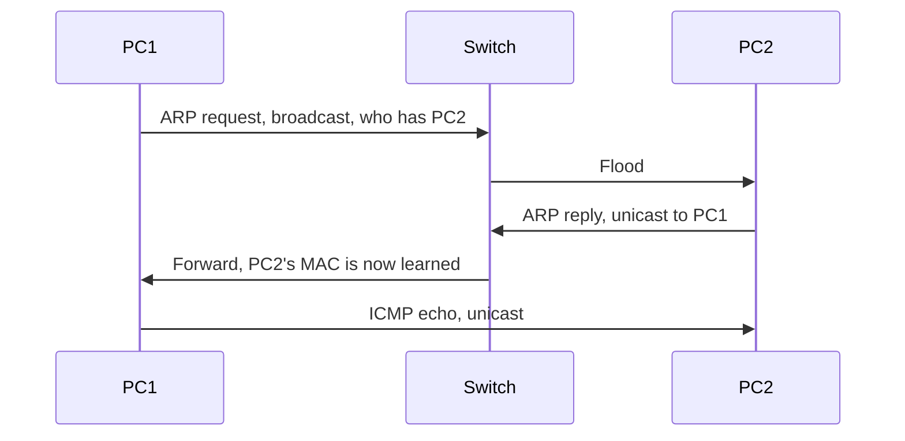

# Day 6 — Ethernet LAN switching, part 2

## References

### Videos

- [Ethernet LAN switching, part 2, day 6](https://www.youtube.com/watch?v=5q1pqdmdPjo) — Jeremy's IT Lab
- [Analyzing Ethernet switching, day 6 lab](https://www.youtube.com/watch?v=Ig0dSaOQDI8)

### Articles

- [Host to host through a router](https://www.practicalnetworking.net/series/packet-traveling/host-to-host-through-a-router/)

## Diagram




Day 5 explained how a switch forwards a frame when it already has a destination MAC. Day 6 answers the previous question: how does a PC learn that MAC in the first place? The protocol is **ARP**. Then you follow one ping across two switches and watch the MAC tables fill in.

## Why ARP exists

IP packets are addressed to IP addresses. Ethernet frames are addressed to MAC addresses. On the local LAN, the sender must wrap the packet in a frame, so it needs the destination MAC.

ARP maps an IPv4 address to a MAC address **on the same link**. It does not cross a router. Each network has its own ARP conversations.

## The two ARP messages

**ARP request.** “Who has 192.168.1.20? Tell 192.168.1.10.”

- Destination MAC: `ffff.ffff.ffff` (broadcast).
- Ethertype: `0x0806`.
- Everyone in the VLAN receives it. The host that owns 192.168.1.20 answers. The others ignore it.
- The switch floods it, because the destination MAC is the broadcast address.

**ARP reply.** “192.168.1.20 is at MAC `bbbb.bbbb.bbbb`.”

- Destination MAC: the requester’s MAC, unicast.
- Only the requester needs the answer, so it is not broadcast.

Both hosts store the result in an **ARP table** (also called the ARP cache).

```text
PC1> arp -a
Internet Address      Physical Address
192.168.1.20          bb-bb-bb-bb-bb-bb
```

On a router or a Layer 3 switch:

```text
R1# show ip arp
Protocol  Address          Age (min)  Hardware Addr   Type   Interface
Internet  192.168.1.1      -          00d0.1234.0001  ARPA   GigabitEthernet0/0
Internet  192.168.1.10     3          aaaa.aaaa.aaaa  ARPA   GigabitEthernet0/0
```

The dash in the Age column is the router’s own address on that interface. Learned entries age out. If the entry is gone, the next packet to that IP triggers a new ARP request.

## One ping, same subnet, one switch

```text
PC1 192.168.1.10  MAC AAAA     Gi0/1
PC2 192.168.1.20  MAC BBBB     Gi0/2
                 [SW1]
```

Both hosts use mask 255.255.255.0, so PC1 considers PC2 local. PC1 will ARP for PC2 directly, not for a gateway.

PC1’s ARP table is empty. SW1’s MAC table is empty.

1. PC1 builds an ICMP Echo Request (ping) to 192.168.1.20, but it cannot frame it yet.
2. PC1 sends an **ARP request**. Source MAC `AAAA`, destination MAC `ffff.ffff.ffff`, “who has .20”.
3. SW1 learns `AAAA` on Gi0/1 and **floods** the request out every other port, including Gi0/2.
4. PC2 sees its own IP and sends an **ARP reply**. Source MAC `BBBB`, destination MAC `AAAA`. PC2 also stores `192.168.1.10 → AAAA` from the request. The request already contained PC1’s MAC, so PC2 does not need its own ARP request.
5. SW1 learns `BBBB` on Gi0/2 and **forwards** the reply only out Gi0/1, because `AAAA` is known.
6. PC1 stores `192.168.1.20 → BBBB` and now sends the ICMP Echo. Source MAC `AAAA`, destination MAC `BBBB`.
7. SW1 forwards it only out Gi0/2.
8. PC2 replies with an ICMP Echo Reply, destination MAC `AAAA`, forwarded only out Gi0/1.

After this, both the ARP tables and the MAC address table are populated. A second ping is just two unicast frames. No ARP, no flood, unless an entry has aged out.

That is the lab on day 6: ping, then look at `show mac address-table` on the switch and the ARP table on the PCs. The switch’s table has MAC addresses only. It never learned the IP addresses. The PCs’ ARP tables have the IP-to-MAC mapping.

## The same ping across two switches

```text
PC1 Gi0/1 [SW1] Gi0/24 -------- Gi0/24 [SW2] Gi0/1 PC2
```

Start with empty tables. PC1 pings PC2.

1. ARP request arrives at SW1 on Gi0/1. SW1 learns `AAAA` on Gi0/1 and floods, including out Gi0/24.
2. SW2 receives the request on Gi0/24. SW2 learns `AAAA` on Gi0/24 and floods, including out Gi0/1 toward PC2.
3. PC2’s ARP reply arrives at SW2 on Gi0/1. SW2 learns `BBBB` on Gi0/1. Destination `AAAA` is known on Gi0/24, so SW2 forwards the reply only toward SW1.
4. SW1 receives the reply on Gi0/24, learns `BBBB` on Gi0/24, and forwards it out Gi0/1 to PC1.

MAC tables afterward:

| Switch | MAC | Port | Why |
|--------|-----|------|-----|
| SW1 | AAAA (PC1) | Gi0/1 | PC1 is directly attached |
| SW1 | BBBB (PC2) | Gi0/24 | PC2 was heard via SW2 |
| SW2 | BBBB (PC2) | Gi0/1 | PC2 is directly attached |
| SW2 | AAAA (PC1) | Gi0/24 | PC1 was heard via SW1 |

A switch never learns “PC2 is two hops away.” It only learns “this MAC came in this port.” The rest of the path is the next switch’s problem.

## What a switch does not do

- It does not rewrite MAC addresses. The frame PC1 sent is the frame PC2 receives, as long as both are in the same VLAN and no router is in the path.
- It does not decrement TTL. TTL is an IP field. Switches are not routing.
- It does not drop a broadcast. It floods it. Too many hosts in one VLAN means every ARP request and every DHCP discover interrupts every host. That is the reason VLANs exist (day 16).

## When the destination is off the subnet

If PC2 were 10.0.0.20 and PC1’s default gateway were 192.168.1.1, PC1 would **not** ARP for 10.0.0.20. It would ARP for **192.168.1.1**, the gateway, and address the frame to the gateway’s MAC. The IP packet inside would still say “destination 10.0.0.20”.

Day 12 follows that packet through the router. The ARP rule to memorize now:

> ARP only for a destination on your own subnet. If the destination is remote, ARP for the default gateway.

A router has a separate ARP table on each interface, because each interface is a separate link.

## Check yourself

1. Is an ARP request unicast or broadcast? Is the reply unicast or broadcast?
2. After PC1 pings PC2 on the same switch, which table on the switch contains IP addresses?
3. SW1 and SW2 are linked. PC2 is on SW2. On SW1, which port is PC2’s MAC learned on?
4. Two hosts are in different VLANs on the same switch. Will an ARP request from the first reach the second?
5. A PC wants to ping a host on another subnet. Whose MAC does it put in the frame?

## Answers

1. The request is broadcast. The reply is unicast.
2. None. The MAC address table has MAC addresses, VLANs, and ports. IP-to-MAC mappings live in the hosts’ and the router’s ARP tables.
3. The port that faces SW2, the uplink, not a port facing a local PC.
4. No. Flooding stays inside the VLAN. Separate VLANs are separate broadcast domains.
5. The default gateway’s MAC. The remote host’s IP goes in the packet. The remote host’s MAC is unknown here, and ARP for it would not cross the router.
