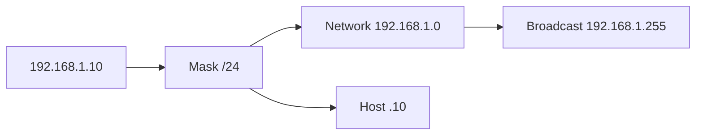

# Day 7 — IPv4 addressing, part 1

## References

### Videos

- [IPv4 addressing, part 1, day 7](https://www.youtube.com/watch?v=3ROdsfEUuhs) — Jeremy's IT Lab

### Articles

- [RFC 1918, private addresses](https://datatracker.ietf.org/doc/html/rfc1918)

## Diagram




An IPv4 address identifies a host on a network. The subnet mask says which part of the address is the network and which part is the host. Day 7 is that split, the old class system, and the reserved ranges. Day 13 is where you start carving a network into smaller pieces. Do not skip the binary here. Subnetting is this same AND operation with a longer mask.

## The address

IPv4 is 32 bits, written as four decimal **octets** from 0 to 255:

```text
192.168.1.10
11000000.10101000.00000001.00001010
```

Convert one octet by place value:

```text
128  64  32  16   8   4   2   1
  1   1   0   0   0   0   0   1   = 128+64+1 = 193
```

Work a few of these until they are automatic. The ones you need constantly are the powers of two along the top row, and these decimal values:

| Binary in the interesting octet | Decimal | Where it shows up |
|---------------------------------|---------|-------------------|
| 10000000 | 128 | /25 mask in the last octet, or a /17 in the third |
| 11000000 | 192 | /26 or /18 |
| 11100000 | 224 | /27 or /19 |
| 11110000 | 240 | /28 or /20 |
| 11111000 | 248 | /29 or /21 |
| 11111100 | 252 | /30 or /22 |
| 11111110 | 254 | /31 or /23 |
| 11111111 | 255 | a full octet of network bits |

## Network vs host

A **subnet mask** is 32 bits long: one contiguous run of 1s, then one contiguous run of 0s. The 1s mark the network. The 0s mark the host.

`255.255.255.0` is twenty-four 1s and eight 0s. Written in CIDR as **/24**. Both notations mean the same mask. Cisco commands usually want the dotted decimal mask. Design conversations usually use the slash.

```text
Address   192.168.1.10     11000000.10101000.00000001.00001010
Mask /24  255.255.255.0    11111111.11111111.11111111.00000000
                           |-------- network --------|--host-|
```

AND the address with the mask (1 AND 1 = 1, anything AND 0 = 0) to get the **network address**:

```text
192.168.1.10 AND 255.255.255.0  =  192.168.1.0
```

Every host with network 192.168.1.0 and mask /24 is on the same link and can ARP for the others.

Two addresses inside that range are reserved:

| Address | Role |
|---------|------|
| 192.168.1.0 | Network address. Not assigned to a host. |
| 192.168.1.255 | Broadcast address. A packet here is delivered to every host in the subnet. |
| 192.168.1.1 through 192.168.1.254 | Usable hosts. 254 of them. |

The count of usable hosts is `2^(host bits) − 2`. Eight host bits: 256 − 2 = 254. The minus two is the network address and the broadcast address.

A **/31** is the exception you will meet on day 15: point-to-point links can use both addresses, with no broadcast. Ignore that until VLSM.

### Worked example: same subnet or not?

PC1 is 192.168.1.10/24. Which of these can it ARP for directly?

| Destination | Network of destination | Same as 192.168.1.0/24? |
|-------------|------------------------|-------------------------|
| 192.168.1.200 | 192.168.1.0 | Yes. ARP for .200. |
| 192.168.2.10 | 192.168.2.0 | No. Send to the default gateway. |
| 192.168.1.255 | This **is** the local broadcast | Every host on the LAN receives it. Do not assign this to a PC. |

The default gateway must be an address in the **same** subnet as the PC. A PC at 192.168.1.10/24 with gateway 192.168.2.1 will never reach the gateway: it thinks 192.168.2.1 is remote, so it looks for a gateway to reach the gateway. That is a classic lab fault.

## Classful addressing

Classes are obsolete for designing networks. CIDR replaced them. You still have to recognize them, because exam questions and `show ip route` output use the class letters, and the private ranges are easier to remember against the classes.

The **first octet** decides the class:

| Class | First octet | Default mask | What it was for |
|-------|-------------|--------------|-----------------|
| A | 1–126 | /8 | Huge networks. 127 is reserved and is not a usable Class A network. |
| B | 128–191 | /16 | Medium networks. |
| C | 192–223 | /24 | Small networks. |
| D | 224–239 | none | Multicast destinations, not host addresses. |
| E | 240–255 | none | Experimental, plus the limited broadcast 255.255.255.255. |

The leading bits are the same fact in binary:

```text
0xxxxxxx   Class A
10xxxxxx   Class B
110xxxxx   Class C
1110xxxx   Class D
1111xxxx   Class E
```

**Classful** means “assume the default mask from the class.” **Classless** means “use the mask you were given,” which might be longer (subnetting) or shorter (a summary route). Everything you configure in this course is classless. When someone says “the Class C network 192.168.5.0”, they mean 192.168.5.0 with a /24 default mask, even though 192.168.5.0 is also a private address.

0.0.0.0 and 127.0.0.0 are not usable host networks. 127.0.0.1 is the **loopback** address: traffic a host sends to 127.0.0.1 comes back to itself and never leaves the NIC. You use it to test that the local TCP/IP stack is up.

## Ranges you must recognize on sight

| Range | Name | Meaning |
|-------|------|---------|
| 10.0.0.0/8 | Private (RFC 1918) | 10.0.0.0–10.255.255.255. Free to use inside a network. Not routed on the public Internet. |
| 172.16.0.0/12 | Private | 172.16.0.0–**172.31.255.255**. Not 172.16.0.0/16 only. |
| 192.168.0.0/16 | Private | 192.168.0.0–192.168.255.255. |
| 127.0.0.0/8 | Loopback | Stays on the host. |
| 169.254.0.0/16 | Link-local (APIPA) | A Windows PC that got no DHCP address assigns itself one of these. It can talk only to other link-local hosts on the same LAN. Seeing 169.254 on a PC means DHCP failed. |
| 224.0.0.0–239.255.255.255 | Multicast | Receivers join a group. Not assigned to a PC as its address. |
| 255.255.255.255 | Limited broadcast | “Everyone on this LAN.” Never forwarded by a router. DHCP uses it before the client has a subnet mask. |

### The /12 private range, worked out

People remember “172.16” and then treat 172.32.1.1 as private. It is not.

172.16.0.0/12 fixes the first 12 bits:

```text
172.16.0.0 = 10101100.00010000.00000000.00000000
mask /12  = 11111111.11110000.00000000.00000000
              octet1   0001xxxx   <- second octet can be 16 through 31
```

- 172.16.5.4 is private.
- 172.31.255.255 is the top of the range, still private.
- 172.32.0.1 is **public** space (and Class B). Do not use it in a lab as if it were RFC 1918.

10.0.0.0/8 is the entire first octet of 10. 192.168.0.0/16 is every 192.168.x.x address.

## Network, first host, last host, broadcast

For any subnet, once you know the network address and the mask:

1. **Network** = address AND mask.
2. **Broadcast** = network bits, with all host bits set to 1.
3. **First host** = network + 1.
4. **Last host** = broadcast − 1.

### Worked example

Address 10.1.1.77, mask 255.255.255.128 (/25).

- /25 means the network includes the first bit of the last octet. Block size in that octet is 128.
- 77 is between 0 and 127, so the network is 10.1.1.0.
- Broadcast is 10.1.1.127 (host bits all 1s: the last octet is 01111111).
- First host 10.1.1.1. Last host 10.1.1.126.
- Usable hosts: 2^7 − 2 = 126.

The other subnet in this /24 is 10.1.1.128/25, broadcast 10.1.1.255, hosts .129–.254.

Day 13 generalizes this to every mask. If this example feels slow, redo it with /26 (block size 64) before you move on: 10.1.1.77/26 sits in 10.1.1.64/26, broadcast .127, hosts .65–.126.

## Check yourself

1. Write 255.255.255.192 as a slash mask. How many host bits are left?
2. Is 172.20.5.1 a private address?
3. PC is 192.168.4.20/24, gateway is 192.168.4.1. Can it ARP for 192.168.4.250? For 192.168.5.1?
4. A PC shows address 169.254.23.15. What failed?
5. List the network address, first host, last host, and broadcast of 10.0.0.1/8. How many usable hosts, as a power of two?

## Answers

1. /26. Six host bits (32 − 26).
2. Yes. 172.16.0.0 through 172.31.255.255 is the private /12.
3. Yes for 192.168.4.250 (same /24). No for 192.168.5.1; that goes to the gateway 192.168.4.1.
4. The PC did not get an address from DHCP and fell back to link-local addressing. It can reach only other 169.254 hosts on that LAN.
5. Network 10.0.0.0, first host 10.0.0.1, last host 10.255.255.254, broadcast 10.255.255.255. Host bits = 24, usable = 2^24 − 2.
