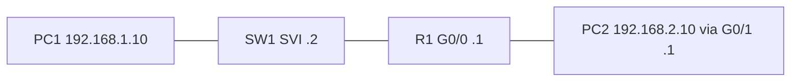

# Day 8 — IPv4 addressing, part 2

## References

### Videos

- [IPv4 addressing, part 2, day 8](https://www.youtube.com/watch?v=FiAatRd84XI) — Jeremy's IT Lab
- [Configuring IP addresses, day 8 lab](https://www.youtube.com/watch?v=e1jbvyMeS5I)

### Articles

- [Host to host through a router](https://www.practicalnetworking.net/series/packet-traveling/host-to-host-through-a-router/)

## Diagram




Day 7 was the math. Day 8 puts addresses on interfaces and checks that two devices agree they are on the same network. The lab is small and worth doing slowly: a router, a switch, and two PCs.

## Where an address goes

| Device | What you configure | Why |
|--------|--------------------|-----|
| PC | IP, mask, default gateway, DNS | The gateway is the router on the PC’s subnet. |
| Router | An IP and mask on each interface that faces a network | Each interface is a different network. The router’s address is the gateway for the hosts on that side. |
| Switch | An IP on a **VLAN interface** (an SVI), plus `ip default-gateway` | So you can SSH or ping the switch itself. The switch does not need this to forward frames. |

A brand-new switch forwards Ethernet with no IP address at all. The address is only for managing the switch.

Router interfaces start **shutdown**. Switch interfaces start **up**. If a router link is down and you have not mistyped the cable, `no shutdown` is the first thing to check.

## Router

```text
Router> enable
Router# configure terminal
Router(config)# hostname R1
R1(config)# interface gigabitEthernet 0/0
R1(config-if)# ip address 192.168.1.1 255.255.255.0
R1(config-if)# no shutdown
R1(config-if)# exit
R1(config)# interface gigabitEthernet 0/1
R1(config-if)# ip address 192.168.2.1 255.255.255.0
R1(config-if)# no shutdown
R1(config-if)# end
```

Give each interface an address from the subnet on that cable. Use the first or last usable address for the gateway and stay consistent. These notes use the first usable address (.1) as the gateway.

A second address on the same interface is legal (`ip address 192.168.3.1 255.255.255.0 secondary`) and almost never what you want in these labs. If a ping fails, check that you did not leave a secondary address in place of the right primary.

## Switch management address

The switch’s management address sits on an SVI, not on a physical port. With only VLAN 1 in use:

```text
SW1(config)# interface vlan 1
SW1(config-if)# ip address 192.168.1.2 255.255.255.0
SW1(config-if)# no shutdown
SW1(config-if)# exit
SW1(config)# ip default-gateway 192.168.1.1
```

`ip default-gateway` is used by the switch’s own packets (a ping you type on the switch, or an SSH reply). It is not a default route for traffic passing through the switch. A Layer 2 switch does not route other people’s packets. On a Layer 3 switch that has `ip routing` turned on, you will later use `ip route` instead of `ip default-gateway`. For day 8, `ip default-gateway` is correct.

The SVI stays down if that VLAN does not exist or if no port in that VLAN is up. On a default switch, VLAN 1 exists and the access ports are in VLAN 1, so bringing a PC link up is enough to bring `interface vlan 1` up.

## PCs

On PC1, in the same subnet as G0/0:

- Address: 192.168.1.10
- Mask: 255.255.255.0
- Gateway: 192.168.1.1

On PC2, off G0/1:

- Address: 192.168.2.10
- Mask: 255.255.255.0
- Gateway: 192.168.2.1

PC1 should ping 192.168.1.1 (its gateway) and 192.168.1.2 (the switch). PC1 pinging PC2 requires routing, which already works for **connected** networks: R1 knows both subnets because its own interfaces are in them. No static route yet. If this ping fails, the fault is masks, gateways, or an interface that is still shutdown, not a missing `ip route`.

## Reading `show ip interface brief`

```text
R1# show ip interface brief
Interface              IP-Address      OK? Method Status                Protocol
GigabitEthernet0/0     192.168.1.1     YES manual up                    up
GigabitEthernet0/1     192.168.2.1     YES manual administratively down down
```

Two columns, and both must say up:

| Status | Protocol | Meaning |
|--------|----------|---------|
| up | up | The interface is working at Layer 1 and Layer 2. |
| up | down | The interface is enabled, but the line protocol is down: cable, speed/duplex, or the other end is down. On Ethernet this often means “no carrier” or a protocol mismatch. |
| administratively down | down | You have not typed `no shutdown`, or you typed `shutdown`. |
| down | down | Enabled in software, but the hardware is down (no cable, bad optic). |

`Method manual` means someone configured the address. `DHCP` means the interface learned it. `unset` means there is no address.

Other checks:

```text
R1# show interfaces gigabitEthernet 0/0
R1# show ip route
```

`show interfaces` gives the MAC address, MTU, speed, duplex, and error counters (day 9). `show ip route` on this router shows two connected networks. Day 11 reads that table properly. For today, confirm that each of your interface subnets appears as connected. If it does not, the interface is not up/up, or it has no address.

## A full mini-lab, with the pings you should see

```text
PC1 .10/24 ---- SW1 .2/24 ---- R1 G0/0 .1/24
                                 R1 G0/1 .1/24 ---- PC2 .10/24
               VLAN 1                         192.168.2.0/24
               192.168.1.0/24
```

| From | To | Expect | If it fails, look at |
|------|-----|--------|----------------------|
| PC1 | 192.168.1.1 | Success | PC1 mask and gateway, R1 G0/0 up, cable |
| PC1 | 192.168.1.2 | Success | SW1 SVI up, SW1 in VLAN 1, same subnet |
| SW1 | 192.168.1.1 | Success | `ip default-gateway` not required for an on-link ping, but the SVI must be up |
| PC1 | 192.168.2.10 | Success | PC2’s gateway must be 192.168.2.1, R1 G0/1 up. This crosses the router. |
| PC2 | 192.168.1.2 | Success | Return path. SW1’s gateway must be 192.168.1.1 so the switch can reply to a remote PC. |

The last row is the subtle one. PC2’s packet reaches SW1, because R1 is connected to both LANs. SW1’s **reply** is a new packet from 192.168.1.2 to 192.168.2.10. That destination is not on SW1’s subnet, so the switch needs `ip default-gateway 192.168.1.1`. Without it, PC2’s ping to the switch fails even though PC1, on the same LAN as the switch, can ping the switch.

## Check yourself

1. A router interface shows `administratively down`. Which command fixes it?
2. Why does a Layer 2 switch forward PC frames with no IP address configured?
3. You address a switch on `interface vlan 1` and the SVI stays down. VLAN 1 exists. What else has to be true?
4. PC1 is 10.0.0.5/24 with default gateway 10.0.1.1. Why does a ping to 10.0.1.1 fail even though the router is powered on?
5. Which show command tells you, in one screen, the IP and the up/down state of every interface?

## Answers

1. `no shutdown` on that interface.
2. Frame forwarding uses the MAC address table, not IP. The IP is only so that you can manage the switch.
3. At least one port in VLAN 1 must be up (a connected PC or an up trunk that carries VLAN 1), and the SVI itself needs `no shutdown`.
4. 10.0.1.1 is outside 10.0.0.0/24, so PC1 treats its own gateway as a remote destination and will not ARP for it. The gateway has to be an address inside the PC’s subnet, and the router interface needs that same address and mask.
5. `show ip interface brief`.
