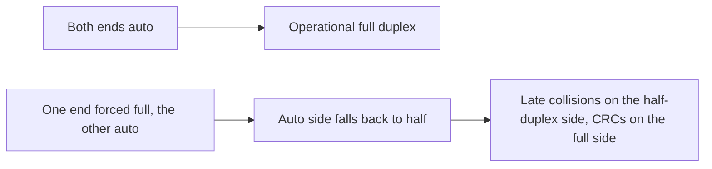

# Day 9 — Switch interfaces

## References

### Videos

- [Switch interfaces, day 9](https://www.youtube.com/watch?v=cCqluocfQe0) — Jeremy's IT Lab
- [Configuring interfaces, day 9 lab](https://www.youtube.com/watch?v=rzDb5DoBKRk)

### Articles

- [Jeremy's CCNA notes](https://www.jeremysitlab.com/ccna-resources/)

## Diagram




Day 8 put an IP on the switch. Day 9 configures the physical ports: description, speed, duplex, shutdown, and several ports at once. It is also the day you learn to read interface errors, because a wrong duplex setting looks like a “slow network” rather than a down link.

## Names

```text
GigabitEthernet0/1
GigabitEthernet1/0/1
FastEthernet0/1
```

The name is speed-family plus slot/port. On a fixed switch, `0/1` is module 0, port 1. On a chassis, `1/0/1` is module 1, submodule 0, port 1. Always copy the name from `show ip interface brief` rather than guessing. Abbreviate it in commands: `int g0/1`.

## One port

```text
SW1(config)# interface gigabitEthernet 0/1
SW1(config-if)# description LINK-TO-PC1
SW1(config-if)# speed auto
SW1(config-if)# duplex auto
SW1(config-if)# no shutdown
```

- **description** is a label in the config and in `show interfaces`. It does not affect forwarding. Use it anyway. Six months later “LINK-TO-PC1” is worth more than a comment you meant to write down.
- **shutdown** disables the port in software. The status becomes `administratively down`. **no shutdown** enables it. Switch ports default to enabled, unlike router ports.
- **speed** and **duplex** should stay on **auto** unless you have a reason. Both ends negotiate to the fastest speed and to full duplex.

## Many ports

```text
SW1(config)# interface range gigabitEthernet 0/1 - 10
SW1(config-if-range)# description ACCESS-PORT
SW1(config-if-range)# switchport mode access
SW1(config-if-range)# no shutdown
```

The space around the hyphen matters in IOS: `g0/1 - 10`, not `g0/1-10`, on many platforms. Non-contiguous ports use a comma: `interface range g0/1, g0/3, g0/5`.

`switchport mode access` is a VLAN-day command. It is harmless here and is how you stop an access port from trying to become a trunk. The full VLAN assignment is day 16.

## What “auto” actually negotiates

Both sides on auto: they pick the highest speed both support, and full duplex.

One side hardcoded to 1000 full, the other on auto: speed often still comes up at 1000 if the hardcoded side still participates in a limited way, but duplex is the dangerous field. A side left on auto, facing a partner that is forced to full duplex and does not negotiate, falls back to **half duplex**.

The link is **up**. Throughput is bad. This is a duplex mismatch.

| End A | End B | Result |
|-------|-------|--------|
| auto | auto | Best speed, full duplex |
| 1000 / full | 1000 / full | Full duplex, no negotiation needed |
| 1000 / full | auto | A common mismatch: auto side lands on half duplex |
| 100 / full | 1000 / full | Often the link stays down, because the speeds do not match |

Set both ends the same way. Prefer auto on both.

## Reading errors

```text
SW1# show interfaces gigabitEthernet 0/1
GigabitEthernet0/1 is up, line protocol is up
  Hardware is Gigabit Ethernet, address is 001b.d400.0101
  MTU 1500 bytes, BW 1000000 Kbit/sec, DLY 10 usec,
  Full-duplex, 1000Mb/s, media type is 10/100/1000BaseTX
     0 input errors, 0 CRC, 0 frame, 0 overrun, 0 ignored
     0 output errors, 0 collisions, 0 interface resets
     0 babbles, 0 late collision, 0 deferred
```

Also useful:

```text
SW1# show interfaces status
Port      Name       Status       Vlan       Duplex  Speed Type
Gi0/1     LINK-TO-PC1 connected   1          a-full  a-1000 10/100/1000BaseTX
Gi0/2                notconnect   1            auto   auto 10/100/1000BaseTX
```

The `a-` prefix means the value was **auto-negotiated**. `full` without `a-` means someone configured it.

| Counter | What it suggests |
|---------|------------------|
| CRC | Damaged frames. Bad cable, noise, or a duplex mismatch. |
| Runts | Frames that are too short. |
| Giants | Frames that are too long for the interface MTU. |
| Collisions | Normal on half duplex under load. Should be **zero** on a full-duplex port. |
| Late collisions | A collision detected after the first 64 bytes. Classic symptom of a duplex mismatch (this end is half duplex, the other end is full and transmits whenever it wants). |

### Worked example: find the bad port

Users on Gi0/5 say the file server is slow. The port is up/up. `show interfaces status` shows `a-half` and `a-100` on Gi0/5. The server is set to `100` / `full`.

- The switch negotiated speed 100, and because the server did not negotiate duplex, the switch chose half.
- `show interfaces g0/5` will show collisions and late collisions climbing on the switch.
- The server, which believes the link is full duplex, will show CRC errors instead. It never backs off, because full duplex does not expect collisions.

Fix: set the server to auto, or set both ends to `speed 100` and `duplex full`. Then clear the counters and confirm they stay at zero:

```text
SW1# clear counters gigabitEthernet 0/5
```

## Administrative vs operational

You configure the **administrative** speed and duplex. The **operational** values are what the link is actually using. `show interfaces status` and the duplex line inside `show interfaces` show the operational result. If you configured `duplex full` but the status shows half, you are looking at the wrong port, or negotiation with the other end overrode your expectation. Trust the operational line.

## A short standard for access ports

You will add VLAN commands on day 16. The interface habits from day 9 stay:

```text
SW1(config)# interface range g0/1 - 20
SW1(config-if-range)# description USERS
SW1(config-if-range)# switchport mode access
SW1(config-if-range)# switchport access vlan 10
SW1(config-if-range)# spanning-tree portfast
SW1(config-if-range)# no shutdown
```

Leave `spanning-tree portfast` until the STP days if you have not seen it. It is safe only on ports that go to end hosts, never on ports that go to other switches. The day 9 lab is complete with description, speed, duplex, range, and shutdown.

## Check yourself

1. Switch ports default to shutdown. True or false?
2. Both ends are `auto`. What duplex do you expect on a gigabit PC connection?
3. One end is forced to full duplex, the other is auto, and the forced end does not negotiate. What duplex does the auto end end up with, and which counter rises?
4. In `show interfaces status`, what does `a-full` mean?
5. Write the command to set a description on Gi0/1 through Gi0/8 in one step.

## Answers

1. False. Switch ports default to `no shutdown`. Router ports default to shutdown.
2. Full duplex, at 1000 Mbps if the PC’s NIC supports it.
3. Half duplex. Late collisions on the half-duplex side, CRC errors on the full-duplex side.
4. Duplex was auto-negotiated and the result is full.
5. `interface range gigabitEthernet 0/1 - 8`, then `description ...`.
