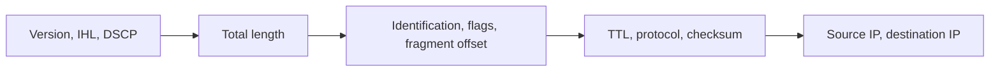

# Day 10 — The IPv4 header

## References

### Videos

- [IPv4 header, day 10](https://www.youtube.com/watch?v=aQB22y4liXA) — Jeremy's IT Lab. Includes a Wireshark walkthrough.
- [Wireshark for beginners](https://www.youtube.com/playlist?list=PL6gx4Cwl9DGBI2ZFuyZOl5Q7sptR7PwYN)

### Articles

- [RFC 791, Internet Protocol](https://datatracker.ietf.org/doc/html/rfc791)
- [Wireshark Learn](https://www.wireshark.org/learn)

## Diagram




Days 7 and 8 treated an address as a configuration value. The address is two fields in a header that every router reads. Day 10 walks that header so that TTL, fragmentation, and “protocol number” are concrete when static routing and the life of a packet use them.

## Layout

The header is at least **20 bytes** and at most **60 bytes**. The extra bytes are options, which are rare. A normal packet you capture in the lab has a 20-byte header.

```text
 0                   1                   2                   3
 0 1 2 3 4 5 6 7 8 9 0 1 2 3 4 5 6 7 8 9 0 1 2 3 4 5 6 7 8 9 0 1
+-+-+-+-+-+-+-+-+-+-+-+-+-+-+-+-+-+-+-+-+-+-+-+-+-+-+-+-+-+-+-+-+
|Version|  IHL  |    DSCP   |ECN|          Total Length         |
+-+-+-+-+-+-+-+-+-+-+-+-+-+-+-+-+-+-+-+-+-+-+-+-+-+-+-+-+-+-+-+-+
|         Identification        |Flags|     Fragment Offset     |
+-+-+-+-+-+-+-+-+-+-+-+-+-+-+-+-+-+-+-+-+-+-+-+-+-+-+-+-+-+-+-+-+
|  Time to Live |    Protocol   |         Header Checksum       |
+-+-+-+-+-+-+-+-+-+-+-+-+-+-+-+-+-+-+-+-+-+-+-+-+-+-+-+-+-+-+-+-+
|                       Source Address                          |
+-+-+-+-+-+-+-+-+-+-+-+-+-+-+-+-+-+-+-+-+-+-+-+-+-+-+-+-+-+-+-+-+
|                    Destination Address                        |
+-+-+-+-+-+-+-+-+-+-+-+-+-+-+-+-+-+-+-+-+-+-+-+-+-+-+-+-+-+-+-+-+
|                    Options (if IHL > 5)                       |
+-+-+-+-+-+-+-+-+-+-+-+-+-+-+-+-+-+-+-+-+-+-+-+-+-+-+-+-+-+-+-+-+
```

| Field | Size | What you use it for |
|-------|------|---------------------|
| Version | 4 bits | 4 for IPv4, 6 for IPv6. A router uses this to decide which header parser to run. |
| IHL | 4 bits | Internet Header Length, in 32-bit words. 5 means 20 bytes. 15 means 60 bytes. |
| DSCP | 6 bits | QoS marking. Routers can queue this packet ahead of others. You will set this in the QoS days. Default is 0, best effort. |
| ECN | 2 bits | Explicit congestion notification. End hosts signal congestion without dropping. Know the name; you will not configure it now. |
| Total Length | 16 bits | Header plus payload, in bytes. Maximum 65535. |
| Identification | 16 bits | All fragments of one original packet share this number. |
| Flags | 3 bits | Reserved, **DF** (don’t fragment), **MF** (more fragments follow). |
| Fragment Offset | 13 bits | Where this fragment sits in the original payload, in units of **8 bytes**. |
| TTL | 8 bits | Hop limit. Each router subtracts 1. At 0 the packet is dropped. |
| Protocol | 8 bits | What the payload is. 1 ICMP, 6 TCP, 17 UDP, 89 OSPF. |
| Header Checksum | 16 bits | Covers the header only. Recomputed at every hop because TTL changes. |
| Source | 32 bits | Sending host. |
| Destination | 32 bits | Receiving host. Routers forward on this field. |

The old name **ToS** (Type of Service) is the same byte that is now DSCP plus ECN. Older docs say ToS. Current docs say DSCP.

## TTL

TTL stops a packet from circulating forever if a routing loop exists.

A host often starts TTL at 64, 128, or 255. Each router:

1. Subtracts 1 from TTL.
2. If the result is 0, drops the packet and sends an **ICMP Time Exceeded** message back to the source.
3. Otherwise forwards the packet and recomputes the header checksum.

### Worked example

PC1 pings PC2 through two routers. PC1 sets TTL to 64.

| Hop | Device | TTL on the packet it forwards | Action |
|-----|--------|-------------------------------|--------|
| 1 | R1 | 63 | Forwards toward R2 |
| 2 | R2 | 62 | Forwards toward PC2 |
| — | PC2 | 62 | Receives it. Hosts do not decrement TTL on receive. |

The Echo Reply is a new packet. PC2 sets its own TTL, and the reply is decremented by R2 and then R1 on the way back.

If someone pointed R1’s route at R2 and R2’s route at R1, TTL would hit 0 within a few dozen loops and the packet would die. The application would fail, but the loop would not consume the link forever. That is the whole point of the field.

**Traceroute** uses this on purpose. It sends a probe with TTL 1, receives Time Exceeded from the first router, then TTL 2, and so on, learning each hop’s address from the ICMP error.

## Protocol number

The protocol field tells the destination which process should have the payload. It is not a port number. Ports live inside TCP and UDP.

| Number | Protocol | You see it when |
|--------|----------|-----------------|
| 1 | ICMP | ping, traceroute errors, “destination unreachable” |
| 6 | TCP | web, SSH, email |
| 17 | UDP | DNS, DHCP, SNMP |
| 89 | OSPF | routing updates, later in the course |

A ping is IP protocol 1, not TCP and not UDP. Access lists later in the course match ICMP separately from TCP port numbers. If you remember only one thing from this table, remember that ICMP is its own protocol number.

## Fragmentation

Ethernet’s payload limit is 1500 bytes. That is the **MTU**. If a router must forward a packet larger than the next link’s MTU, it either fragments the packet or drops it.

- **DF = 0.** The router may fragment.
- **DF = 1.** The router must not fragment. It drops the packet and sends ICMP back: fragmentation needed, and it includes the MTU it wanted. Modern TCP sets DF and discovers the path MTU this way (path MTU discovery).

Fragments:

- Share the same Identification value.
- Carry an offset, measured in 8-byte blocks, so the receiver can reassemble them in order.
- All but the last have **MF = 1**. The last has MF = 0.
- The **destination host** reassembles them. Routers along the way do not. If one fragment is lost, the whole original packet is lost.

### Worked example

A 4000-byte IP packet (20-byte header + 3980 bytes of payload) must cross a link with MTU 1500. DF is 0.

Each fragment’s payload must be a multiple of 8 bytes. The largest payload that fits is 1480 bytes (1500 − 20), and 1480 / 8 = 185 exactly.

| Fragment | Payload | Total length | Offset (8-byte units) | MF |
|----------|---------|--------------|------------------------|----|
| 1 | 1480 | 1500 | 0 | 1 |
| 2 | 1480 | 1500 | 185 | 1 |
| 3 | 1020 | 1040 | 370 | 0 |

Check the payload: 1480 + 1480 + 1020 = 3980. Check the offset of the third fragment: 2960 bytes in, and 2960 / 8 = 370.

If DF had been 1, the router would drop the 4000-byte packet and send ICMP Type 3 Code 4 (fragmentation needed) back to the source.

You will rarely fragment on purpose. You will see the symptoms: a ping of the default size works (ICMP plus headers fit in 1500), and a large transfer hangs because DF is set and some link in the path has a smaller MTU (often a tunnel). The header fields are how you explain that hang.

## What a router changes, and what it does not

On a normal forward:

- TTL decreases by 1.
- Header checksum is recomputed.
- Source and destination IP stay the same.
- The Ethernet header is a different header, built for the next hop (day 12). It is not part of the IP header.

NAT, later, rewrites the source or destination IP. Until then, if the addresses changed, you are looking at a different packet, not a forwarded one.

## Check yourself

1. How long is an IPv4 header with no options?
2. A packet arrives at a router with TTL 1. What does the router do?
3. Which protocol number is ICMP, and which are TCP and UDP?
4. What does DF = 1 force a router to do when the packet is larger than the next MTU?
5. Two fragments belong to the same original packet. Which field proves that, and which field says there is another fragment after this one?

## Answers

1. 20 bytes. IHL is 5.
2. It decrements TTL to 0, drops the packet, and sends ICMP Time Exceeded to the source. It does not forward it.
3. ICMP is 1, TCP is 6, UDP is 17.
4. Drop the packet and inform the sender (ICMP fragmentation needed). It must not split the packet.
5. The Identification field matches. MF = 1 means more fragments follow.
