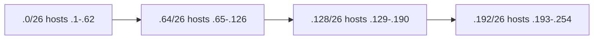

# Day 13 — Subnetting, part 1

## References

### Videos

- [Subnetting, part 1, day 13](https://www.youtube.com/watch?v=bQ8sdpGQu8c) — Jeremy's IT Lab

### Articles

- [Jeremy's CCNA notes](https://www.jeremysitlab.com/ccna-resources/)

## Diagram



Four equal subnets from one /24. The number under the slash is the block size in the last octet.


Subnetting takes one network and splits the host bits into more network bits, so you get several smaller networks. Day 13 stays inside a single octet, almost always the last octet of a /24. The method you learn here is the same method day 14 uses on harder masks.

## What you are changing

192.168.1.0/24 has 8 host bits and 254 usable hosts. You need four LANs of about 50 hosts. One /24 given to a single LAN wastes addresses and, worse, puts everyone in one broadcast domain. Borrow 2 host bits:

```text
/24   nnnnnnnn.nnnnnnnn.nnnnnnnn.hhhhhhhh
/26   nnnnnnnn.nnnnnnnn.nnnnnnnn.nnhhhhhh
```

- Borrowed bits: 2. Number of subnets: 2^2 = 4.
- Host bits left: 6. Addresses per subnet: 2^6 = 64. Usable hosts: 64 − 2 = 62.

Sixty-two is enough for 50 hosts. Four subnets is exactly what you asked for.

## Block size

You do not need binary on every problem once you can see the **block size**.

In the interesting octet (the one where the mask is neither 0 nor 255), the block size is `256 − mask-value`.

| Mask in that octet | Slash, if it is the last octet | Block size | Usable hosts |
|--------------------|--------------------------------|------------|--------------|
| 128 | /25 | 128 | 126 |
| 192 | /26 | 64 | 62 |
| 224 | /27 | 32 | 30 |
| 240 | /28 | 16 | 14 |
| 248 | /29 | 8 | 6 |
| 252 | /30 | 4 | 2 |
| 255 | /32 in the last octet | 1 | a single host route |

Subnets start at 0 and step by the block size. They must start on a multiple of the block. 192.168.1.32/27 is legal. 192.168.1.40/27 is not a network address.

For each subnet:

- Network = the start of the block.
- Broadcast = one less than the next block.
- First host = network + 1.
- Last host = broadcast − 1.

## Worked example: split 192.168.1.0/24 into /26

Block size 64. Four subnets.

| Subnet | Network | First host | Last host | Broadcast | Usable |
|--------|---------|------------|-----------|-----------|--------|
| 1 | 192.168.1.0 | .1 | .62 | .63 | 62 |
| 2 | 192.168.1.64 | .65 | .126 | .127 | 62 |
| 3 | 192.168.1.128 | .129 | .190 | .191 | 62 |
| 4 | 192.168.1.192 | .193 | .254 | .255 | 62 |

Assign them left to right and write the assignment down. LAN A gets .0/26, gateway 192.168.1.1. LAN B gets .64/26, gateway 192.168.1.65. A PC on LAN B at .70 talks to gateway .65. It does not use .1. .1 is in a different subnet.

Check a host before you configure it: 192.168.1.130 is in the third subnet (.128/26), not the second. The second ends at .127.

## Worked example: which /27 contains 172.16.5.45?

You need 30 hosts per LAN, so you chose /27 (32 − 2 = 30). Block size is 32.

Count blocks in the last octet until you pass 45:

```text
0, 32, 64, ...
```

45 is between 32 and 64, so:

- Network: 172.16.5.32
- Broadcast: 172.16.5.63
- First host: 172.16.5.33
- Last host: 172.16.5.62

172.16.5.45 is a valid host. 172.16.5.32 and .63 are not.

## Worked example: “how many subnets and hosts?”

**Question.** You subnet 10.5.5.0/24 with mask 255.255.255.240. How many subnets, and how many usable hosts in each?

- 255.255.255.240 is /28.
- Borrowed bits from the original /24: 28 − 24 = 4. Subnets = 2^4 = 16.
- Host bits = 32 − 28 = 4. Usable hosts = 2^4 − 2 = 14.
- Block size = 256 − 240 = 16. Networks: .0, .16, .32, …, .240.

The last subnet, 10.5.5.240/28, runs from .240 to broadcast .255, hosts .241–.254. People sometimes stop at .224 and forget .240. The last block is still valid as long as it lands inside the original range.

## A design in one pass

You have 192.168.10.0/24. Build:

- LAN A, 60 hosts
- LAN B, 20 hosts
- a point-to-point link, 2 hosts

This is almost VLSM (day 15), but you can solve the first cut with equal subnets to see why equal subnets waste space.

Sixty hosts forces /26 (62 usable) if every subnet is the same size. A /26 gives only **four** subnets, and each one burns 64 addresses. LAN B needs 20, so 42 addresses sit idle. The point-to-point link needs 2 and receives 62. It works. It is clumsy. Day 15 lets LAN B be a /27 and the link a /30. For day 13, being able to produce the equal-size table quickly is the goal.

Pick the mask from the **host requirement**, not from a guess:

| Hosts needed | Smallest mask that works | Usable |
|--------------|--------------------------|--------|
| 100 | /25 | 126 |
| 50 | /26 | 62 |
| 20 | /27 | 30 |
| 10 | /28 | 14 |
| 2 | /30 | 2 |

Always check the next-smaller size and reject it. Fifty hosts do not fit in a /27 (30 usable). That one-step check catches most exam mistakes.

## Binary check, when the block method feels shaky

Address 192.168.1.130, mask 255.255.255.192.

```text
130 = 10000010
192 = 11000000
AND = 10000000 = 128
```

Network 192.168.1.128. The host bits are the last 6 bits. Set them all to 1: `10111111` = 191. Broadcast 192.168.1.191. Same answer as the table. Use binary to audit yourself, then go back to block size for speed.

## Check yourself

1. Block size and usable hosts for mask 255.255.255.224.
2. List the four network addresses when 10.1.1.0/24 is subnetted to /26.
3. Is 10.1.1.127 a valid host address in 10.1.1.64/26?
4. You need 12 hosts in a subnet. What mask do you use, and how many usable hosts does it give?
5. Network 192.168.4.0/24, mask /28. What is the network address of the subnet that contains 192.168.4.100?

## Answers

1. Block size 32. Usable hosts 30. The mask is /27.
2. 10.1.1.0, 10.1.1.64, 10.1.1.128, 10.1.1.192.
3. No. 10.1.1.64/26 broadcasts at .127. The last host is .126.
4. /28, which gives 14 usable hosts. A /29 gives only 6, so it is too small.
5. Block size 16. 96 is the multiple of 16 at or below 100 (96, then 112). Network 192.168.4.96, broadcast 192.168.4.111, hosts .97–.110. 100 sits inside it.
