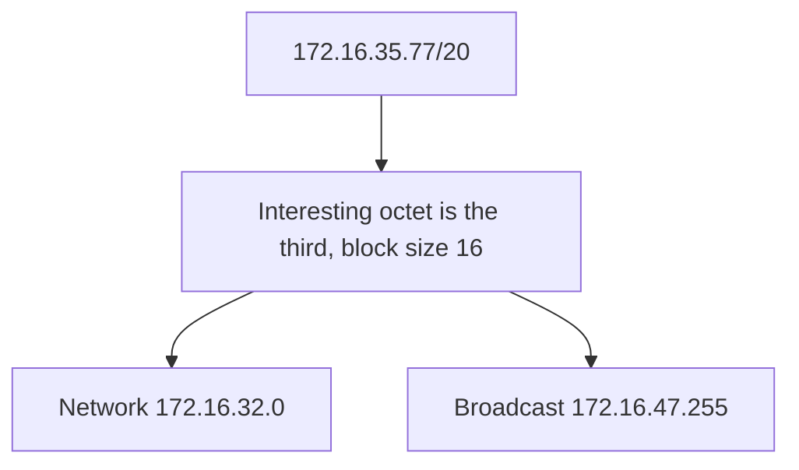

# Day 14 — Subnetting, part 2

## References

### Videos

- [Subnetting, part 2, day 14](https://www.youtube.com/watch?v=IGhd-0di0Qo) — Jeremy's IT Lab

### Articles

- [Jeremy's CCNA notes](https://www.jeremysitlab.com/ccna-resources/)

## Diagram

Day 13 changed bits in the last octet. Day 14 uses the same block-size method when the interesting octet is the third or the second, which is what /17 through /23 and the Class B problems look like. The arithmetic does not change. You have to be careful about which octet the block lives in, and about the all-ones octets to its right.

## Find the interesting octet

Write the mask. The interesting octet is the first one that is not 255, which is also the last one that is not 0.

| Mask | Slash | Interesting octet | Block size |
|------|-------|-------------------|------------|
| 255.255.255.192 | /26 | 4th | 64 |
| 255.255.255.0 | /24 | none; the boundary is between octets | — |
| 255.255.240.0 | /20 | 3rd | 16 |
| 255.255.192.0 | /18 | 3rd | 64 |
| 255.255.0.0 | /16 | none | — |
| 255.252.0.0 | /14 | 2nd | 4 |
| 255.224.0.0 | /11 | 2nd | 32 |

Block size is still `256 − value` in that octet.

Everything to the **left** of the interesting octet is fixed. Everything to the **right** is a host octet: 0 in the network address, 255 in the broadcast address.

## The procedure

1. Note the mask and the block size.
2. In the interesting octet, find the multiple of the block that is less than or equal to the address’s octet.
3. That multiple, with the original octets to the left and zeros to the right, is the network.
4. The next multiple minus one, with 255 in every octet to the right, is the broadcast.
5. First host = network + 1 in the last octet. Last host = broadcast − 1 in the last octet.

## Worked example: 172.16.35.77/20

Mask 255.255.240.0. Interesting octet is the third. Block size = 256 − 240 = 16.

Third octet is 35. Multiples of 16: 0, 16, 32, 48. 35 falls in the block that starts at 32. The next block would start at 48.

| | Address |
|--|---------|
| Network | 172.16.32.0 |
| First host | 172.16.32.1 |
| Last host | 172.16.47.254 |
| Broadcast | 172.16.47.255 |

The last octet of the network is 0, not 35. A common mistake is to answer 172.16.32.77 or 172.16.35.0. The whole third-octet range from 32 through 47 belongs to this one subnet, and every last-octet value from 0 to 255 comes with it, except the network and broadcast addresses themselves.

How many usable hosts? /20 leaves 12 host bits. 2^12 − 2 = 4094.

## Worked example: 10.47.92.15/18

Mask 255.255.192.0. Interesting octet is the third. Block size = 256 − 192 = 64.

Third octet 92. Multiples: 0, 64, 128, 192. 92 is in the block starting at 64. Next block starts at 128.

| | Address |
|--|---------|
| Network | 10.47.64.0 |
| First host | 10.47.64.1 |
| Last host | 10.47.127.254 |
| Broadcast | 10.47.127.255 |

The second octet stayed 47. It is to the left of the interesting octet, so it is part of the network and does not vary inside this subnet.

## Worked example: 10.200.5.9/14

Mask 255.252.0.0. Now the interesting octet is the **second**. Block size = 256 − 252 = 4.

Second octet 200. Multiples of 4: … 196, 200, 204. 200 is itself a multiple, so the network starts at 200. Next block starts at 204.

| | Address |
|--|---------|
| Network | 10.200.0.0 |
| First host | 10.200.0.1 |
| Last host | 10.203.255.254 |
| Broadcast | 10.203.255.255 |

Both the third and the fourth octets are host bits. The broadcast sets both of them to 255, and the second octet to 203 (one less than 204).

Borrowed bits from a /8: 14 − 8 = 6, so 2^6 = 64 subnets inside 10.0.0.0/8 if the original network was the Class A. Host bits: 18. You rarely need the full host count. You do need the network and broadcast written correctly.

## “Which subnet?” versus “is it a host?”

**Question.** Does 172.16.47.255/20 belong to a host?

From the first worked example, 172.16.47.255 is the **broadcast** of 172.16.32.0/20. It is not a host address. A ping to it is a directed broadcast into that subnet.

**Question.** Are 172.16.40.1/20 and 172.16.50.1/20 on the same subnet?

40 is inside 32–47, so 172.16.40.1 is in 172.16.32.0/20. 50 is inside 48–63, so 172.16.50.1 is in 172.16.48.0/20. Different subnets. Traffic between them goes through a router even though both addresses “look like 172.16.”

## Splitting a /16

**Question.** Subnet 172.16.0.0/16 into at least 20 subnets. What mask, and what is the range of the subnet that contains 172.16.130.10?

You need 2^n ≥ 20 borrowed bits. 2^4 = 16, too small. 2^5 = 32, enough. Borrow 5 bits from the third octet.

- New mask: /21, which is 255.255.248.0.
- Block size in the third octet: 256 − 248 = 8.
- 130 sits in the block starting at 128 (128, then 136).

| | Address |
|--|---------|
| Network | 172.16.128.0 |
| First host | 172.16.128.1 |
| Last host | 172.16.135.254 |
| Broadcast | 172.16.135.255 |

Usable hosts per subnet: host bits = 32 − 21 = 11, so 2^11 − 2 = 2046. If the question also required 500 hosts, /21 still works. If it required 5000 hosts, it would not, and you would have a conflict between “at least 20 subnets” and “5000 hosts” inside a /16 (a /16 has only 16 bits of host space). Day 15 is where requirements of different sizes are the main point. Here, check both constraints before you commit to the mask.

## Speed habits

- Draw the multiples until you pass the octet. Do not do it in your head for a block size of 8 or 16 until you are bored of getting them right.
- Say the broadcast out loud with the 255s: “third octet 47, last octet 255.”
- Reject any network address that is not a multiple of the block. 172.16.36.0/20 is not a network. 36 is not a multiple of 16.
- When the mask is /24, /16, or /8, there is no partial octet. The network address is the given octets with zeros after the boundary. 10.1.2.50/16 is network 10.1.0.0, broadcast 10.1.255.255.

## Check yourself

1. Network, first host, last host, and broadcast of 192.168.50.20/22.
2. Are 10.10.10.10/18 and 10.10.70.10/18 in the same subnet?
3. You must create at least 10 subnets from 172.20.0.0/16, borrowing as few host bits as possible. What mask do you use?
4. What is the block size of 255.255.248.0, and which octet is it in?
5. Is 10.1.1.0 a valid network address for a /30?

## Answers

1. /22 is 255.255.252.0. Block size 4 in the third octet. 50 sits in the block starting at 48. Network 192.168.48.0, first host 192.168.48.1, last host 192.168.51.254, broadcast 192.168.51.255.
2. No. /18 has block size 64 in the third octet. 10.10.10.10 is in 10.10.0.0/18 (third octet 0–63). 10.10.70.10 is in 10.10.64.0/18 (third octet 64–127).
3. 2^3 = 8, which is short of 10. 2^4 = 16, which is enough. Borrow 4 bits: /20, mask 255.255.240.0.
4. Block size 8, in the third octet.
5. Yes. A /30 has block size 4: .0, .4, .8, .12, … .0 is the first one. Hosts are 10.1.1.1 and 10.1.1.2, broadcast 10.1.1.3. (A /31 would also be a valid point-to-point network, with both .0 and .1 usable and no broadcast. That is day 15.)
