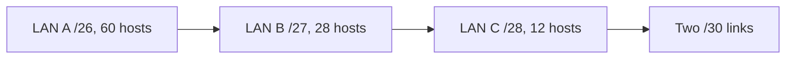

# Day 15 — Subnetting, part 3 (VLSM)

## References

### Videos

- [Subnetting, part 3, VLSM, day 15](https://www.youtube.com/watch?v=z-JqCedc9EI) — Jeremy's IT Lab
- [VLSM lab, day 15](https://www.youtube.com/watch?v=Rn_E1Qv8--I)

### Articles

- [RFC 3021, /31 prefixes](https://datatracker.ietf.org/doc/html/rfc3021)

## Diagram



Place the largest block first so the next free address is still aligned.


Days 13 and 14 used one mask for every subnet. **VLSM** (variable-length subnet masking) lets each subnet have the mask its host count actually needs. You do this inside one classless block, allocating the largest subnet first so the small ones can fill the gaps.

Classful addressing wasted a /24 on a link that has two routers. VLSM is the fix. It only works if every router is classless, which IOS is. The mask is configured on each interface. There is no separate “enable VLSM” command.

## The rules

1. Start from one summary block you actually own, such as 192.168.10.0/24.
2. Count the **usable** hosts required, then pick the smallest mask that provides them. Remember 2^n − 2, except a point-to-point link, which can be a /30 (2 usable) or a /31 (2 usable, no broadcast).
3. Sort the requirements **largest subnet first**.
4. Place each subnet on the next free address that is a legal network for **that** mask. A /26 must start on a multiple of 64. A /28 must start on a multiple of 16. If the next free address is not aligned, skip forward until it is. Allocating large-to-small usually avoids the skip.
5. Write network, first, last, broadcast, and gateway before you move on. The next subnet starts at broadcast + 1.
6. Do not overlap. The failure mode is a LAN that quietly includes the addresses you gave to a WAN link.

## Mask chooser

| Hosts required | Mask | Block size in the last octet | Usable |
|----------------|------|------------------------------|--------|
| 126 | /25 | 128 | 126 |
| 62 | /26 | 64 | 62 |
| 30 | /27 | 32 | 30 |
| 14 | /28 | 16 | 14 |
| 6 | /29 | 8 | 6 |
| 2 | /30 | 4 | 2 |
| 2 on a point-to-point link | /31 | 2 | 2 (both addresses are hosts) |

If you need 30 hosts exactly, a /27 fits and a /28 does not. “Exactly 30” uses every address, which leaves no room for a printer you forgot. In production, leave spare. In an exam, use the smallest mask that meets the number printed in the question.

## Worked example

Block: **192.168.10.0/24**.

| Network | Hosts needed | Mask chosen |
|---------|--------------|-------------|
| LAN A | 60 | /26 (62) |
| LAN B | 28 | /27 (30) |
| LAN C | 12 | /28 (14) |
| WAN 1 | 2 | /30 |
| WAN 2 | 2 | /30 |

Largest first. LAN A is already first.

| Piece | Network | Usable range | Broadcast | Block consumed |
|-------|---------|--------------|-----------|----------------|
| LAN A | 192.168.10.0/26 | .1 – .62 | .63 | .0 – .63 |
| LAN B | 192.168.10.64/27 | .65 – .94 | .95 | .64 – .95 |
| LAN C | 192.168.10.96/28 | .97 – .110 | .111 | .96 – .111 |
| WAN 1 | 192.168.10.112/30 | .113 – .114 | .115 | .112 – .115 |
| WAN 2 | 192.168.10.116/30 | .117 – .118 | .119 | .116 – .119 |

Free space starts at 192.168.10.120 and runs through 192.168.10.255. That is room for another /28, or a lot of /30s, or a future /26 if you had placed the big LAN badly. You did not. The /26 took the aligned block at zero.

Give each LAN its .1 as the gateway: LAN A gateway 192.168.10.1, LAN B gateway 192.168.10.65, LAN C gateway 192.168.10.97. On the WAN, one end takes the first usable and the other takes the second: 192.168.10.113 and .114.

### What goes wrong if you allocate small-first

Suppose you hand WAN 1 the 192.168.10.0/30 first. The next free address is .4. LAN A needs a /26, and the next multiple of 64 is .64. Addresses .4 through .63 become a hole you cannot give to LAN A. The plan still fits in the /24, but you stranded almost a /26. Largest-first is how you avoid that.

### Overlap check

LAN B occupies .64 through .95 inclusive. A careless second subnet of 192.168.10.80/28 sits inside LAN B. Both interfaces would accept the configuration. Hosts would ARP for addresses the other subnet also believes it owns. When you build the table, confirm that each broadcast + 1 equals the next network.

## /30 and /31 on router links

A link with two routers needs two addresses.

**/30** is the classic choice. Four addresses: network, two hosts, broadcast. You configure it like any other subnet.

```text
R1(config)# interface g0/1
R1(config-if)# ip address 192.168.10.113 255.255.255.252
R2(config)# interface g0/0
R2(config-if)# ip address 192.168.10.114 255.255.255.252
```

**/31** uses the two addresses and nothing else (RFC 3021). IOS accepts it. There is no broadcast address, which is fine because the only listener is the other router.

```text
R1(config-if)# ip address 192.168.10.120 255.255.255.254
R2(config-if)# ip address 192.168.10.121 255.255.255.254
```

Use /30 in the labs unless the question says /31. Know that /31 exists so a “2 hosts, mask /31” answer does not look illegal.

## A second example, middle of the page, no peeking at the first

Block **10.10.0.0/22** (10.10.0.0 through 10.10.3.255, 1024 addresses).

Requirements, already sorted:

- Site LAN: 500 hosts → /23 gives 510. A /23 is 512 addresses, block size 2 in the third octet.
- Floor LAN: 100 hosts → /25 gives 126.
- Two WAN links → two /30s.

Place them:

| Piece | Network | Broadcast |
|-------|---------|-----------|
| Site LAN | 10.10.0.0/23 | 10.10.1.255 |
| Floor LAN | 10.10.2.0/25 | 10.10.2.127 |
| WAN 1 | 10.10.2.128/30 | 10.10.2.131 |
| WAN 2 | 10.10.2.132/30 | 10.10.2.135 |

The /23 consumed the third octet values 0 and 1. The next free address is 10.10.2.0, which is a legal start for a /25. The /25 consumes through 10.10.2.127. The next address, .128, is a multiple of 4, so it is a legal /30. This is the alignment check you do every time the mask crosses an octet boundary.

## Configuring it

VLSM is ordinary interface addressing plus matching static routes. For LAN A and LAN B on R1, and WAN 1 between R1 and R2:

```text
R1(config)# interface g0/0
R1(config-if)# description LAN-A
R1(config-if)# ip address 192.168.10.1 255.255.255.192
R1(config-if)# no shutdown
R1(config)# interface g0/1
R1(config-if)# description LAN-B
R1(config-if)# ip address 192.168.10.65 255.255.255.224
R1(config-if)# no shutdown
R1(config)# interface g0/2
R1(config-if)# ip address 192.168.10.113 255.255.255.252
R1(config-if)# no shutdown
R1(config)# ip route 192.168.10.96 255.255.255.240 192.168.10.114
```

The static route’s mask is the **remote LAN’s** mask, not the WAN’s mask. LAN C is a /28, so the route is for 192.168.10.96 255.255.255.240. Using 255.255.255.0 here would claim the entire original block and can overlap R1’s connected routes. IOS may refuse the route or install a covering prefix you did not intend. Match the mask to the subnet you are trying to reach.

`show ip route` should list each connected subnet with its real mask:

```text
C  192.168.10.0/26  is directly connected, GigabitEthernet0/0
C  192.168.10.64/27 is directly connected, GigabitEthernet0/1
C  192.168.10.112/30 is directly connected, GigabitEthernet0/2
```

If two of those overlap, you mis-drew the table. Fix the design before you add static routes.

## Check yourself

1. You need 40 hosts. Which mask, and why not the next longer one?
2. From 172.16.0.0/24, place a 100-host LAN, a 20-host LAN, and a /30, largest first. Give the three network addresses.
3. Why does allocating a /30 at 10.0.0.0 and then a /25 force the /25 to start at 10.0.0.128?
4. Write the interface commands for both ends of a /30 on 10.1.1.0/30.
5. A static route to a remote /27 is written with mask 255.255.255.0. What is wrong with that?

## Answers

1. /26, which has 62 usable hosts. A /27 has 30, which is short of 40.
2. 100 hosts need a /25. That takes 172.16.0.0/25 (through .127). 20 hosts need a /27, so 172.16.0.128/27 (through .159). The /30 follows at 172.16.0.160/30.
3. A /25 must start on a multiple of 128. After a /30 at .0, the next address is .4, which is not a legal /25 boundary. .128 is the next one that is.
4. One side: `ip address 10.1.1.1 255.255.255.252`. The other: `ip address 10.1.1.2 255.255.255.252`. .0 is the network and .3 is the broadcast.
5. The mask is a /24, so the route covers 256 addresses, including subnets that are not that /27. Use 255.255.255.224 so the route matches only the remote subnet.
