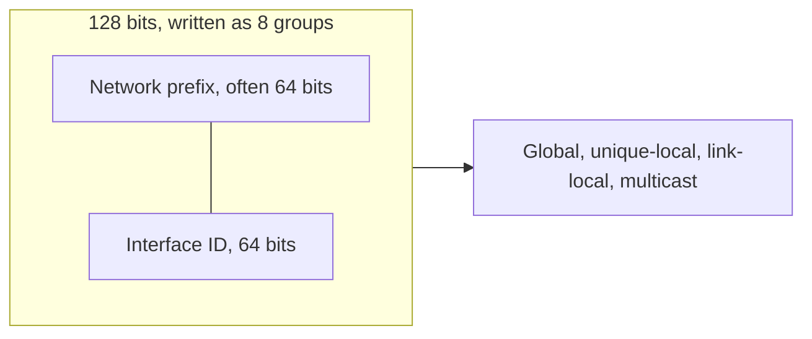

# IPv6

IPv4’s 32 bits and its broadcast habits do not extend cleanly. IPv6 is 128 bits, has no broadcast, and discovers neighbors with ICMPv6 instead of ARP. The addressing rules below are the ones that show up in design docs and in a first lab.

## References

### Videos

- Jeremy’s IT Lab IPv6 days are in the [Free CCNA v1.1 playlist](https://www.youtube.com/playlist?list=PLxbwE86jKRgMpuZuLBivzlM8s2Dk5lXBQ) (later than day 17).
- Keith Barker’s IPv6 videos are in the [CCNA 200-301 playlist](https://www.youtube.com/playlist?list=PLQQoSBmrXmrysEaVNia7KVwf85qATIi1V).

### Articles

- Kurose chapters 4 and 7 on the [lectures page](https://www-net.cs.umass.edu/kurose_ross/lectures.php)
- [RFC 8200, IPv6 specification](https://datatracker.ietf.org/doc/html/rfc8200)
- [RFC 4291, addressing architecture](https://datatracker.ietf.org/doc/html/rfc4291)

## Diagram



A LAN prefix is almost always a **/64**. The second half identifies the host. Subnetting steals bits from the prefix side, not by shrinking the interface ID below 64 on a normal LAN. SLAAC needs the 64-bit interface ID.

## Writing an address

Eight groups of four hex digits, separated by colons:

```text
2001:0db8:0000:0001:0000:0000:0000:0001
```

Two compression rules:

- Drop leading zeros in a group: `0db8` becomes `db8`, `0000` becomes `0`.
- Replace **one** run of all-zero groups with `::`.

```text
2001:db8:0:1::1
```

`::` may appear once. `2001::1::2` is illegal because the length becomes ambiguous. A trailing or leading `::` is fine: `::1` is loopback, `fe80::1` is a link-local.

The prefix length is written as a slash, the same idea as IPv4 CIDR: `2001:db8:0:1::/64` is the subnet, `2001:db8:0:1::1` is a host in it.

## Address kinds you must recognize

| Prefix | Name | Where it is used |
|--------|------|------------------|
| `2000::/3` | Global unicast | Routable on the Internet. Documentation uses `2001:db8::/32`. |
| `fc00::/7` | Unique local | Private, like RFC 1918. In practice the next bit is 1, so you see `fd00::/8`. Not routed on the public Internet. |
| `fe80::/10` | Link-local | Present on every interface. Used by routing protocols and neighbor discovery. Never forwarded off the link. |
| `ff00::/8` | Multicast | Replaces broadcast. `ff02::1` is all nodes on the link. `ff02::2` is all routers. |
| `::1/128` | Loopback | The host itself. |
| `::/128` | Unspecified | “No address yet,” used as a source during initialization. |

There is no ARP broadcast and no address that means “all hosts in this subnet” the way 192.168.1.255 does. A host that wants one neighbor sends to a **solicited-node multicast** address, `ff02::1:ff` plus the last 24 bits of the target: the neighbor of `2001:db8:0:1::1` is solicited at `ff02::1:ff00:1`.

## Neighbor discovery, instead of ARP

NDP is ICMPv6.

| Message | Who sends it | Purpose |
|---------|--------------|---------|
| Router Solicitation (RS) | Host | “Are there any routers on this link?” |
| Router Advertisement (RA) | Router | Prefix, default router, flags for SLAAC or DHCPv6 |
| Neighbor Solicitation (NS) | Host or router | “Who has this IPv6 address?” Also used for duplicate-address detection. |
| Neighbor Advertisement (NA) | The owner | “That address is my MAC.” |

The neighbor cache is the IPv6 ARP table. On IOS: `show ipv6 neighbors`.

### Worked example

PC `2001:db8:0:1::10/64` pings `2001:db8:0:2::10`, which is off-link (different fourth group, so a different /64).

1. The PC has no match in its own prefix, so it sends the packet to the default router learned from an RA.
2. It resolves the **router’s link-local** with NS/NA, not the far host.
3. The router decrements the hop limit (the IPv6 name for TTL) and repeats the process on the next link.

Same rule as IPv4: on-link destinations are resolved directly. Everything else goes to the router. The resolved address on the first hop is the router.

## Configuring a router

IOS does not forward IPv6 until you enable it.

```text
R1(config)# ipv6 unicast-routing
R1(config)# interface gigabitEthernet 0/0
R1(config-if)# ipv6 address 2001:db8:0:1::1/64
R1(config-if)# no shutdown
R1(config)# ipv6 route 2001:db8:0:2::/64 2001:db8:12::2
```

Link-local addresses appear by themselves once IPv6 is enabled on the interface. Global addresses are what you configure, or what SLAAC builds from an RA.

A static route’s next hop is often a link-local, and a link-local is not unique across interfaces, so IOS asks for the exit interface as well:

```text
R1(config)# ipv6 route 2001:db8:0:2::/64 GigabitEthernet0/1 FE80::2
```

## EUI-64, once

SLAAC can build the interface ID from the MAC. Split the 48-bit MAC in half, insert `fffe`, and flip the universal/local bit (bit 7 of the first byte).

MAC `00:1a:2b:3c:4d:5e` becomes interface ID `021a:2bff:fe3c:4d5e`. The `00` became `02` because that bit flipped. Modern operating systems often use a random interface ID instead, for privacy. You still need to recognize an `ff:fe` in the middle as EUI-64.

## What changes for later topics

- OSPFv3 and IS-IS both carry IPv6. IS-IS was multi-protocol from the start. OSPFv3 is a different process from OSPFv2.
- BGP carries IPv6 as a separate address family (`ipv6 unicast`), often over an IPv4 or IPv6 session.
- MPLS can transport IPv6 (6PE) without an IPv6 core. SRv6 puts the segment list inside the IPv6 header itself. Both are later notes: [SR-MPLS](../06-traffic-engineering/02-sr-mpls.md) and [SRv6](../06-traffic-engineering/03-srv6.md).

## Check yourself

1. Compress `2001:0db8:0000:0000:0000:0000:0000:0001`.
2. Is `fe80::1` forwarded by a router toward the Internet?
3. Which NDP message replaces the ARP request?
4. Why is a LAN almost always a /64 even when it has twenty hosts?
5. PC `2001:db8:1:1::10/64` wants `2001:db8:1:2::10`. Whose address does it resolve with Neighbor Solicitation first?

## Answers

1. `2001:db8::1`.
2. No. Link-local stays on the link.
3. Neighbor Solicitation. The answer is a Neighbor Advertisement.
4. SLAAC and the convention that the interface ID is 64 bits. The size of the LAN is not the reason.
5. Its default router. `2001:db8:1:2::/64` is a different prefix from `2001:db8:1:1::/64`.
