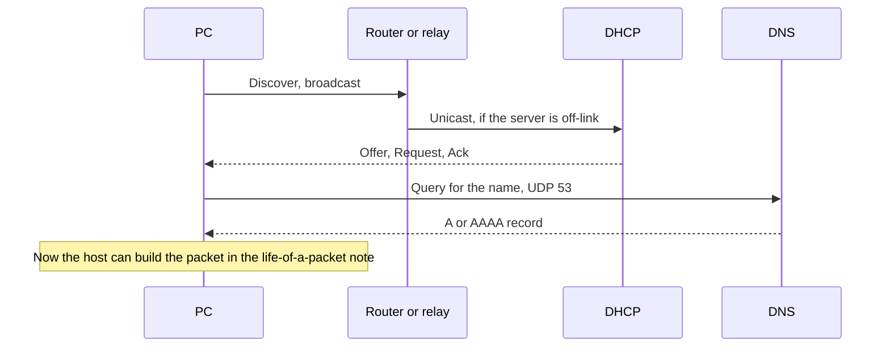

# DHCP and DNS

A host with a cable and no configuration still cannot start the life of a packet. DHCP hands it an address, a mask, a gateway, and a DNS server. DNS turns the name the user typed into the IP address that packet is sent to. Every later lab assumes both already happened.

## References

### Videos

- Jeremy’s IT Lab DHCP and DNS days in the [Free CCNA v1.1 playlist](https://www.youtube.com/playlist?list=PLxbwE86jKRgMpuZuLBivzlM8s2Dk5lXBQ) (after the VLAN days)
- [Packet Traveling](https://www.practicalnetworking.net/series/packet-traveling/packet-traveling/) — start once the host has an address

### Articles

- [RFC 2131, DHCP](https://datatracker.ietf.org/doc/html/rfc2131)
- [RFC 1034, DNS concepts](https://datatracker.ietf.org/doc/html/rfc1034)

## Diagram



## DHCP: four messages

DHCP is UDP. The client uses port 68. The server uses port 67. A host with no address yet cannot unicast, so the first message is a broadcast.

| Step | Message | Who | What it means |
|------|---------|-----|----------------|
| 1 | Discover | Client, broadcast | “I need a lease.” Destination IP 255.255.255.255, destination MAC `ffff.ffff.ffff`. |
| 2 | Offer | Server | “You may use this address.” |
| 3 | Request | Client | “I accept that offer.” |
| 4 | Ack | Server | “It is yours until the lease expires.” The options ride along. |

People call this **DORA**. The switch floods the Discover because it is a broadcast. That flood stays inside the VLAN. A client in VLAN 10 never hears a server that is only listening in VLAN 20.

The options that matter on day one:

| Option | What the host does with it |
|--------|----------------------------|
| Subnet mask | Decides which destinations are on-link |
| Router | The default gateway it will ARP for |
| DNS server | Who it asks when the user types a name |
| Lease time | When it must renew. At half the lease (T1) it unicasts a Request to the server that leased it. |

If no server answers, many operating systems assign themselves an address in **169.254.0.0/16** (link-local, APIPA). Those hosts can sometimes reach each other on the same link. They cannot reach a gateway. A PC that “has an IP” of 169.254.x.x did not get a lease.

### The server is on another subnet

Routers do not forward the Discover broadcast. A **relay** on the router (IOS: `ip helper-address`) receives it, writes its own interface address into the giaddr field so the server knows which pool to use, and unicasts the message to the server. The server’s reply comes back to the relay, which delivers it on the client VLAN.

```text
R1(config)# interface gigabitEthernet 0/0.10
R1(config-subif)# ip helper-address 10.0.0.5
```

`ip helper-address` also forwards several other UDP broadcasts (including TFTP). It is not “DHCP only” unless you change the forwarded-port list. The address you type is the DHCP server, not the gateway.

### Worked example

VLAN 10 is 192.168.10.0/24, gateway 192.168.10.1, server 10.0.0.5 on a different subnet. The router’s VLAN 10 interface has the helper.

1. PC boots. Discover is flooded only inside VLAN 10.
2. The router unicasts it to 10.0.0.5 and sets giaddr to 192.168.10.1.
3. The server picks a free address from the 192.168.10.0/24 pool, because giaddr told it which network this is.
4. Ack includes mask 255.255.255.0, router 192.168.10.1, DNS 10.0.0.6.
5. The PC ARPs for 192.168.10.1 the first time it needs to leave the subnet. That ARP is [day 6](06-ethernet-switching-2.md). The gateway itself may be redundant later: [gateway redundancy](../03-routing/07-gateway-redundancy.md).

A second DHCP server that also answers can hand out an overlapping address. [DHCP snooping](../02-lan-switching/05-layer2-security.md) is how a switch stops a rogue server.

## DNS: the name becomes an address

The user types `https://www.example.com`. The packet’s destination is an IP address, not that string. **DNS** does the translation.

| Record | Holds |
|--------|--------|
| A | An IPv4 address for the name |
| AAAA | An IPv6 address |
| CNAME | An alias pointing at another name |
| NS | Which server is authoritative for a zone |
| PTR | A name for an IP address, used by reverse lookups |
| MX | Where mail for a domain should go |

The host’s stub resolver asks the **recursive resolver** from the DHCP options (or typed by hand). That query is usually one UDP message to port 53. The recursive server does the walking if it has no cached answer:

1. Ask a **root** server who serves `.com`.
2. Ask that TLD server who serves `example.com`.
3. Ask the **authoritative** server for `www.example.com`.
4. Cache the answer for the record’s TTL, then return it to the host.

The host then opens TCP port 443 to that address. The name does not appear in the IP header. It appears again inside TLS, as the name the certificate must match. A wrong A record sends the whole [life of a packet](../03-routing/02-life-of-a-packet.md) to the wrong machine, and every router along the way will look healthy.

Large answers and zone transfers use TCP port 53. If a firewall allows UDP 53 and drops TCP 53, small lookups work and some replies fail.

### What “DNS is down” looks like

- `ping 192.168.1.1` works and `ping gateway.lab` does not: routing is fine, name resolution is not. Check the configured DNS server, then ping that server by address.
- Both fail: you do not have a path yet. Do not start with DNS.
- The name resolves to an address you did not expect: someone else’s record, a stale cache, or a hosts file on the PC. The TTL says how long a resolver is allowed to keep the old answer.

## Check yourself

1. Which DHCP message is a broadcast the switch must flood, and which UDP ports are the client and the server?
2. Why does a router need `ip helper-address` when the DHCP server is on another VLAN?
3. A PC shows 169.254.12.8 and mask 255.255.0.0. Did DHCP succeed?
4. Which DNS record returns the IPv4 address of a name, and which port does the query use first?
5. Ping to an IP works. Ping to a name fails. Which of DHCP’s options, or which server, do you check first?

## Answers

1. Discover (and often Request) is broadcast. Client port 68, server port 67.
2. The Discover is a broadcast, and routers do not forward those. The helper turns it into a unicast toward the server and identifies the client subnet with giaddr.
3. No. 169.254.0.0/16 is the address a host gives itself when no lease arrives. It has no DHCP gateway.
4. An A record. The query is UDP port 53 unless the answer is too large, in which case the resolver retries over TCP 53.
5. The DNS server address the host is using, which DHCP option 6 (or a static resolver) was supposed to set. Then check that the host can reach that server by IP.
