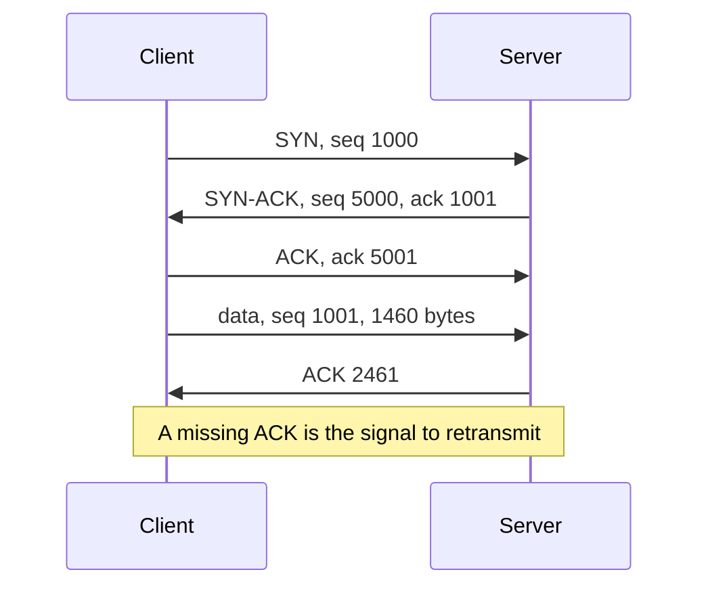

# TCP reliability

[Day 3](03-tcp-ip-model.md) separated TCP from UDP and showed the three-way handshake. This note is the part day 3 left out: how TCP notices loss, how it slows down, and why a “TCP session” is what BGP, SSH, and HTTP are actually riding on.

## References

### Videos

- Kurose transport-layer videos, linked from the [chapter video page](https://gaia.cs.umass.edu/kurose_ross/videos/1/) (the transport chapter is with the book’s later lectures on the [lectures page](https://www-net.cs.umass.edu/kurose_ross/lectures.php))

### Articles

- [RFC 9293, TCP](https://datatracker.ietf.org/doc/html/rfc9293)

## Diagram



## Sequence numbers and acknowledgements

Each direction has its own sequence number space. The SYN consumes one sequence number, which is why the acknowledgement of a SYN is “your initial number plus one” even though no data bytes moved.

The receiver acknowledges the next byte it is willing to accept. ACK 2461 means “I have everything before 2461.” It does not mean “I received packet number 2461.” If byte 1001 never arrives, the receiver keeps acknowledging 1001 even if later bytes show up. The sender eventually retransmits the missing bytes.

The receiver does not hand the application a byte stream with a hole in it. Bytes that arrived after the missing one sit in the buffer until the hole is filled. That stall is **head-of-line blocking**. UDP does not have it, which is why voice would rather drop a syllable than wait.

A sender that sees no ACK for a segment starts a retransmission timer and sends the segment again. Duplicate ACKs (the receiver repeating “I still want byte 1001” because something else arrived) are the faster signal. Three duplicate ACKs mean “this one is missing, the path is otherwise alive,” and the sender retransmits before the timer fires. Selective acknowledgement lets a sender repair the hole without resending bytes the receiver already has. The application still waits for the hole.

## The window

The sender may have several segments in flight. Two independent limits apply, and the smaller one wins.

- **Receive window (rwnd).** The receiver advertises how many bytes it can still buffer. This is **flow control**. A busy application shrinks the window so the sender pauses.
- **Congestion window (cwnd).** The sender’s own guess at how much the network can take. The receiver does not advertise it.

**Slow start** grows cwnd quickly (roughly doubling each round trip) from a small initial window. **Congestion avoidance** grows it slowly once the sender is near the capacity it has seen before. A loss cuts the window back. The exact curve (Reno, CUBIC) changes the numbers and not the idea: TCP uses loss, and sometimes ECN, as the sign that the path is full.

This is why a backup that fills a link makes SSH feel stuck, and why [QoS](../08-operations/01-qos.md) exists. TCP will fill whatever bandwidth you give it. Marking and queuing decide which TCP session loses first.

## States worth naming

You do not need all eleven for a lab. You need the ones `show` commands and captures actually display.

| State | Who | Meaning |
|-------|-----|---------|
| LISTEN | Server | Ready for a SYN. BGP on a router listens on TCP 179. |
| SYN-SENT | Client | SYN is out, no SYN-ACK yet. |
| ESTABLISHED | Both | Handshake finished. Data may flow. This is the only “up” state. |
| FIN-WAIT / CLOSE-WAIT | Either | One side has sent FIN. The other direction may still be sending. |
| TIME-WAIT | The side that sent the last ACK | Waits so a delayed duplicate of this connection cannot be confused with a new one. Often two minutes. |

Closing is a FIN in each direction, each acknowledged. A connection can be half-closed: one application is done sending, the other is not.

BGP, HTTP, and SSH all sit in ESTABLISHED while they work. A BGP session that the [BGP note](../03-routing/05-bgp.md) calls Active has not reached ESTABLISHED. The TCP handshake itself is failing, so no prefixes will arrive no matter how correct the route policy is.

## MSS and the segment size

The **maximum segment size** is the most TCP payload the sender will put in one segment. It is negotiated in the handshake. On Ethernet with a 1500-byte MTU and a 20-byte IP header plus a 20-byte TCP header, MSS is **1460**.

MSS is not MTU. MTU limits the whole IP packet. MSS limits the TCP payload. If a tunnel shrinks the MTU and the endpoints still use 1460, the IP packet no longer fits, DF is set, and the transfer stalls. That failure, and the clamp that fixes it, is [MTU and tunnels](../03-routing/12-mtu-and-tunnels.md).

### Worked example

A client downloads a file. The path round trip is 40 ms. The receive window is 64 KB, and loss is zero, so cwnd is allowed to grow past it.

The sender can keep at most 64 KB in flight, because rwnd is the tighter limit. Throughput is about one window per round trip:

```text
64 KB / 0.040 s ≈ 1.6 MB/s ≈ 13 Mbps
```

A bigger file and a fatter pipe do not go faster until the window grows. A long, fast path with a small window is how a 10 Gbps link still moves a transfer at about 13 Mbps. Loss that cuts cwnd produces the same ceiling. This is a transport limit, not a routing limit. `ping` will look perfect.

## Check yourself

1. An ACK of 5001 after a SYN with sequence 5000 means what, given that the SYN carried no data?
2. What is the difference between the receive window and the congestion window?
3. A BGP neighbor stays in Active. Has the TCP connection reached ESTABLISHED?
4. Why can one lost segment delay bytes that already arrived behind it?
5. MTU is 1500 and both IP and TCP headers are 20 bytes with no options. What MSS do you expect?

## Answers

1. The SYN consumed one sequence number. 5001 is “the next byte I want,” which is the first data byte.
2. The receive window is the receiver’s buffer, advertised in the header (flow control). The congestion window is the sender’s estimate of the path, and it is not a field the receiver sets.
3. No. Active means BGP is still trying to open TCP. ESTABLISHED is the handshake’s success state. Prefixes are exchanged only after that.
4. TCP delivers a reliable byte stream. A hole at byte N makes the receiver withhold the stream from the application even if bytes after N are sitting in the buffer, and the sender must repair N first.
5. 1460 bytes of TCP payload.
