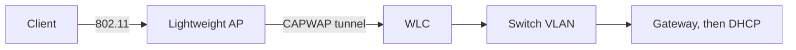

# Wireless LANs

[Day 1](01-network-devices.md) named the access point and the wireless LAN controller. This note is the part a wired diagram hides: how a client joins an SSID, and what the switch still has to provide.

## References

### Videos

- Jeremy’s IT Lab wireless days in the [Free CCNA v1.1 playlist](https://www.youtube.com/playlist?list=PLxbwE86jKRgMpuZuLBivzlM8s2Dk5lXBQ)

### Articles

- [Packet Traveling, key players](https://www.practicalnetworking.net/series/packet-traveling/key-players/) — the AP is a bridge onto the Ethernet LAN once the client is associated

## Diagram

The radio hop ends at the AP. From the gateway’s point of view the client is a host on a VLAN, reached by Ethernet, once the controller has bridged it there.

## Names

| Term | Meaning |
|------|---------|
| SSID | The network name the user sees. |
| BSSID | The AP radio’s MAC for that SSID. A client associates to a BSSID, not to the letters of the SSID. |
| STA | The wireless client. |
| BSS | One AP and the clients associated to it. |
| ESS | Several APs advertising the same SSID so the client can roam. |

An **autonomous** AP is configured on its own and bridges wireless clients onto a local VLAN. A **lightweight** AP tunnels client traffic to a **WLC** with CAPWAP. The switch port for a lightweight AP needs the AP management VLAN and, if the AP is not locally powered, PoE from [day 2](02-interfaces-and-cables.md).

## Joining, in order

1. The client scans. It sends probe requests, or it listens for beacons that advertise the SSID.
2. It authenticates. Open authentication is the usual 802.11 step. The real password check is WPA, which happens next, not in that old “open” frame.
3. It associates. The AP (or the WLC) accepts it. The client now has a radio link.
4. If the WLAN uses enterprise security, **802.1X** runs and a RADIUS server accepts or rejects the user. A pre-shared key WLAN checks the key locally instead.
5. The client does DHCP on the VLAN mapped to that SSID and gets an address, mask, gateway, and DNS server. Association without a lease looks like “Wi-Fi connected, no internet.”

Frames on the air are 802.11. The AP or WLC bridges them to Ethernet before they hit the wired LAN. The switch still learns a MAC and still floods broadcasts inside that VLAN. Wireless did not remove ARP, DHCP, or the need for a gateway.

## Channels

2.4 GHz has three non-overlapping 20 MHz channels in common use: **1, 6, and 11**. Two APs on channel 1 in the same room share the air the way two hosts shared a hub. They do not collide in the Ethernet sense. They defer and retry, and both get slower.

5 GHz and 6 GHz have many more channels. Wider channels (40, 80, 160 MHz) move more bits and fail if the neighbors overlap. A site survey picks channels and power so that adjacent APs do not sit on the same channel at full power. That work is outside this note. The rule you can apply without a survey: neighboring APs on 2.4 GHz should be 1, 6, and 11, not 1 and 2.

## What the wired network still decides

- The SSID is mapped to a VLAN. Two SSIDs can share an AP and land in different broadcast domains.
- The gateway, ACLs, and DHCP pool are the same designs as a wired VLAN.
- Roaming between APs works cleanly when both APs deliver the client into the same VLAN (or the controller keeps the anchor). A roam that also changes the client’s subnet forces a new address and breaks open connections.
- Guest traffic is often tunneled to a controller in a DMZ so it never enters the office VLAN.

### Worked example

A phone associates to SSID `corp`, which the WLC maps to VLAN 10. VLAN 10 is 192.168.10.0/24.

1. Association and WPA finish. The phone still has no IP.
2. DHCP Discover is bridged into VLAN 10 and relayed if the server is elsewhere.
3. The phone receives 192.168.10.50/24, gateway 192.168.10.1.
4. It ARPs for 192.168.10.1 when it needs to leave the subnet. The ARP is a broadcast in VLAN 10, the same flood as [day 6](06-ethernet-switching-2.md), carried across the CAPWAP tunnel.

If step 2 never happens, the radio is fine and the VLAN or the helper is not. Check the SSID-to-VLAN map before you blame the gateway.

## Check yourself

1. What is the difference between an SSID and a BSSID?
2. A laptop shows the Wi-Fi icon and an address of 169.254.x.x. Which step succeeded, and which failed?
3. Why are channels 1 and 2 a poor pair for two neighboring APs on 2.4 GHz?
4. Where does a lightweight AP send client traffic before it reaches the office switch fabric?
5. Does a wireless client still need a default gateway to reach another subnet?

## Answers

1. The SSID is the name. The BSSID is the radio MAC of the AP serving that SSID. The client associates to a BSSID.
2. Association succeeded. DHCP did not. 169.254.0.0/16 is the address a host assigns itself when no lease arrives.
3. Those channels overlap, so the APs interfere instead of sharing cleanly. Use 1, 6, and 11.
4. Through a CAPWAP tunnel to the wireless LAN controller, which bridges the client onto a VLAN.
5. Yes. The subnet rule is unchanged. On-link neighbors are reached directly. Everything else goes to the gateway learned from DHCP.
