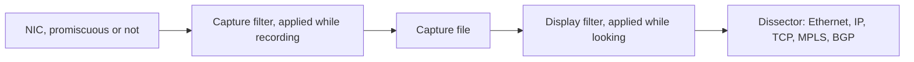

# Wireshark

Wireshark is how you check a story you told on a whiteboard. A ping, an ARP request, or a labeled packet is either on the wire or it is not. This note is the minimum that makes a capture useful for the rest of the roadmap.

## References

### Videos

- [Wireshark for beginners (8 videos)](https://www.youtube.com/playlist?list=PL6gx4Cwl9DGBI2ZFuyZOl5Q7sptR7PwYN) — thenewboston
- [IPv4 header, day 10](https://www.youtube.com/watch?v=aQB22y4liXA) — Jeremy’s IT Lab. The lecture opens a capture and walks the header fields.
- [Packet Traveling](https://www.youtube.com/watch?v=rYodcvhh7b8)

### Articles

- [Wireshark Learn](https://www.wireshark.org/learn)
- [Host to host through a router](https://www.practicalnetworking.net/series/packet-traveling/host-to-host-through-a-router/)

## Diagram

Capture filters decide what is written to disk. Display filters hide rows you already captured. A display filter cannot recover a packet the capture filter dropped.

## Two filters, two languages

Capture filters use pcap syntax. Display filters use Wireshark field names.

| Goal | Capture filter | Display filter |
|------|----------------|----------------|
| One host | `host 192.168.1.10` | `ip.addr == 192.168.1.10` |
| DNS | `port 53` | `dns` |
| HTTPS | `tcp port 443` | `tcp.port == 443` |
| ICMP | `icmp` | `icmp` |
| ARP only | `arp` | `arp` |
| Between two hosts | `host 10.0.0.1 and host 10.0.0.2` | `ip.addr == 10.0.0.1 && ip.addr == 10.0.0.2` |

`ip.addr == 10.0.0.1` matches source or destination. `ip.src == 10.0.0.1` is only the source. That distinction matters when you are chasing the return path.

## A ping, frame by frame

PC 192.168.1.10 pings 192.168.1.20 on the same LAN. Display filter: `arp || icmp`.

1. **ARP request.** Ethernet destination `ff:ff:ff:ff:ff:ff`. Ethertype `0x0806`. The ARP opcode is request (1). Target MAC is all zeros because the sender does not know it yet.
2. **ARP reply.** Unicast back to the requester. Opcode 2. Sender MAC is the answer you needed.
3. **ICMP echo request.** Ethertype `0x0800`. IP protocol 1. ICMP type 8, code 0. The IP identification and TTL are visible in the IPv4 tree. This is the same header as [the IPv4 header note](ipv4-header.md).
4. **ICMP echo reply.** Type 0. Same identifier and sequence so the sender can match the reply to the request.

If step 1 appears and step 3 does not, the host never got a reply and never sent the ping. If step 3 appears and step 4 does not, the request left and the return path or the far host failed.

## When the destination is remote

PC 192.168.1.10 pings 8.8.8.8.

- The first ARP is for the **default gateway**, not for 8.8.8.8.
- The ICMP packet’s destination IP is 8.8.8.8.
- The Ethernet destination MAC is the gateway.
- On the far side of the router, a new capture shows a different source MAC and a decremented TTL. The IP addresses are unchanged. That is [life of a packet](../03-routing/life-of-a-packet.md), visible in two capture files.

## Reading the packet bytes pane

Select the IPv4 layer. The bytes pane highlights the header. Twenty bytes with no options:

| Bytes | Field |
|-------|--------|
| First nibble | Version 4 |
| Next nibble | IHL, usually 5 |
| Byte 8 | TTL |
| Byte 9 | Protocol (1, 6, or 17) |
| Bytes 12–15 | Source IP |
| Bytes 16–19 | Destination IP |

MPLS, later, inserts a shim **before** this header. The Ethernet type becomes `0x8847`. Wireshark then shows an MPLS label, EXP, bottom-of-stack bit, and label TTL, and only then the IP header. If you do not see `0x8847` on a core link, that hop is not imposing or forwarding a label.

## TCP in one glance

Display filter `tcp.flags.syn == 1`. A handshake is three rows:

1. SYN from the client ephemeral port to the server port.
2. SYN-ACK.
3. ACK.

`Follow` → `TCP stream` rebuilds the payload in order. Use it for HTTP and for a failed SSH banner. It hides the packets that were retransmitted, so when you care about loss, stay in the packet list and look for “TCP retransmission” and duplicate ACKs.

## Habits that keep a capture honest

- Capture on the right interface. A capture on the PC does not show the rewrite a router does. Capture on both sides of the device you are blaming.
- Stop the capture before you scroll for an hour. A multi-gigabit link will fill the disk and drop packets, and dropped packets look like network loss.
- Save as pcapng and write down the topology in the file name: `pc1-to-r1-icmp.pcapng`.
- Confirm the clock. TTL and sequence numbers are more trustworthy than a timestamp that jumped.

## Check yourself

1. You set a display filter `icmp` and still see ARP. What did you actually filter?
2. A ping to a remote host is on the wire. Which MAC is the Ethernet destination on the first hop?
3. Which Ethernet type means “MPLS unicast follows”?
4. Why can a capture filter of `port 53` hide the TCP handshake of a zone transfer you later wish you had?

## Answers

1. You did not. A display filter of `icmp` hides ARP. If ARP is still visible, the filter is not applied, or the expression is `arp || icmp`.
2. The default gateway’s MAC. The IP destination is the remote host.
3. `0x8847`.
4. Capture filters are applied as packets arrive. A later display filter cannot show packets that were never stored. Use a wider capture filter and narrow it with a display filter.
