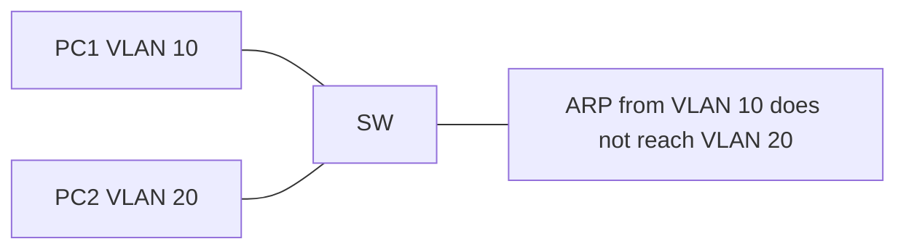

# Day 16 — VLANs, part 1

## References

### Videos

- [VLANs, part 1, day 16](https://www.youtube.com/watch?v=cjFzOnm6u1g) — Jeremy's IT Lab
- [VLANs lab, day 16](https://www.youtube.com/watch?v=-tq7f3xtyLQ)

### Articles

- [Packet Traveling](https://www.practicalnetworking.net/series/packet-traveling/packet-traveling/)

## Diagram




A switch with one VLAN is one broadcast domain. Every ARP, every DHCP discover, and every unknown unicast is flooded to every port. A **VLAN** is a logical switch inside the physical switch: same hardware, separate broadcast domains. Day 16 creates VLANs and puts access ports into them. Day 17 carries several VLANs across one link.

## What a VLAN changes

- Ports in the same VLAN behave like ports on a small dedicated switch. They share broadcasts. Hosts in the same subnet should be in the same VLAN.
- Ports in different VLANs do not see each other’s frames. PC1 cannot ARP for PC2 across a VLAN boundary.
- The separation is inside the switch. Two VLANs do not need two switches.
- A router (or a Layer 3 switch) is required before those VLANs can exchange IP packets. That configuration is day 17. Until then, different VLAN means no ping, and that is correct.

Put one subnet in one VLAN. VLAN 10 as 192.168.10.0/24 and VLAN 20 as 192.168.20.0/24 is the pattern. Mixing two subnets in one VLAN, or splitting one subnet across two VLANs without a reason, makes ARP and the default gateway disagree with the switch.

## VLAN numbers

| Range | Name | Notes |
|-------|------|-------|
| 1 | Default | Every port starts here. You cannot delete VLAN 1. You can move all user ports out of it. |
| 1–1005 | Normal range | Stored in `vlan.dat` on the switch. |
| 1002–1005 | Reserved | Legacy Token Ring and FDDI. Do not use them. |
| 1006–4094 | Extended range | Needs the switch in VTP transparent mode. Day 19 covers VTP. You will not need extended VLANs for this lab. |
| 0 and 4095 | Reserved by 802.1Q | Not usable as VLAN IDs. The tag’s VLAN field is 12 bits, so the numbers stop at 4095. |

Day 17 goes further into the tag. For today, use VLAN IDs from 2 upward for user data, and leave VLAN 1 empty of users when you can.

## Access ports

An **access port** belongs to one VLAN. Frames leaving it toward a PC are ordinary Ethernet, with no VLAN tag. The PC does not know what a VLAN is. The switch adds the VLAN meaning internally.

```text
SW1(config)# vlan 10
SW1(config-vlan)# name SALES
SW1(config-vlan)# exit
SW1(config)# vlan 20
SW1(config-vlan)# name ENGINEERING
SW1(config-vlan)# exit
SW1(config)# interface gigabitEthernet 0/1
SW1(config-if)# description PC-SALES
SW1(config-if)# switchport mode access
SW1(config-if)# switchport access vlan 10
SW1(config-if)# no shutdown
SW1(config)# interface gigabitEthernet 0/2
SW1(config-if)# description PC-ENG
SW1(config-if)# switchport mode access
SW1(config-if)# switchport access vlan 20
```

Creating the VLAN with `vlan 10` and assigning a port to it are two steps. On many IOS versions, assigning a port to a VLAN that does not exist creates the VLAN for you. Do not rely on that. Create it, name it, then assign ports. A name is optional and local to the switch. VLAN 10 on SW1 and VLAN 10 on SW2 are the same VLAN only if a trunk connects them and both switches agree on the number. The name is not sent to the PC.

`switchport mode access` locks the port as an access port so it will not negotiate into a trunk. Negotiation (DTP) is day 19. Set the mode explicitly now so the lab matches your intention.

Several ports at once:

```text
SW1(config)# interface range g0/1 - 8
SW1(config-if-range)# switchport mode access
SW1(config-if-range)# switchport access vlan 10
```

## Verify

```text
SW1# show vlan brief

VLAN Name                             Status    Ports
---- -------------------------------- --------- -------------------------------
1    default                          active    Gi0/3, Gi0/4, Gi0/5
10   SALES                            active    Gi0/1
20   ENGINEERING                      active    Gi0/2
1002 fddi-default                     act/unsup
1003 token-ring-default               act/unsup
1004 fddinet-default                  act/unsup
1005 trnet-default                    act/unsup
```

Gi0/1 is in VLAN 10. Gi0/3 is still in VLAN 1 because you did not move it. The reserved VLANs at the bottom are normal. Leave them.

```text
SW1# show interfaces g0/1 switchport
```

Look for `Administrative Mode: static access`, `Operational Mode: static access`, and `Access Mode VLAN: 10`.

```text
SW1# show mac address-table
```

MAC entries are per VLAN. The same MAC value in two VLANs would be two rows. A PC in VLAN 10 is learned in VLAN 10 only.

## Where the VLAN configuration lives

The VLAN database is stored in **vlan.dat** in flash, not only in `running-config`. Interface commands (`switchport access vlan 10`) are in the running config. The VLAN’s existence and name are in `vlan.dat`.

```text
SW1# erase startup-config
SW1# reload
```

After the reload the interfaces are back to defaults, but VLAN 10 and VLAN 20 may still exist. To wipe VLANs:

```text
SW1# delete flash:vlan.dat
SW1# reload
```

Confirm the filename with `dir flash:` if `vlan.dat` is not exactly that. This is the lab reset people skip, then wonder why yesterday’s VLANs are still in `show vlan brief`.

## A complete small design

```text
VLAN 10  SALES         192.168.10.0/24   gateway will be 192.168.10.1
VLAN 20  ENGINEERING   192.168.20.0/24   gateway will be 192.168.20.1

Gi0/1  PC1  192.168.10.10/24  access vlan 10
Gi0/2  PC2  192.168.20.10/24  access vlan 20
```

Expected pings **today**, with no router:

| From | To | Result |
|------|----|--------|
| PC1 | 192.168.10.11 (another PC in VLAN 10) | Works. Same VLAN, same subnet. |
| PC1 | PC2 192.168.20.10 | Fails. Different VLAN. The ARP request is not flooded to Gi0/2. |
| PC1 | 192.168.10.1 | Fails until day 17, because nothing owns that address yet. |

If PC1 and PC2 can ping each other, they are in the same VLAN, or you are pinging through a router you already configured. `show vlan brief` settles the first possibility.

Also check the PC itself. A PC in VLAN 10 with address 192.168.20.10 will not reach a correctly addressed VLAN 10 neighbor: the PC thinks the neighbor is remote and sends the frame to a gateway that is not there. VLAN and subnet have to match.

## The management SVI, updated

Day 8 put the switch’s address on `interface vlan 1`. Once users leave VLAN 1, put the management address on a VLAN you actually trunk and protect:

```text
SW1(config)# interface vlan 10
SW1(config-if)# ip address 192.168.10.2 255.255.255.0
SW1(config-if)# no shutdown
SW1(config)# ip default-gateway 192.168.10.1
```

The SVI comes up when at least one port in that VLAN is up. If you shut every access port in VLAN 10 and no trunk is carrying it, interface vlan 10 goes down and you lose the management address. That surprises people who shut ports “to tidy the lab” and then cannot ping the switch.

## Check yourself

1. What does an access port send toward a PC: a tagged frame or an untagged frame?
2. Two PCs are on the same switch, in VLAN 10 and VLAN 20, with no router. Can they ping each other?
3. Which command shows the VLAN of every access port in one list?
4. You erased the startup config and reloaded. VLAN 30 is still there. Where was it stored?
5. Write the commands to create VLAN 30 named GUEST and put Gi0/10 into it as an access port.

## Answers

1. Untagged. The VLAN is a property of the port, not a tag the PC sees.
2. No. They are in different broadcast domains. ARP does not cross.
3. `show vlan brief`.
4. In `vlan.dat` in flash.
5. `vlan 30`, then `name GUEST`, then on Gi0/10: `switchport mode access` and `switchport access vlan 30`.
