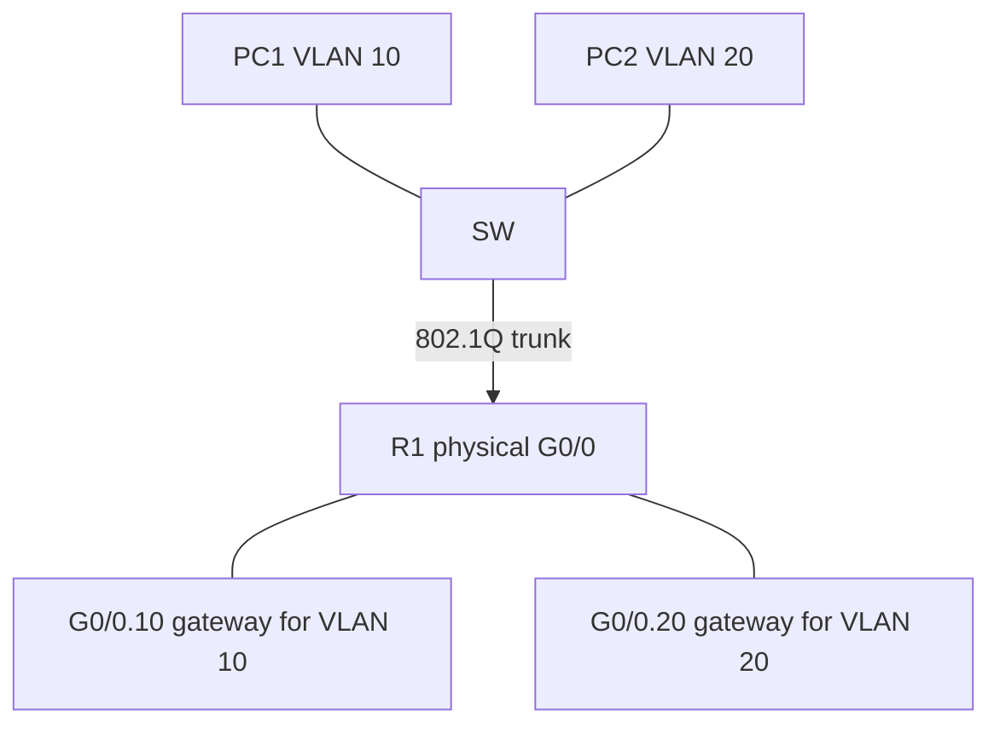

# Day 17 — VLANs, part 2: trunks and router on a stick

## References

### Videos

- [VLANs, part 2, day 17](https://www.youtube.com/watch?v=Jl9OOzNaBDU) — Jeremy's IT Lab
- [VLANs lab, day 17](https://www.youtube.com/watch?v=iRkFE_lpYgc)

### Articles

- [IEEE 802.1Q](https://standards.ieee.org/ieee/802.1Q/6844/)

## Diagram




Day 16 isolated the VLANs. Day 17 connects them to the rest of the network. A **trunk** carries many VLANs on one link between switches, or between a switch and a router. **Router on a stick** uses one of those trunks so a single router interface can be the default gateway for every VLAN.

## Why a trunk exists

Two switches, VLAN 10 and VLAN 20 on both. If you use access ports to connect the switches, one cable carries one VLAN. Two VLANs means two cables, and a third VLAN means a third cable.

A trunk is one cable. Each frame is marked with a VLAN ID so the receiving switch knows which VLAN it belongs to. The PCs still send and receive untagged frames on access ports. Tagging happens on the link between the network devices.

```text
PC1 VLAN10 -- SW1 --trunk-- SW2 -- PC3 VLAN10
PC2 VLAN20 -- SW1            SW2 -- PC4 VLAN20
```

PC1’s broadcast is flooded to every VLAN 10 port on SW1, across the trunk with a VLAN 10 tag, and out every VLAN 10 port on SW2. PC2 and PC4 do not see it.

## 802.1Q

**802.1Q** (dot1q) is the trunk tagging standard you will configure. **ISL** is an old Cisco encapsulation. It wrapped the whole frame, had no native VLAN, and is obsolete. Know the name so you can reject it. Configure dot1q.

The tag is 4 bytes inserted between the source MAC and the EtherType:

```text
| Dest MAC | Src MAC | 802.1Q tag | Type | Payload | FCS |
                     \____________/
                      TPID + TCI
```

| Field | Size | Value |
|-------|------|--------|
| TPID | 16 bits | Always `0x8100`. This is how the receiver knows a tag is present. |
| PCP | 3 bits | Priority (Class of Service) for QoS. |
| DEI | 1 bit | Drop eligibility if the link is congested. |
| VID | 12 bits | The VLAN ID, 0–4095. 0 and 4095 are reserved. Usable VLANs are 1–4094. |

Twelve bits is why VLAN numbers stop at 4094. Normal-range VLANs are 1–1005. Extended-range VLANs are 1006–4094.

The tag makes the frame 4 bytes longer. A full-size Ethernet frame of 1518 bytes becomes 1522 bytes on a trunk. Switches expect that. A device that is not configured for tagging will treat 0x8100 as an unknown EtherType and drop the frame, which is what happens if you plug a PC into a trunk by mistake.

## Native VLAN

802.1Q allows one VLAN on the trunk to travel **untagged**. That VLAN is the **native VLAN**. The default native VLAN is VLAN 1.

- Frames in the native VLAN leave the trunk with no tag.
- Untagged frames that arrive on a trunk are placed in the native VLAN.
- The native VLAN is a property of the **port**, not of the whole switch. Two trunks on one switch can have different native VLANs. Configure both ends.
- A Cisco switch drops a frame that arrives **tagged** with the native VLAN ID. Native-VLAN traffic is supposed to be untagged. A tagged copy is treated as a mismatch.

ISL has no native VLAN. Every ISL frame is encapsulated. If a question depends on untagged traffic, the encapsulation is 802.1Q.

### Native VLAN mismatch

SW1’s trunk uses native VLAN 10. SW2’s end of the same cable uses native VLAN 20.

PC1 in VLAN 10 on SW1 sends a broadcast. SW1 transmits it untagged, because VLAN 10 is native on that port. SW2 receives an untagged frame and delivers it into **its** native VLAN, VLAN 20. A broadcast just crossed from VLAN 10 into VLAN 20.

The link stays up. Pings may even work, in confusing directions. CDP reports:

```text
%CDP-4-NATIVE_VLAN_MISMATCH: Native VLAN mismatch discovered on GigabitEthernet0/1 (10), with SW2 GigabitEthernet0/1 (20).
```

Set the same native VLAN on both ends. A common hardening step is to make the native VLAN an unused VLAN, for example 999, with no access ports in it, so untagged traffic has nowhere useful to go. Do that only when you also remember to match it on the router subinterface if the router is using that native VLAN. For the first lab, matching VLAN 1 on both ends, or matching whatever you explicitly set, is the requirement.

## Trunk configuration on the switch

```text
SW1(config)# interface gigabitEthernet 0/1
SW1(config-if)# description TRUNK-TO-SW2
SW1(config-if)# switchport trunk encapsulation dot1q
SW1(config-if)# switchport mode trunk
SW1(config-if)# switchport trunk native vlan 99
SW1(config-if)# switchport trunk allowed vlan 10,20,99
SW1(config-if)# no shutdown
```

`switchport trunk encapsulation dot1q` is for switches that still offer both ISL and dot1q. A 2960 in Packet Tracer often supports only dot1q and rejects the encapsulation command. If the command is rejected, skip it and set `switchport mode trunk`. The port is still an 802.1Q trunk.

`switchport mode trunk` makes this port a trunk. Do this on both ends.

### Allowed VLANs

By default a trunk allows **all** VLANs. Restricting the list limits broadcast scope and stops a VLAN you did not mean to extend.

```text
switchport trunk allowed vlan 10,20,99
switchport trunk allowed vlan add 30
switchport trunk allowed vlan remove 20
switchport trunk allowed vlan except 99
switchport trunk allowed vlan all
switchport trunk allowed vlan none
```

The first command **replaces** the list. `add` and `remove` edit it. People wipe a working trunk by typing `allowed vlan 30` when they meant `allowed vlan add 30`. After any change, check the list.

### Verify a trunk

```text
SW1# show interfaces trunk
Port        Mode         Encapsulation  Status        Native vlan
Gi0/1       on           802.1q         trunking      99

Port        Vlans allowed on trunk
Gi0/1       10,20,99

Port        Vlans in spanning tree forwarding state and not pruned
Gi0/1       10,20,99
```

`show vlan brief` lists **access** ports under each VLAN. It does not reliably show you the trunk’s allowed list. Use `show interfaces trunk` for trunks. A trunk port sometimes appears under the native VLAN in `show vlan brief`. That does not mean the trunk carries only that VLAN.

`show interfaces g0/1 switchport` shows administrative mode trunk, operational mode trunk, native VLAN, and the allowed VLAN list. Use it when `show interfaces trunk` is empty: an empty list means the port is not trunking. The other end may still be an access port, or the link may be down.

## Router on a stick

Each VLAN needs a default gateway in its subnet. You could connect one physical router interface per VLAN, each as an access port. That works and burns one interface per VLAN.

**Router on a stick** uses a single physical router interface, split into **subinterfaces**. The switch port is a trunk. Each subinterface is the gateway for one VLAN. The router receives a tagged frame and hands it to the subinterface configured with that VLAN ID.

```text
                     R1
                     G0/0  (no IP on the physical interface)
                     |  .10  VLAN 10  192.168.10.1/24
                     |  .20  VLAN 20  192.168.20.1/24
                     |  .30  VLAN 30  192.168.30.1/24
                     |
                    SW1 G0/1 trunk, allows 10,20,30
                   /    |    \
               PC1     PC2    PC3
             VLAN 10  VLAN 20 VLAN 30
```

Switch:

```text
SW1(config)# interface g0/1
SW1(config-if)# switchport mode trunk
SW1(config-if)# switchport trunk allowed vlan 10,20,30
SW1(config-if)# no shutdown
```

Router:

```text
R1(config)# interface gigabitEthernet 0/0
R1(config-if)# no shutdown
R1(config)# interface gigabitEthernet 0/0.10
R1(config-subif)# encapsulation dot1q 10
R1(config-subif)# ip address 192.168.10.1 255.255.255.0
R1(config)# interface gigabitEthernet 0/0.20
R1(config-subif)# encapsulation dot1q 20
R1(config-subif)# ip address 192.168.20.1 255.255.255.0
R1(config)# interface gigabitEthernet 0/0.30
R1(config-subif)# encapsulation dot1q 30
R1(config-subif)# ip address 192.168.30.1 255.255.255.0
```

Details that decide whether the lab works:

- The **physical** interface has no IP address and must be `no shutdown`. Subinterfaces stay down while the physical interface is administratively down.
- The number after the dot is only a label. `g0/0.10` does not have to be VLAN 10. Matching them keeps you sane. The number that must match the VLAN is the argument to `encapsulation dot1q`.
- `encapsulation dot1q` comes **before** the IP address. IOS will not take the address until the encapsulation is set.
- Each subinterface is a connected route. `show ip route` lists 192.168.10.0/24, .20.0/24, and .30.0/24. No static route is required for VLANs that all terminate on this router.
- PCs use the matching gateway: PC1’s gateway is 192.168.10.1, mask /24, and PC1’s switch port is an **access** port in VLAN 10, not a trunk.

### Life of a packet, PC1 to PC2

PC1 (192.168.10.10, VLAN 10) pings PC2 (192.168.20.10, VLAN 20).

1. PC1 sees that PC2 is outside 192.168.10.0/24, so it ARPs for the gateway 192.168.10.1. That ARP stays in VLAN 10. R1’s subinterface G0/0.10 answers. The ARP frame crossed the trunk with a VLAN 10 tag (unless 10 is the native VLAN, in which case it crossed untagged).
2. PC1 sends the ICMP Echo to gateway MAC, destination IP 192.168.20.10.
3. SW1 receives it on an access port, so it knows the frame belongs to VLAN 10, and tags it on the trunk toward R1.
4. R1 accepts it on G0/0.10, decrements TTL, and routes to the connected subnet 192.168.20.0/24.
5. R1 ARPs for 192.168.20.10 out G0/0.20. The ARP request is tagged VLAN 20. SW1 floods it only to VLAN 20 ports. PC2 replies.
6. R1 sends the Echo out G0/0.20, tagged VLAN 20. SW1 strips the tag and delivers an ordinary frame to PC2.

Same story as day 12. The only new fact is that both “router interfaces” share one cable, and the VLAN tag tells the router which interface the frame arrived on.

### Native VLAN on a subinterface

If the trunk’s native VLAN is 99 and the router must route for VLAN 99, that subinterface has to expect **untagged** frames:

```text
R1(config)# interface g0/0.99
R1(config-subif)# encapsulation dot1q 99 native
R1(config-subif)# ip address 192.168.99.1 255.255.255.0
```

Without the `native` keyword, the router looks for a tag of 99 and ignores the untagged frames the switch is actually sending. If your lab leaves the native VLAN at 1 and you do not route VLAN 1, you can skip this. The data VLANs 10, 20, and 30 are tagged, and the configurations above are complete.

## Verify the whole path

```text
R1# show ip interface brief
GigabitEthernet0/0       unassigned      YES unset  up                    up
GigabitEthernet0/0.10    192.168.10.1    YES manual up                    up
GigabitEthernet0/0.20    192.168.20.1    YES manual up                    up

SW1# show interfaces trunk
SW1# show vlan brief
PC1> ping 192.168.20.10
```

| Symptom | Likely cause |
|---------|----------------|
| Physical interface down/down | Cable, or the switch port is shut. |
| Physical interface administratively down | Missing `no shutdown` on the router. Subinterfaces will not come up. |
| Subinterface up, ping to the gateway fails | PC in the wrong VLAN, wrong mask, or the VLAN is missing from `switchport trunk allowed vlan`. |
| Ping to the gateway works, ping to the other VLAN fails | The other subinterface is missing `encapsulation dot1q`, or that VLAN is not allowed on the trunk, or the other PC’s gateway is wrong. |
| CDP native VLAN mismatch | The two ends disagree. Match `switchport trunk native vlan`. |
| `show vlan brief` looks right and the other switch still has no VLAN 10 | You created the VLAN on one switch only. Create it on both. The trunk carries the tag; it does not create the VLAN in the other switch’s database. |

## Check yourself

1. Which field in the 802.1Q tag carries the VLAN number, and how many bits is it?
2. A trunk’s native VLAN is 10. A frame from VLAN 10 leaves this trunk. Is it tagged?
3. You run `switchport trunk allowed vlan 40` on a trunk that already allows 10 and 20. Which VLANs are allowed now?
4. On a router, which command binds subinterface G0/0.20 to VLAN 20?
5. PC1 in VLAN 10 can ping 192.168.10.1 and cannot ping a PC in VLAN 20. The router has both subinterfaces up. Name two things to check on the switch.

## Answers

1. The VID, 12 bits.
2. No. Native-VLAN frames are sent untagged.
3. Only 40. That command replaces the list. Use `switchport trunk allowed vlan add 40` to keep 10 and 20.
4. `encapsulation dot1q 20` on interface G0/0.20, then the IP address.
5. The trunk must allow VLAN 20 (`show interfaces trunk`). The destination PC’s port must be an access port in VLAN 20 (`show vlan brief`). Also confirm VLAN 20 exists. Either miss produces this exact symptom: the local gateway answers, and the other VLAN is silent.
