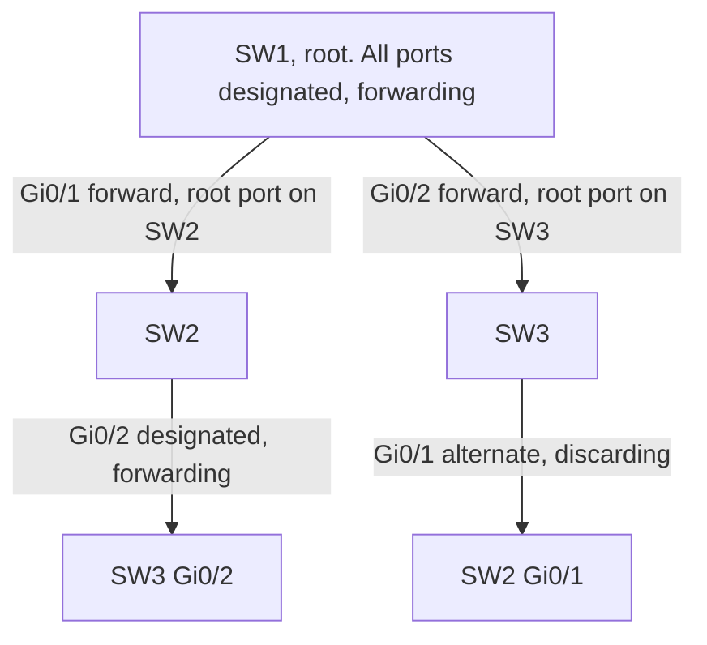

# Spanning tree

A switch floods broadcasts and unknown unicasts. Two cables between the same switches turn that flood into a loop: each switch keeps sending the frame back out the other cable, and the MAC table flaps as the source address appears on both ports. Spanning tree keeps the physical redundancy and blocks one port so the forwarding paths form a tree.

## References

### Videos

- Jeremy’s IT Lab days 20–22 (STP, PVST+, RSTP) in the [Free CCNA v1.1 playlist](https://www.youtube.com/playlist?list=PLxbwE86jKRgMpuZuLBivzlM8s2Dk5lXBQ)
- Keith Barker’s STP videos in the [CCNA playlist](https://www.youtube.com/playlist?list=PLQQoSBmrXmrysEaVNia7KVwf85qATIi1V)

### Articles

- [Packet Traveling series](https://www.practicalnetworking.net/series/packet-traveling/packet-traveling/) for the broadcast behavior STP is containing
- [IEEE 802.1Q, bridges and bridged networks](https://standards.ieee.org/ieee/802.1Q/6844/) (the standard; the CCNA view below is enough to design and to debug)

## Diagram



One link in the triangle does not forward. The other two are the tree. Unplug a forwarding link and the discarding port starts forwarding. That is the redundancy you paid for.

## The tree, in order

Every switch thinks it might be root until it hears a better Bridge ID.

**Bridge ID** = priority + MAC address. Lower wins. Cisco’s default priority is 32768, and per-VLAN STP adds the VLAN number, so VLAN 10’s default priority is 32778. Set the root on purpose. Leaving it to the lowest MAC means a new access switch with a low MAC can become root and pull traffic across an edge link.

```text
SW1(config)# spanning-tree vlan 10 root primary
```

That lowers the priority so SW1 wins. `root secondary` is the backup.

**Path cost** is the cost of the links toward the root, added at each hop. Revised IEEE costs you should remember:

| Speed | Cost |
|-------|------|
| 10 Mbps | 100 |
| 100 Mbps | 19 |
| 1 Gbps | 4 |
| 10 Gbps | 2 |

### Worked example

Three switches in a triangle. Every link is 1 Gbps, cost 4. Priorities: SW1 is 4096, SW2 and SW3 are 32768. SW1 is root.

- SW2’s port toward SW1 is the **root port** (cost 4). The long way, SW2–SW3–SW1, costs 8, so it loses.
- SW3’s port toward SW1 is its root port, for the same reason.
- On the link SW2–SW3, both ends are the same cost from the root (4). The **designated** port is the switch with the better Bridge ID. SW2 has a lower MAC than SW3 in this lab, so SW2’s port is designated and forwarding. SW3’s port is **alternate** and discarding.

A frame from a PC on SW2 to a PC on SW3 goes SW2 → SW1 → SW3, not across the direct link. The direct link is the spare. If you expected the “shortest physical path” and forgot who the root is, the MAC table and the traceroute-like behavior of STP will surprise you.

## Port roles and states

| Role | Meaning |
|------|---------|
| Root | Best port toward the root bridge. One per switch, except the root itself. |
| Designated | Forwarding port for a segment. One per link. The root’s ports are all designated. |
| Alternate | Another path to the root, discarding. This is the backup root port. RSTP’s name. Classic STP just said “blocking.” |
| Backup | A redundant port to the same segment (two cables to a hub, which you will not build). Discarding. |

Classic 802.1D states: blocking, listening, learning, forwarding. Listening and learning each take the forward delay, 15 seconds by default. A port can sit for about 30 seconds, and with max age (20 seconds) a topology change can take about 50 seconds before traffic flows. Host ports should not wait that long.

**RSTP (802.1w)** collapses blocking and listening into **discarding**, keeps learning and forwarding, and uses a proposal/agreement handshake so a point-to-point link can move to forwarding in seconds. Cisco’s Rapid PVST+ runs RSTP per VLAN. It is the default you want on a modern campus.

```text
SW1(config)# spanning-tree mode rapid-pvst
SW1(config)# interface range g0/1 - 20
SW1(config-if-range)# spanning-tree portfast
SW1(config-if-range)# spanning-tree bpduguard enable
```

**PortFast** skips the wait on a port that goes to a single host. **BPDU guard** shuts the port (err-disables it) if a BPDU arrives. That is how you stop someone from plugging a switch into a desk port and either looping the VLAN or becoming root. Never put PortFast on a link to another switch.

## BPDUs

Switches tell each other about the tree with Bridge Protocol Data Units. The important fields are the root ID the sender believes, the cost to that root, and the sender’s own Bridge ID. A switch that hears a better root adopts it and passes the news on.

If BPDUs stop arriving on a blocking port for max age, the switch assumes the old path died and starts using the backup. That is convergence. It is also why a unidirectional link is dangerous: one side still hears BPDUs and stays blocking, the other does not and starts forwarding, and the loop returns. Loop guard and UDLD exist for that failure. Know the symptom even if you do not configure them yet.

## Verify

```text
SW1# show spanning-tree vlan 10
SW1# show spanning-tree interface gigabitEthernet 0/1 detail
```

Read the root ID, which bridge this switch thinks is root, the root port, and each port’s role and state. If the root is an access switch in a closet, fix the priority before you debug anything else.

## Check yourself

1. Two switches are connected by two cables and STP is off. What happens to a broadcast?
2. Which wins as root: priority 32768 with a lower MAC, or priority 4096 with a higher MAC?
3. A port toward the root and a port toward a downstream switch. Which one is the root port?
4. Why is PortFast unsafe on a switch-to-switch link?
5. Roughly how long can classic STP take to move a blocking port to forwarding, and what does RSTP change?

## Answers

1. The broadcast is flooded forever and multiplies. MAC learning flaps. The VLAN becomes unusable.
2. Priority 4096. Priority is compared before the MAC.
3. The port toward the root. The downstream port is designated if this switch is the best bridge on that segment.
4. PortFast goes forwarding immediately and does not wait to hear about a loop. A switch on that port can bridge a loop before STP reacts. BPDU guard is the companion that shuts the port if a BPDU shows up.
5. On the order of 30–50 seconds (forward delay twice, plus max age when the old root information has to expire). RSTP uses a handshake and converges in seconds on point-to-point links.
