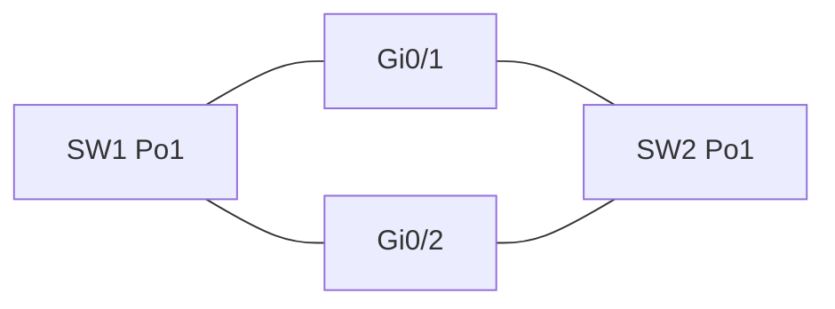

# EtherChannel

Spanning tree keeps a loop-free tree by blocking ports. Two cables between the same switches are what you want for capacity and for failover, and STP’s answer is to idle one of them. EtherChannel bundles those cables into one logical link. STP sees one port, and both cables forward.

## References

### Videos

- Jeremy’s IT Lab EtherChannel day in the [Free CCNA v1.1 playlist](https://www.youtube.com/playlist?list=PLxbwE86jKRgMpuZuLBivzlM8s2Dk5lXBQ)

### Articles

- [IEEE 802.1AX, link aggregation](https://standards.ieee.org/ieee/802.1AX/6768/) — the standard behind LACP. The IOS view below is enough to build the lab.

## Diagram



STP’s view is a single link, Po1. A frame is hashed onto Gi0/1 or Gi0/2. If Gi0/1 fails, traffic moves to Gi0/2 without reconverging the tree.

## The protocols

| Mode you configure | Protocol | Forms a channel with |
|--------------------|----------|----------------------|
| `active` | LACP (IEEE) | `active` or `passive` |
| `passive` | LACP | `active` only. Passive with passive never starts. |
| `desirable` | PAgP (Cisco) | `desirable` or `auto` |
| `auto` | PAgP | `desirable` only |
| `on` | None | The other side must also be `on`. There is no negotiation. |

Use LACP (`active` on both ends) unless you have a reason not to. `on` will bundle even if the other side is not a channel, and it will also refuse to bundle with a neighbor that is negotiating. Mixed `active` and `on` does not come up.

Members of one channel must match: speed, duplex, trunk or access, allowed VLANs, native VLAN. A mismatch suspends the member. Configure the logical interface, and let the members inherit, so you do not update one physical port and forget the other:

```text
SW1(config)# interface range g0/1 - 2
SW1(config-if-range)# channel-group 1 mode active
SW1(config)# interface port-channel 1
SW1(config-if)# switchport mode trunk
SW1(config-if)# switchport trunk allowed vlan 10,20
```

Do this on both switches. The channel-group number is local. Po1 on SW1 may connect to Po2 on SW2. The number does not have to match. The mode and the switchport settings do.

## What hashing actually balances

The switch picks a member by hashing fields from the frame, often source and destination IP:

```text
SW1(config)# port-channel load-balance src-dst-ip
```

One flow stays on one cable. That keeps packets inside a flow in order. It also means a single large transfer between two hosts will not use both links. Twenty independent flows spread. Two links are not “2 Gbps for one copy job.” They are 1 Gbps for each flow, with two flows able to run at once.

STP, MAC learning, and the VLAN all operate on Po1. The MAC table shows `Po1`, not `Gi0/1`. If you expected a MAC on the physical port, look at the port-channel.

### Worked example

SW1 and SW2 have two 1 Gbps links. Without a channel, STP blocks one. VLAN 10’s traffic crosses one link, and a cable cut waits on STP (or on RSTP’s handshake) before the other link forwards.

With LACP active on both sides:

1. `show etherchannel summary` shows `Po1(SU)` and both members with flag `P` (bundled).
2. STP shows one port, Po1, and it is forwarding. There is no alternate port for “the other cable,” because the other cable is inside Po1.
3. Unplug Gi0/1. The member drops. Po1 stays up on Gi0/2. Hosts do not wait 30 seconds. The flows that were hashed onto Gi0/1 move.

`SU` means Layer 2 and in use. A member marked `s` (suspended) or sitting alone in `I` (stand-alone) is the mismatch case: compare speed, trunk mode, and allowed VLANs on both ends before you change STP.

## Routed channels

Routers and Layer 3 switches can bundle links too. The port-channel then has the IP address, and the members have `no switchport`. OSPF and BGP see one neighbor on one subnet, not two. That matters in a [spine-leaf](../05-vpn-services/04-evpn.md) underlay and on firewall uplinks. The negotiation rules are the same.

## Check yourself

1. STP is on, and two switches are connected by two cables with no port-channel. How many of those cables forward?
2. One side is LACP `passive` and the other is LACP `passive`. Does the channel form?
3. Why does a single file transfer often fill only one member of a two-link channel?
4. Does the EtherChannel number have to match on the two switches?
5. After the channel is up, which interface name do you expect in the MAC address table?

## Answers

1. One. STP blocks the other to break the loop. EtherChannel is how you make both forward.
2. No. At least one side must be `active` so that LACP starts the negotiation.
3. The hash pins one flow (one source/destination pair, depending on the algorithm) to one member so that flow stays in order. A second flow can use the other member.
4. No. The number is local to each switch. Speed, duplex, VLANs, and the negotiation mode have to be compatible.
5. The port-channel, for example `Po1`, not the physical member the frame happened to use.
