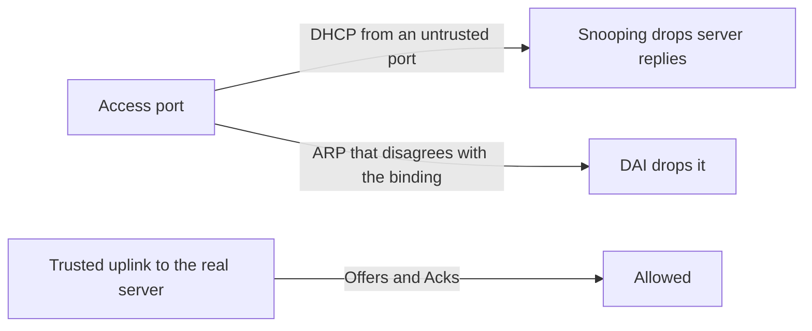

# Layer 2 security

A VLAN is a shared broadcast domain. Anyone who can plug into a port can send a frame that the switch will flood, learn, or trust. Port security, DHCP snooping, and dynamic ARP inspection are how a switch stops treating every port as an equal peer. BPDU guard, which belongs with spanning tree, is the same idea applied to BPDUs: [spanning tree](03-spanning-tree.md).

## References

### Videos

- Jeremy’s IT Lab security days (port security, DHCP snooping, DAI) in the [Free CCNA v1.1 playlist](https://www.youtube.com/playlist?list=PLxbwE86jKRgMpuZuLBivzlM8s2Dk5lXBQ)

### Articles

- [DHCP and DNS](../01-fundamentals/16-dhcp-and-dns.md) — the lease this note is protecting
- [Ethernet switching, part 2](../01-fundamentals/06-ethernet-switching-2.md) — ARP, which DAI is checking

## Diagram



Trust the port that faces your DHCP server or your uplink. Do not trust the port that faces a desk.

## Port security

The switch already learns MAC addresses. Port security caps how many, and which, may be learned on an access port.

```text
SW1(config)# interface g0/1
SW1(config-if)# switchport mode access
SW1(config-if)# switchport port-security
SW1(config-if)# switchport port-security maximum 2
SW1(config-if)# switchport port-security violation shutdown
SW1(config-if)# switchport port-security mac-address sticky
```

`sticky` writes the learned MACs into the running config so a reload keeps them. Save the config or they disappear.

| Violation | What happens to extra frames |
|-----------|------------------------------|
| shutdown | The port goes **err-disabled**. This is the default, and the one you want on a desk port. |
| restrict | Drops the extra frames and counts them. The port stays up. |
| protect | Drops the extra frames and does not tell you. Avoid it. You will debug a silent drop. |

Err-disable is an operational state, not a VLAN. The interface is down until someone shuts and no-shuts it, or until errdisable recovery is configured. A port that is err-disabled because of port security is doing what you asked. Check `show port-security interface g0/1` before you cycle it and invite the same MAC back.

Port security on a trunk, or on an AP port that legitimately presents many client MACs, will shut the uplink. Use it on access ports toward single hosts. A phone plus a PC behind the phone is why `maximum 2` exists. Count the MACs you expect.

## DHCP snooping

A rogue DHCP server on a desk port can answer Discovers faster than your server and hand out its own address as the gateway. Every host that accepts the lease forwards traffic to the attacker.

**DHCP snooping** drops DHCP server messages (Offer and Ack) that arrive on **untrusted** ports. Trusted ports are the uplink and the real server.

```text
SW1(config)# ip dhcp snooping
SW1(config)# ip dhcp snooping vlan 10
SW1(config)# interface g0/24
SW1(config-if)# ip dhcp snooping trust
```

Gi0/24 in that example is the uplink, so it is trusted. Host ports stay untrusted, which is the default. The switch records each successful lease in the **binding table**: MAC, IP, VLAN, port, lease time.

```text
SW1# show ip dhcp snooping binding
```

If the uplink is untrusted, the real server’s Offers are dropped and nobody gets an address. That is the usual reason a network “breaks when snooping is turned on.” Trust the port the leases come from. Then turn it on per VLAN you mean to protect.

The binding table is the input to the next feature. Snooping without a working table means DAI will deny legitimate hosts.

## Dynamic ARP inspection

ARP has no authentication. A host can answer “192.168.10.1 is at my MAC” and the other hosts will update their caches. That is ARP spoofing, and the gateway is the valuable target.

**DAI** checks ARP against the DHCP snooping binding. An ARP on an untrusted port that claims an IP/MAC pair absent from the table is dropped. Trusted ports, again the uplinks, are not inspected.

```text
SW1(config)# ip arp inspection vlan 10
SW1(config)# interface g0/24
SW1(config-if)# ip arp inspection trust
```

A host with a **static** IP never went through DHCP, so it has no binding, and DAI drops its ARP. Add a static binding, or inspection will look like a random failure for printers and servers. Validate on a VLAN with DHCP clients first.

**IP source guard** is the third step, optional in a first lab: it drops IP packets whose source is not the address DHCP gave that port. The order is snooping, then DAI, then source guard. Source guard with an empty binding table blackholes the VLAN.

### Worked example

VLAN 10, one DHCP server reached through Gi0/24. A laptop on Gi0/7 starts answering DHCP and sending gratuitous ARPs for the gateway.

1. Port security on Gi0/7 is unrelated to this attack if the laptop is using its own single MAC. It will not stop a bad payload.
2. DHCP snooping, Gi0/24 trusted, VLAN 10 enabled: the laptop’s DHCP Offers are dropped. Clients keep leasing from the real server. The binding table fills.
3. DAI on VLAN 10, Gi0/24 trusted: the laptop’s fake ARP for 192.168.10.1 is dropped, because that IP is bound to the router’s MAC on a different port.
4. Clients keep the gateway MAC they learned from a real ARP.

Turn the features on in that order, on one VLAN, and read the binding table before you enable DAI. Enabling DAI campus-wide on the same afternoon as snooping, with no bindings yet, is how every ARP fails at once.

## Check yourself

1. A port-security violation of shutdown puts the interface in which state?
2. Which DHCP messages should an untrusted port be allowed to send, and which should it not?
3. Why does DAI depend on DHCP snooping?
4. A server uses a static IP and DAI is enabled. Why does its ARP fail, and what do you add?
5. Where does BPDU guard fit relative to these three features?

## Answers

1. Err-disabled. The port is down until it is recovered. Traffic from the offending MAC stops.
2. It may send client messages (Discover, Request). Offers and Acks from a server are dropped, because a desk port is not a DHCP server.
3. DAI compares ARP senders to the binding table that snooping builds. With no table, a legitimate client looks like a spoof.
4. There is no DHCP binding for that address. Add a static snooping binding, or exclude that port in a way your platform documents, before the server can ARP.
5. It is the spanning-tree equivalent: a host port that receives a BPDU is shut, so a plugged-in switch cannot join the tree or become root. Configure it with PortFast on access ports, in the spanning tree note.
