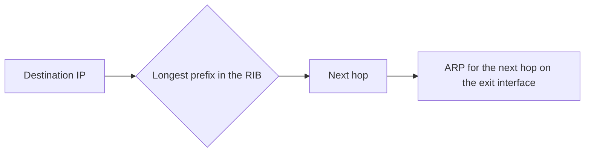

# Day 11 — Routing fundamentals and static routes

## References

### Videos

- [Routing fundamentals, day 11 part 1](https://www.youtube.com/watch?v=aHwAm8GYbn8) — Jeremy's IT Lab
- [Static routing, day 11 part 2](https://www.youtube.com/watch?v=YCv4-_sMvYE)
- [Configuring static routes lab](https://www.youtube.com/watch?v=XHxOtIav2k8)
- [Troubleshooting static routes lab](https://www.youtube.com/watch?v=3z8YGEVFTiA)

### Articles

- [Host to host through a router](https://www.practicalnetworking.net/series/packet-traveling/host-to-host-through-a-router/)

## Diagram




A router’s job is the IP header you just studied: look at the destination address, find the best matching route, and hand the packet to the next hop. Day 11 is the routing table and the routes you type by hand. Connected routes are already there from day 8. Static routes are how you reach networks that are not directly attached.

## What a route contains

```text
R1# show ip route
Codes: C - connected, S - static, L - local, O - OSPF, D - EIGRP, R - RIP
       S* - static default

      192.168.1.0/24 is variably subnetted, 2 subnets, 2 masks
C        192.168.1.0/24 is directly connected, GigabitEthernet0/0
L        192.168.1.1/32 is directly connected, GigabitEthernet0/0
S        10.1.1.0/24 [1/0] via 192.168.1.2
S*       0.0.0.0/0 [1/0] via 203.0.113.1
```

| Piece | In the example | Meaning |
|-------|----------------|---------|
| Code | `S` | How the route was learned. |
| Prefix and mask | `10.1.1.0/24` | Which destinations this route covers. |
| [AD/metric] | `[1/0]` | Administrative distance 1, metric 0. Lower is better, for each number separately. |
| via | `192.168.1.2` | Next hop. The router ARPs for this address and sends the frame there. |
| Interface | `GigabitEthernet0/0` on the connected route | The exit. For a static route that names only a next hop, IOS finds the exit by a second lookup of the next-hop address. |

**Connected (C).** The subnet on an up/up interface. AD 0. You do not type these.

**Local (L).** A /32 for the router’s own interface address. Traffic to the router itself matches this. AD 0.

**Static (S).** Typed by you. AD 1 by default.

The other codes (O, D, R) are dynamic protocols. They show up in this output later. You only need the letters for now.

## Longest prefix match

Forwarding uses the route whose prefix matches the destination and has the **most network bits**.

### Worked example

The table contains:

- `10.1.1.0/24` via R2
- `10.1.1.128/25` via R3
- `0.0.0.0/0` via R4

| Destination | Winning route | Why |
|-------------|---------------|-----|
| 10.1.1.10 | 10.1.1.0/24 via R2 | It matches /24. It does not match /25, because .10 is below 128. |
| 10.1.1.200 | 10.1.1.128/25 via R3 | It matches both /24 and /25. /25 is longer, so it wins. |
| 8.8.8.8 | 0.0.0.0/0 via R4 | Nothing more specific matches. The default is the shortest possible prefix. |

A more specific route wins even when it was learned by a protocol you trust less. Administrative distance is not consulted between these three, because they are different prefixes. All three can sit in the table at once.

## Administrative distance

When two sources offer the **same** prefix, the lower AD is installed. The other candidate is kept as a backup only if the protocol supports it (a floating static route works this way). It is not used for forwarding while the winner is present.

| Source | AD |
|--------|----|
| Connected | 0 |
| Static | 1 |
| eBGP | 20 |
| EIGRP (internal) | 90 |
| OSPF | 110 |
| IS-IS | 115 |
| RIP | 120 |
| EIGRP (external) | 170 |
| iBGP | 200 |
| Unusable | 255 |

You will not configure EIGRP or BGP in this block of days. Learn the column now, because static versus OSPF is the comparison that bites people: a static route to 10.1.1.0/24 (AD 1) hides an OSPF route to the same prefix (AD 110). The OSPF route is in the database and absent from the routing table. If that surprises you during a later lab, check for a static route you forgot.

**Metric** breaks a tie only after the route is coming from the same source. Two static routes to the same prefix with the same AD can both be installed and share traffic. Two OSPF routes to the same prefix compare OSPF cost. You do not compare an OSPF cost number with an EIGRP metric number. AD decides first, and they are different sources, so the metrics are never compared.

## Static routes

```text
R1(config)# ip route 10.1.1.0 255.255.255.0 192.168.12.2
```

Read it as: “To reach network 10.1.1.0, mask 255.255.255.0, forward the packet to next hop 192.168.12.2.”

The next hop must be reachable by a connected route (or by another route already in the table). 192.168.12.2 should be the address of the neighboring router on a subnet R1 is attached to. If the next hop is not reachable, the static route is installed in the configuration and stays **out** of the routing table. `show ip route` will not list it. `show running-config` will. That difference is your troubleshooting clue.

### Exit interface, next hop, or both

```text
ip route 10.1.1.0 255.255.255.0 GigabitEthernet0/0
ip route 10.1.1.0 255.255.255.0 GigabitEthernet0/0 192.168.12.2
ip route 10.1.1.0 255.255.255.0 192.168.12.2
```

| Form | When it is right |
|------|------------------|
| Next hop only | The normal choice on Ethernet. IOS resolves the next hop to an exit interface with a recursive lookup, then ARPs for the next hop. |
| Exit interface only | Fine on a point-to-point serial link, where the other end is the only possible neighbor. On Ethernet, the router may ARP for **every** destination address, as if each remote host were on the local LAN. That depends on proxy ARP and does not scale. |
| Both | Explicit and safe on Ethernet. The route does not depend on a second lookup. |

Use next-hop IP on Ethernet labs. Add the exit interface when you want the route to be obvious in `show ip route`.

### Default route

```text
R1(config)# ip route 0.0.0.0 0.0.0.0 203.0.113.1
```

This matches every destination that nothing more specific matches. An edge router uses it to point at the ISP. A small site’s internal routers might use a default toward the core instead of learning every remote subnet.

`S*` in `show ip route` is a static default. The gateway of last resort line at the top of the table echoes it.

### Floating static route

```text
R1(config)# ip route 10.1.1.0 255.255.255.0 192.168.12.2
R1(config)# ip route 10.1.1.0 255.255.255.0 192.168.13.3 5
```

The second route has AD 5. The first has AD 1, so only the first is used. If G0/0 toward 192.168.12.2 goes down and that next hop becomes unreachable, the AD 1 route leaves the table and the AD 5 route takes over. This is a backup link. Pick an AD higher than the primary route and lower than any dynamic route you do not want to beat.

## A three-router example

```text
PC1 ---- R1 G0/0 192.168.1.1/24
         R1 G0/1 10.0.12.1/30 ---- R2 G0/0 10.0.12.2/30
                                   R2 G0/1 192.168.2.1/24 ---- PC2
```

R1 already knows 192.168.1.0/24 and 10.0.12.0/30 as connected. It does not know 192.168.2.0/24.

```text
R1(config)# ip route 192.168.2.0 255.255.255.0 10.0.12.2
```

R2 needs the return path, or PC2’s replies die at R2:

```text
R2(config)# ip route 192.168.1.0 255.255.255.0 10.0.12.1
```

One-way static routing is the most common lab failure. Ping from PC1 fails, and the instinct is to stare at R1. Check the route **back** to PC1’s subnet on every router the reply must cross.

Verify:

```text
R1# show ip route 192.168.2.0
R1# ping 192.168.2.1
PC1> ping 192.168.2.10
```

Ping the far router’s interface before you ping the far PC. If the router answers and the PC does not, the PC’s mask or gateway is wrong. If the router does not answer, the route or the link is wrong.

## Troubleshooting order

Use this list in the day 11 troubleshooting lab. Stop at the first failure.

1. `show ip interface brief` on every router. Both ends of each link must be up/up, with the address you think.
2. Confirm the two ends of a link are in the **same** subnet. 10.0.12.1/30 and 10.0.12.2/30 are. 10.0.12.1/30 and 10.0.12.5/30 are not: /30 only contains .0 network, .1 and .2 hosts, .3 broadcast.
3. `show ip route` on the source router. Is there a matching route, and is the next hop the address you intended?
4. Check the same on the next router, and check the **return** route.
5. On the PCs, confirm the gateway is the near router’s address, inside the PC’s subnet.
6. Only then check an access list. Matching and placement are in [ACLs](08-acls.md). If this lab never configured one, the failure is still in steps 1–5.

A route can be in the running config and missing from the table when the next hop is not reachable or the exit interface is down. Fix the next hop. Do not add a second static route on top of a broken one until you know why the first is absent.

## Check yourself

1. A packet matches a /24 and a /28. Which route forwards it?
2. OSPF offers 10.0.0.0/8 with AD 110, and a static route offers 10.0.0.0/8 with AD 1. Which one is in the routing table?
3. Write a static route on R1 so that 172.16.5.0/24 is reached via next hop 10.1.1.2.
4. Why is an exit-interface-only static route a poor fit for Ethernet?
5. PC1 can ping R1. PC1 cannot ping PC2 behind R2. R1 has a static route to PC2’s subnet. Name the most likely missing configuration.

## Answers

1. The /28. Longest prefix match.
2. The static route. Same prefix, lower AD wins.
3. `ip route 172.16.5.0 255.255.255.0 10.1.1.2`
4. The router does not have a next-hop address to ARP for, so on a multi-access network it ends up ARPing for each final destination and relying on proxy ARP.
5. The return route on R2 (and on any router between them) toward PC1’s subnet. R1 knowing the way there does not tell R2 the way back.
