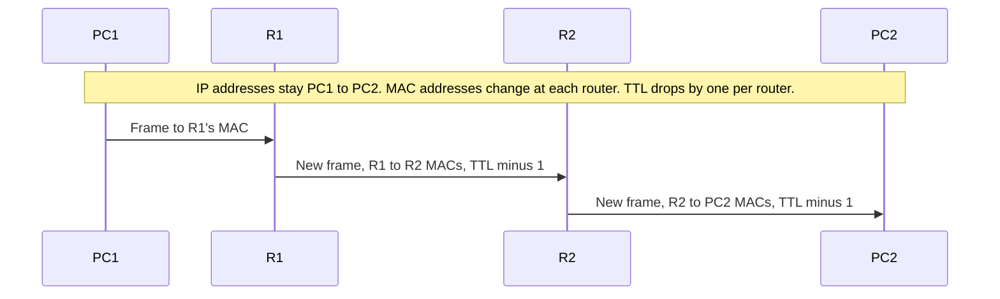

# Day 12 — Life of a packet

## References

### Videos

- [The life of a packet, day 12](https://www.youtube.com/watch?v=4YrYV2io3as) — Jeremy's IT Lab
- [Life of a packet lab](https://www.youtube.com/watch?v=bfsEqDeHbpI)
- [Packet Traveling on YouTube](https://www.youtube.com/watch?v=rYodcvhh7b8)

### Articles

- [Key players](https://www.practicalnetworking.net/series/packet-traveling/key-players/)
- [Host to host through a router](https://www.practicalnetworking.net/series/packet-traveling/host-to-host-through-a-router/)
- [Series finale](https://www.practicalnetworking.net/series/packet-traveling/packet-traveling-series-finale/)

## Diagram




This day stitches day 6 and day 11 into one story. Pick a packet and follow it. At every device, name the source and destination IP, the source and destination MAC, and which table the device uses. If you can do that on a blank diagram, the rest of the notes have somewhere to sit.

Two steps happen before this story. The host learns its address, mask, gateway, and DNS server from [DHCP](../01-fundamentals/16-dhcp-and-dns.md), and it learns the destination IP by resolving a name. This note begins once the IP packet exists.

## The rules, in one place

1. A host sends directly to a destination on its own subnet. It ARPs for that destination’s MAC.
2. A host sends everything else to its default gateway. It ARPs for the gateway’s MAC. The IP destination is still the far host.
3. A switch forwards the frame. It does not change IP or MAC. It does not decrement TTL.
4. A router strips the frame, decrements TTL, looks up the destination IP, and builds a **new** frame for the next hop.
5. The return packet is a separate life story. Every router needs a route in both directions.

## Lab topology

```text
PC1                          PC2
192.168.1.10/24              192.168.2.10/24
MAC AAAA                     MAC DDDD
gw 192.168.1.1               gw 192.168.2.1
        |                            |
      SW1                          SW2
        |                            |
   R1 G0/0                       R2 G0/1
   192.168.1.1/24                192.168.2.1/24
   MAC BBBB                      MAC CCCC
        |                            |
   R1 G0/1 ------ 10.0.12.0/30 ------ R2 G0/0
   10.0.12.1                     10.0.12.2
   MAC EEEE                      MAC FFFF
```

Static routes:

- R1: `ip route 192.168.2.0 255.255.255.0 10.0.12.2`
- R2: `ip route 192.168.1.0 255.255.255.0 10.0.12.1`

PC1 pings PC2. ARP tables and MAC tables start empty. TTL starts at 64.

## Step by step

### 1. PC1 decides the destination is remote

PC1’s subnet is 192.168.1.0/24. 192.168.2.10 is outside it. PC1 will send the packet to 192.168.1.1.

PC1 has no ARP entry for 192.168.1.1, so it broadcasts an ARP request. SW1 floods it. R1 replies. PC1 learns `192.168.1.1 → BBBB`. SW1 learns MAC AAAA on PC1’s port and MAC BBBB on R1’s port.

### 2. PC1 sends the ICMP Echo

| Field | Value |
|-------|--------|
| Source IP | 192.168.1.10 |
| Destination IP | 192.168.2.10 |
| Source MAC | AAAA (PC1) |
| Destination MAC | BBBB (R1 G0/0) |
| TTL | 64 |

SW1 forwards the frame out the port toward R1. The frame is unchanged.

### 3. R1 routes

R1 checks the FCS, removes the Ethernet header, and sees destination IP 192.168.2.10.

- TTL becomes 63.
- The routing table matches 192.168.2.0/24, next hop 10.0.12.2, out G0/1.
- 10.0.12.2 is on a connected subnet, so R1 ARPs on G0/1 if needed and learns MAC FFFF.

New frame, same packet:

| Field | Value |
|-------|--------|
| Source IP | 192.168.1.10 |
| Destination IP | 192.168.2.10 |
| Source MAC | EEEE (R1 G0/1) |
| Destination MAC | FFFF (R2 G0/0) |
| TTL | 63 |

The IP addresses did not change. Both MAC addresses did.

### 4. R2 routes

R2’s lookup of 192.168.2.10 matches the **connected** network on G0/1. The next hop is PC2 itself, not another router.

- TTL becomes 62.
- R2 ARPs for 192.168.2.10 on G0/1. SW2 floods that ARP. PC2 replies. R2 learns MAC DDDD.
- SW2 learns FFFF is not involved here; it learns R2’s G0/1 MAC (CCCC) and PC2 (DDDD).

New frame:

| Field | Value |
|-------|--------|
| Source IP | 192.168.1.10 |
| Destination IP | 192.168.2.10 |
| Source MAC | CCCC (R2 G0/1) |
| Destination MAC | DDDD (PC2) |
| TTL | 62 |

SW2 delivers it to PC2.

### 5. PC2 replies

PC2 builds an ICMP Echo Reply. Source IP 192.168.2.10, destination IP 192.168.1.10. That destination is remote, so the frame goes to PC2’s gateway, R2, MAC CCCC. PC2 already learned CCCC from the ARP exchange.

R2 looks up 192.168.1.0/24, next hop 10.0.12.1. R1 looks up 192.168.1.10 as connected and delivers the frame to PC1 via SW1, destination MAC AAAA.

If R2 did not have `ip route 192.168.1.0 255.255.255.0 10.0.12.1`, the Echo would reach PC2 and the Echo Reply would be dropped at R2. PC1 would show “request timed out.” The outbound route being correct is not enough.

## Same subnet, for contrast

PC1 pings 192.168.1.50, another host on SW1.

- No router is involved.
- PC1 ARPs for 192.168.1.50, not for the gateway.
- Source and destination MAC are the two PCs.
- TTL is unchanged end to end, because no router forwarded the packet.
- SW1’s MAC table is the only forwarding table that matters.

If you are unsure whether a router will touch a flow, compare the destination with the sender’s mask. Same network means Layer 2 only.

## What each device stores after the ping

| Device | Table | Learned |
|--------|-------|---------|
| PC1 | ARP | 192.168.1.1 is BBBB. PC1 never learns PC2’s MAC. |
| PC2 | ARP | 192.168.2.1 is CCCC. PC2 never learns PC1’s MAC. |
| R1 | ARP | 192.168.1.10 is AAAA on G0/0. 10.0.12.2 is FFFF on G0/1. |
| R1 | Routing | Connected routes plus the static route to 192.168.2.0/24. |
| R2 | ARP | 10.0.12.1 is EEEE on G0/0. 192.168.2.10 is DDDD on G0/1. |
| SW1 | MAC | AAAA toward PC1, BBBB toward R1. |
| SW2 | MAC | DDDD toward PC2, CCCC toward R2. |

The switches never learn 192.168.2.10. The PCs never learn the far MAC. That split is the definition of Layer 2 versus Layer 3.

## A second packet is shorter

The ARP entries and MAC entries are already there, so the second ping skips the broadcasts. You still rewrite the frame at R1 and again at R2, and you still decrement TTL twice. Cache hits remove ARP. They do not remove routing.

Entries age out. If you wait long enough, the next ping broadcasts again. A failed ping after a topology change is often a stale ARP entry pointing at a MAC that has moved. `clear arp-cache` on a router forces a fresh ARP. On a switch, a host that moved ports is updated when the switch sees a frame with that source MAC on the new port; until then, frames may leave the old port.

## How to practice

Draw a new topology with three routers and do not look at this page. Pick a ping. Fill a table with four rows per hop: source IP, destination IP, source MAC, destination MAC. Then check:

- IPs constant across all rows of the outbound journey.
- MACs change at every router, and only at routers.
- TTL drops by one at every router.
- The gateway MAC, not the far host MAC, is on the first frame.
- Somewhere, a static or connected route justifies each router’s choice of next hop.
- A matching route exists in the reverse direction.

## Check yourself

1. PC1 and PC2 are on different subnets. Does PC1 ever learn PC2’s MAC address during a ping?
2. Which device decrements TTL: the switch, the router, or both?
3. A frame arrives at R1 with destination MAC BBBB and destination IP 192.168.2.10. What is the destination MAC of the frame R1 sends to R2?
4. The ping reaches PC2, and PC1 still says timed out. Where do you look?
5. Two hosts in the same VLAN ping each other. Does the default gateway’s MAC appear in the frame?

## Answers

1. No. PC1 learns the gateway’s MAC. PC2’s MAC is only used on PC2’s own LAN, by R2.
2. The router. A switch forwards the frame without reading the IP header.
3. R2’s MAC on the link that faces R1 (FFFF in the diagram). R1 also uses its own G0/1 MAC as the source.
4. The return route. R2 must have a path to 192.168.1.0/24. Then check PC2’s gateway.
5. No. The destination is local, so the frame’s destination MAC is the other host. The gateway is used only for remote destinations.
