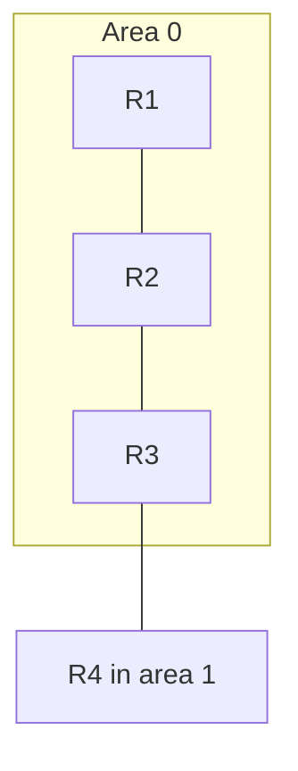

# OSPF

OSPF is a link-state IGP. Every router in an area describes its links, every router stores the same database, and each router runs SPF and builds a shortest-path tree rooted at itself. The result is a loop-free route to each prefix, with a cost you can explain from the topology. Static routes do not do that. BGP is not trying to be an IGP.

## References

### Videos

- Jeremy’s IT Lab OSPF days (26–28) in the [Free CCNA v1.1 playlist](https://www.youtube.com/playlist?list=PLxbwE86jKRgMpuZuLBivzlM8s2Dk5lXBQ)
- Keith Barker’s OSPF block in the [CCNA playlist](https://www.youtube.com/playlist?list=PLQQoSBmrXmrysEaVNia7KVwf85qATIi1V)

### Articles

- [Jeremy’s CCNA notes](https://www.jeremysitlab.com/ccna-resources/)
- [RFC 2328, OSPF version 2](https://datatracker.ietf.org/doc/html/rfc2328)

## Diagram



Area 0 is the backbone. Another area touches the backbone through an area border router. R3 is an ABR: it has a link in area 0 and a link in area 1. Traffic between non-backbone areas goes through area 0.

## Neighbors, then the database, then routes

Routers do not exchange the whole database with strangers. They become **adjacent**, then they synchronize link-state advertisements (LSAs), then they run Dijkstra.

On a broadcast link (Ethernet) the hello interval is 10 seconds and the dead interval is 40. These must match, along with the area, the subnet, and the authentication. A mismatch leaves the neighbor in a state that never reaches Full, and no routes appear.

Hello packets go to `224.0.0.5` (all OSPF routers). On a broadcast segment, a **designated router** and a **backup** are elected so that every other router becomes adjacent with the DR, not with everybody. DR election uses the highest priority, then the highest router ID. Priority 0 means “do not elect me.” Traffic is not sent to the DR. The DR is only a control-plane role. Point-to-point links have no DR. Set WAN Ethernet links as point-to-point so you do not wait on a DR election:

```text
R1(config)# interface g0/1
R1(config-if)# ip ospf network point-to-point
```

Neighbor states worth recognizing: Down, Init (I heard you), 2-Way (we agree we are neighbors; this is enough for a non-DR on Ethernet), ExStart, Exchange, Loading, Full. **Full** means the databases match. `show ip ospf neighbor` is the first command when OSPF is “up” and the route is missing. 2-Way on a DR link is normal for two non-DR routers. 2-Way on a point-to-point link is not. That link should be Full.

## Router ID and cost

The router ID is a 32-bit number written like an IPv4 address. It is not required to be a reachable address, but it should be stable. Set it, and give the router a loopback in the IGP so other routers can reach that identifier:

```text
R1(config)# router ospf 1
R1(config-router)# router-id 1.1.1.1
R1(config)# interface loopback 0
R1(config-if)# ip address 1.1.1.1 255.255.255.255
```

Cost of an interface is `reference bandwidth / interface bandwidth`. The default reference is 100 Mbps, so a 100 Mbps link costs 1, and both 1 Gbps and 10 Gbps also cost 1. Fast links look identical and OSPF will not prefer the 10 Gbps path. Raise the reference on every router to the same value:

```text
R1(config-router)# auto-cost reference-bandwidth 100000
```

The unit is Mbps, so 100000 means 100 Gbps. A 10 Gbps link then costs 10, a 1 Gbps link costs 100. Do this everywhere. Mismatched reference bandwidth means mismatched costs and asymmetric paths.

## LSAs you will actually see

| Type | Name | What it carries |
|------|------|-----------------|
| 1 | Router | A router’s links inside one area. Flooded inside the area. |
| 2 | Network | The subnet of a broadcast segment, originated by the DR. |
| 3 | Summary | An ABR telling one area about a prefix in another area. It is a distance, not the full topology. |
| 4 | ASBR summary | How to reach the router that injected a type 5. Without it, area routers know the external prefix and have no path to the advertiser. |
| 5 | External | A prefix redistributed into OSPF from BGP, static, or another protocol. Flooded through normal areas. |
| 7 | NSSA external | A type 5 that is allowed to originate inside a not-so-stubby area. The ABR translates it to a type 5 for the rest of the domain. |

Type 3 is why an area can stay small. Routers in area 1 do not run SPF on area 0’s links. They receive “10.1.0.0/16 is this way, cost N” from the ABR. The cost of losing that detail is that a suboptimal path across areas is possible. The gain is that a flap in area 0 does not recompute every router in area 1 from scratch.

**Stub areas** shrink the database further. A stub area blocks type 5 externals and installs a default route from the ABR. A totally stubby area also blocks type 3, so the area has only its local LSAs plus a default. An NSSA is a stub that still needs to inject a few external prefixes, which travel as type 7 until the ABR converts them. Use a stub when the area has one exit and no reason to carry the Internet, or every customer route, inside it.

IPv6 uses **OSPFv3**, a separate process from the OSPFv2 configuration above. Areas, DR election, and the LSA idea are the same shape. The [IPv6 note](../01-fundamentals/15-ipv6.md) is the address side.

## A minimal configuration

```text
R1(config)# router ospf 1
R1(config-router)# router-id 1.1.1.1
R1(config-router)# network 10.0.12.0 0.0.0.3 area 0
R1(config-router)# network 1.1.1.1 0.0.0.0 area 0
```

The network statement uses a **wildcard mask**, not a subnet mask. Invert each octet of the subnet mask: `255.255.255.252` (/30) becomes `0.0.0.3`, and `255.255.255.0` (/24) becomes `0.0.0.255`. A 0 bit must match the address in the statement. A 1 bit is ignored. The same wildcard shows up again on [access lists](08-acls.md). The modern alternative enables OSPF on the interface and avoids a wildcard mistake:

```text
R1(config)# interface g0/0
R1(config-if)# ip ospf 1 area 0
```

Process number `1` is local. It does not have to match the neighbor. The area does.

### Worked failure

Two routers share 10.0.12.0/30. R1 is in area 0, R2 was configured in area 1 on that same link. Hellos arrive and are ignored because the area does not match. `show ip ospf neighbor` is empty. The fix is one area on that link. Areas change at the ABR, on different interfaces, not in the middle of a subnet.

## Check yourself

1. What does the designated router forward that other routers do not?
2. Two routers on a point-to-point link sit in 2-Way. Is the adjacency finished?
3. Under the default reference bandwidth, what is the OSPF cost of a 10 Mbps link, a 100 Mbps link, and a 10 Gbps link? Why is the 10 Gbps result a problem?
4. Which LSA lets area 1 learn a prefix from area 0 without learning area 0’s topology?
5. A `network` statement uses `0.0.0.255` for a /24. What kind of mask is that?

## Answers

1. Nothing in the data plane. The DR is the control-plane hub for adjacencies and originates the type 2 LSA.
2. No. Point-to-point neighbors should reach Full. 2-Way is a finished state only between two non-DR routers on a broadcast segment.
3. 10, 1, and 1. Cost is reference bandwidth divided by interface bandwidth, with a floor of 1. The default reference is 100 Mbps, so 10 Mbps costs 10 and anything at or above 100 Mbps costs 1. OSPF will not prefer a 10 Gbps link over a 100 Mbps link until you raise `auto-cost reference-bandwidth` on every router.
4. Type 3, the summary LSA, originated by the ABR.
5. A wildcard mask. The subnet mask would be `255.255.255.0`.
