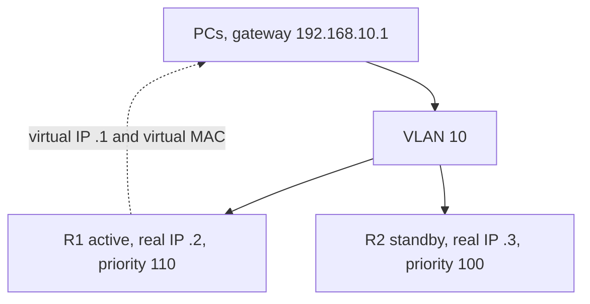

# Gateway redundancy

Every host note so far ends with one default gateway. If that router reboots, the hosts still ARP for its IP, and nothing answers, even though a second router is sitting on the same VLAN. First-hop redundancy gives the hosts one virtual gateway address and moves that address between routers. The hosts do not learn a new gateway. [DHCP](../01-fundamentals/16-dhcp-and-dns.md) keeps handing out the virtual address.

This is a different problem from [high availability](../08-operations/02-high-availability.md). That note is a route processor restarting while the same box keeps forwarding. This note is two boxes, and the LAN’s gateway IP moving between them.

## References

### Videos

- Jeremy’s IT Lab HSRP day in the [Free CCNA v1.1 playlist](https://www.youtube.com/playlist?list=PLxbwE86jKRgMpuZuLBivzlM8s2Dk5lXBQ)

### Articles

- [RFC 5798, VRRP](https://datatracker.ietf.org/doc/html/rfc5798)

## Diagram



The PCs never configure .2 or .3. They ARP for .1 and receive the virtual MAC of whichever router is active.

## HSRP

**HSRP** is Cisco’s protocol. Routers in one group share a virtual IP. The **active** router owns the virtual MAC and answers ARP. The **standby** waits. Others, if you have them, are listening.

```text
R1(config)# interface gigabitEthernet 0/0
R1(config-if)# ip address 192.168.10.2 255.255.255.0
R1(config-if)# standby 10 ip 192.168.10.1
R1(config-if)# standby 10 priority 110
R1(config-if)# standby 10 preempt
```

R2 uses 192.168.10.3, the same `standby 10 ip`, and a lower priority (the default is 100). Higher priority wins. Group 10 is local to the interface’s LAN. The virtual IP must be in the subnet and must not be one of the routers’ real interface addresses in classic HSRP.

**Preempt** lets a router that was down take the active role back when it returns with a better priority. Without preempt, the original standby stays active after the failure heals, which is sometimes what you want and often what surprises you. HSRP does not preempt by default. If you set a priority, also decide whether preempt is on.

HSRP version 1’s virtual MAC is `0000.0c07.acXX`, where XX is the group in hex. Group 10 is `0000.0c07.ac0a`. The switch learns that MAC on the active router’s port. When the active router fails, hellos stop (default hello 3 seconds, hold 10). The standby becomes active and sends a gratuitous ARP. The switch relearns the same virtual MAC on the other port. Hosts keep their ARP entry. They do not DHCP again.

Both routers need a route to the rest of the network. The active router is the only one receiving the hosts’ packets. If the active router has lost its uplink and HSRP has not noticed, it is a black hole with a healthy LAN hello. Track the uplink so the priority drops when the WAN interface goes down:

```text
R1(config-if)# standby 10 track gigabitEthernet 0/1 20
```

Priority 110 minus 20 is 90, which loses to R2’s 100, if preempt is enabled on R2 as well. Track without preempt on the neighbor does not move the role.

## VRRP

**VRRP** is the standard version of the same idea. The master forwards. The virtual IP may be a real address configured on the master, so one router can own `.1` both as its interface address and as the VRRP address. Preempt is on by default, which is the opposite of HSRP. The virtual MAC is `0000.5e00.01XX`.

```text
R1(config-if)# vrrp 10 ip 192.168.10.1
R1(config-if)# vrrp 10 priority 110
```

Use VRRP when the two routers are not both Cisco, or when the design standard says so. Do not run HSRP and VRRP for the same gateway address.

**GLBP** is the Cisco variant that hands different hosts different virtual MACs so that both routers forward at once. Average load sharing, more state, and one more protocol to debug. Know the name. Prefer HSRP or VRRP until you have measured that one active router is the bottleneck.

## What the hosts and the switch see

| Device | What it knows |
|--------|----------------|
| Host | Gateway 192.168.10.1, MAC `0000.0c07.ac0a` |
| Switch | That MAC is on the active router’s port |
| Standby router | The group, the priority, and a hold timer |
| DHCP server | Option for the router is .1, not .2 |

A traceroute from the host shows the active router’s real address as the first hop, because the router sources the Time Exceeded message from its own interface IP. The gateway the host has configured is still .1. That mismatch is normal. It is not two gateways.

### Worked example

R1 is active. Someone shuts R1’s LAN interface.

1. R2’s hold timer expires (about 10 seconds with defaults, or as fast as you tuned the timers).
2. R2 becomes active, owns `0000.0c07.ac0a`, and gratuitous-ARPs.
3. The switch moves that MAC from R1’s port to R2’s port.
4. Hosts that already had the virtual MAC keep using it. New traffic leaves through R2.
5. Return traffic must have a route back through R2. A static default that only R1 had is not moved by HSRP. HSRP moves the LAN address. It does not copy the routing table. Both routers need the same way out, via an IGP or matching static routes.

If step 5 is missing, the LAN fails over and the WAN does not. Ping the virtual IP (it should be R2), then ping past it.

## Check yourself

1. Which address do the PCs use as their default gateway: a router’s real interface IP, or the virtual IP?
2. HSRP priority is 110 on R1 and 100 on R2, and preempt is not configured. R1 reloads and comes back. Who is active after R1 returns?
3. Why does the virtual MAC in the switch’s MAC table move during a failover, while the hosts’ ARP cache can stay the same?
4. What does HSRP interface tracking fix that a LAN hello cannot see?
5. Which protocol lets the virtual IP be the physical interface IP of one router, and what is its preempt default?

## Answers

1. The virtual IP. The real addresses exist so the routers can talk to each other and so you can manage them. DHCP should hand out the virtual IP.
2. R2 stays active. HSRP does not preempt unless you configure it, so a returned router with a better priority waits.
3. Both routers use the same virtual MAC. The active one is the only sender, so the switch learns it on that port. Hosts are already ARPed to that MAC and do not care which chassis is answering.
4. An uplink failure. The LAN hellos still succeed, so the active role would stay on a router that cannot forward off the VLAN. Tracking lowers priority when the uplink is down.
5. VRRP. Preempt is the default. HSRP’s default is the opposite.
