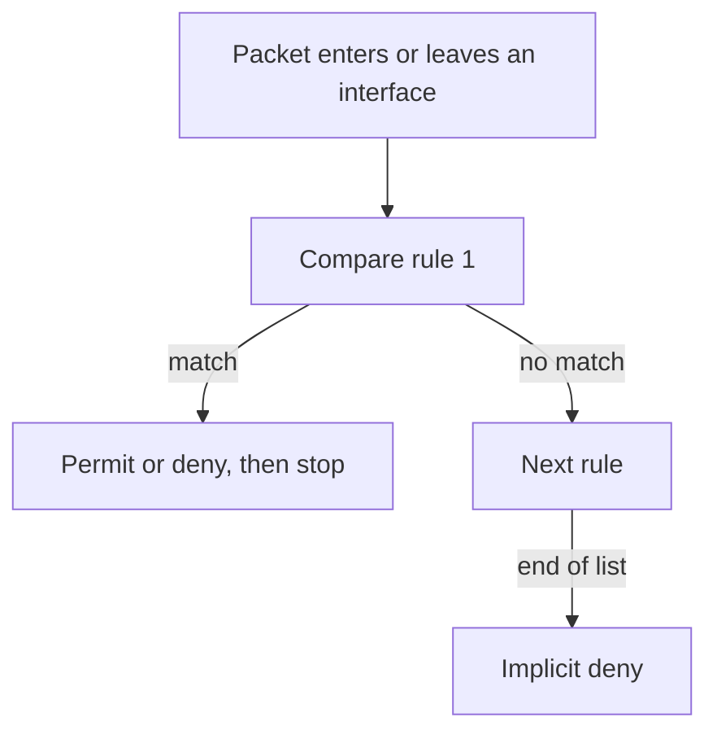

# Access lists

An access list is an ordered list of permit and deny rules, applied to an interface in one direction. Routers do not have one until you write it. When a later lab says “an ACL is dropping it,” this is the mechanism: first match wins, and anything left falls off the end into an implicit deny.

The same wildcard mask appears in [OSPF network statements](03-ospf.md). The same “filter which prefixes” idea, with different syntax, is a [prefix-list](10-routing-policy.md). An ACL matches packets. A prefix-list matches routes. Do not use one where you meant the other.

## References

### Videos

- Jeremy’s IT Lab ACL days in the [Free CCNA v1.1 playlist](https://www.youtube.com/playlist?list=PLxbwE86jKRgMpuZuLBivzlM8s2Dk5lXBQ)

### Articles

- [IPv4 header](../01-fundamentals/10-ipv4-header.md) — protocol numbers an extended ACL matches
- [TCP/IP model](../01-fundamentals/03-tcp-ip-model.md) — ports

## Diagram



## Two kinds

**Standard** lists match only the source IP. Numbered ranges 1–99 and 1300–1999.

```text
R1(config)# access-list 1 permit 192.168.10.0 0.0.0.255
```

**Extended** lists match protocol, source, destination, and (for TCP and UDP) ports. Numbered ranges 100–199 and 2000–2699.

```text
R1(config)# ip access-list extended TO-SERVERS
R1(config-ext-nacl)# deny tcp any host 10.0.0.10 eq 23
R1(config-ext-nacl)# permit ip any any
```

Named lists are the ones you can edit one line at a time. Prefer them. The number is only a label.

The wildcard `0.0.0.255` means “the first three octets must match, the last octet is ignored.” It is the subnet mask with the bits flipped, the same calculation as OSPF. `host 10.0.0.10` means wildcard `0.0.0.0`. `any` means `0.0.0.0 255.255.255.255`.

`eq 23` is the destination port, because the port is written after the destination address. `eq` on the source is written after the source: `deny tcp any eq 443 any` would match a source port, which is rarely what you want. Telnet to 10.0.0.10 is destination port 23.

ICMP is protocol `icmp`, not UDP. Ping is `permit icmp any any echo` and `permit icmp any any echo-reply`, or simply `permit icmp any any` while you are learning. A list that permits TCP and UDP and forgets ICMP makes ping fail while web browsing works.

## Where you apply it

```text
R1(config)# interface gigabitEthernet 0/0
R1(config-if)# ip access-group TO-SERVERS in
```

`in` means “packets arriving on this interface.” `out` means “packets leaving.” One list does not filter both ways. Return traffic needs a rule of its own, or it hits the implicit deny on the way back.

Put an extended list close to the **source**, on the interface where the unwanted packets enter, so you drop them before they cross the network. A standard list can only see the source, so it usually sits close to the **destination**, on the last interface before that destination. Those are placement habits, not protocol rules. The rule is: the interface you chose must actually be on the path, in the direction you chose.

There is an implicit `deny ip any any` at the end. A list that only denies Telnet, and never permits everything else, denies everything else. The `permit ip any any` line in the example is the list doing what you think the absence of a rule would do. Absence is deny.

A list that is written and not applied with `ip access-group` does nothing. `show ip access-lists` shows matches only after packets have been compared. A counter that never moves is a list on the wrong interface, the wrong direction, or no list at all.

### Worked example

Users are on G0/0, subnet 192.168.10.0/24. A server 10.0.0.10 is reached through G0/1. You want the users to reach the server on HTTPS and ICMP, and nothing else.

Apply inbound on G0/0, because that is where the users’ packets enter:

```text
R1(config)# ip access-list extended USERS-OUT
R1(config-ext-nacl)# permit tcp 192.168.10.0 0.0.0.255 host 10.0.0.10 eq 443
R1(config-ext-nacl)# permit icmp 192.168.10.0 0.0.0.255 host 10.0.0.10
R1(config-ext-nacl)# deny ip any any
R1(config)# interface g0/0
R1(config-if)# ip access-group USERS-OUT in
```

The explicit `deny ip any any` is optional. It makes the counter visible. The implicit deny would drop the same packets.

The return packets from the server arrive on G0/1, not on G0/0 inbound. This list does not see them. If you also apply a list inbound on G0/1, you must permit the server’s replies: source port 443 toward 192.168.10.0/24. Forgetting the return direction is the failure mode. `established` on a TCP rule permits segments that look like they belong to an existing connection (ACK set). It is a convenience on the return path, not a stateful firewall. A router ACL does not remember the outbound flow the way the [firewall on day 1](../01-fundamentals/01-network-devices.md) does, unless you add reflexive lists or a zone-based firewall, which is a different feature.

## Checks

```text
R1# show ip access-lists
R1# show ip interface g0/0
```

The interface output names the list and the direction. Then generate traffic and look at the match counters. Edit a named list by sequence number rather than deleting the whole list while it is applied. Deleting the list and leaving `ip access-group` pointing at a missing name can deny all traffic on some IOS trains. Add the new permit, confirm the counters, then remove the old line.

## Check yourself

1. A standard ACL and an extended ACL. Which one can match destination port 443?
2. You wrote `deny tcp any host 10.0.0.10 eq 23` and nothing else, and applied it inbound. What happens to HTTPS?
3. What does the wildcard `0.0.0.255` mean next to `192.168.10.0`?
4. The list is in the running config and the match counters stay at zero while traffic flows. What do you check?
5. Why does a list inbound on the user-facing interface not automatically allow the server’s replies?

## Answers

1. The extended ACL. A standard ACL matches the source address only.
2. HTTPS is denied. The first line does not match it, and the implicit deny at the end drops it. You needed `permit ip any any`, or a more specific permit, after the Telnet deny.
3. The first three octets must equal 192.168.10, and the last octet may be anything. That is the wildcard for a /24.
4. `show ip interface` on the interface you think is filtering. The list is applied in one direction on one interface. The traffic may be taking another path, or the direction may be `out` while you are watching packets arrive.
5. The reply is a different packet, entering a different interface, with the addresses swapped. An inbound list on the user side never sees it. A router ACL is not stateful unless you have built that separately.
