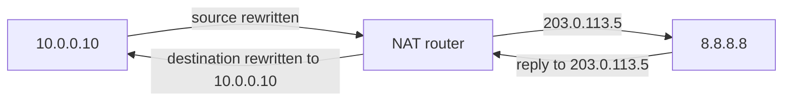

# NAT

[Day 3](../01-fundamentals/03-tcp-ip-model.md) said the IP addresses stay the two hosts for the whole trip. NAT is the exception. The router rewrites an address, and sometimes the port, and keeps a table so the reply can be rewritten back. Private ranges from [day 7](../01-fundamentals/07-ipv4-addressing-1.md) (RFC 1918) are useful because of this rewrite. They are not routable on the public Internet, so the edge router presents a public address instead.

## References

### Videos

- Jeremy’s IT Lab NAT days in the [Free CCNA v1.1 playlist](https://www.youtube.com/playlist?list=PLxbwE86jKRgMpuZuLBivzlM8s2Dk5lXBQ)

### Articles

- [RFC 1918, private addresses](https://datatracker.ietf.org/doc/html/rfc1918)
- [RFC 3022, traditional NAT](https://datatracker.ietf.org/doc/html/rfc3022)

## Diagram



The web server never hears 10.0.0.10. The PC never thinks its address changed. Only the router’s table connects the two.

## Four names for two ends

Cisco’s vocabulary is worth memorizing once, on one flow. Inside is your network. Outside is the Internet side. Local means “as seen on the inside.” Global means “as seen on the outside.”

PC 10.0.0.10 talks to 8.8.8.8, and the router presents the PC as 203.0.113.5.

| Term | Address | Why it is called that |
|------|---------|------------------------|
| Inside local | 10.0.0.10 | The PC’s real address, on the inside |
| Inside global | 203.0.113.5 | That same PC, as the Internet sees it |
| Outside global | 8.8.8.8 | The server’s real address |
| Outside local | 8.8.8.8 | The server, as the PC sees it |

Outside local and outside global differ only when you are also translating the destination (an overlapping-address design). For ordinary Internet access they are the same, and the interesting rewrite is inside local to inside global.

Mark the interfaces or the router will not translate:

```text
R1(config)# interface gigabitEthernet 0/0
R1(config-if)# ip nat inside
R1(config)# interface gigabitEthernet 0/1
R1(config-if)# ip nat outside
```

G0/0 faces the PCs. G0/1 faces the Internet. The words `inside` and `outside` describe the topology, not the ACL direction.

## Static, dynamic, and PAT

**Static NAT** fixes one inside address to one public address. You use it so the Internet can start a connection to a server you host.

```text
R1(config)# ip nat inside source static 10.0.0.10 203.0.113.10
```

**Dynamic NAT** draws a public address from a pool, still one-to-one, for the duration of the translation. A pool of 10 addresses lets 10 inside hosts out at once.

**PAT** (overload, NAPT) uses one public address and distinguishes hosts by port. This is what a home router and almost every enterprise edge actually do.

```text
R1(config)# access-list 1 permit 10.0.0.0 0.0.255.255
R1(config)# ip nat inside source list 1 interface gigabitEthernet 0/1 overload
```

ACL 1 selects which sources may be translated. It is not applied with `ip access-group`. Using it for NAT does not filter packets. The overload keyword is the entire difference between “give each host a public IP” and “share this interface’s public IP.”

The table:

```text
R1# show ip nat translations
```

A PAT line looks like `tcp 10.0.0.10:51514 203.0.113.5:51514 8.8.8.8:443 8.8.8.8:443`. The reply comes back to 203.0.113.5 port 51514, and the router maps that to 10.0.0.10 port 51514. When the entry times out, a new inbound connection to that port has nowhere to go. PAT does not make inside hosts reachable from the Internet. Static NAT, or a port forward, does.

### Worked example

10.0.0.10 sends an HTTPS packet to 93.184.216.34, source port 51514. The edge rewrites with PAT to 203.0.113.5.

On the inside link, a capture shows source 10.0.0.10, destination 93.184.216.34. On the outside link, the same flow shows source 203.0.113.5, destination 93.184.216.34. TTL still decrements. The router is forwarding and translating. The [life of a packet](02-life-of-a-packet.md) gains one extra rewrite at this hop and nowhere else.

The return packet arrives as destination 203.0.113.5, destination port 51514. Without a translation entry, the router has no inside host to deliver it to, and the packet is dropped even though a default route exists. `show ip nat translations` is the table to read before you blame routing.

`clear ip nat translation *` drops the table. Existing connections break and new ones rebuild. That is a test, not a fix.

## What NAT breaks

- Protocols that write an IP address inside the payload (old FTP, some SIP) need an application-layer fixup. The header rewrite is not enough, because the other end also reads the address in the data.
- IPsec that authenticated the original header will fail if a middle router changes that header. NAT traversal exists for a reason. See [MTU and tunnels](12-mtu-and-tunnels.md) for what IPsec is doing.
- One inside address space overlapping another is why MPLS VPNs and VRFs exist. NAT can paper over two companies that both use 10.0.0.0/8. It does not scale as a way to build a [L3VPN](../05-vpn-services/01-l3vpn.md).
- Logging a public source address on the Internet points at your edge, not at a PC, until you correlate the PAT table (and you must have saved the table from that moment).

## Check yourself

1. In the example, which address is the inside global?
2. What does the `overload` keyword change?
3. Why can a host behind PAT open a connection out, while a stranger on the Internet cannot open one in?
4. You applied ACL 1 with `ip nat inside source list 1 ...` and also expected it to block Telnet. Does it?
5. A ping from the PC works to the router’s inside interface and fails to 8.8.8.8, and the translation table stays empty. Name two configuration lines that are probably missing.

## Answers

1. 203.0.113.5, the public address that represents the inside host.
2. It turns a one-to-one mapping into PAT: many inside hosts share one public address, and the router keeps them apart by port.
3. The translation entry is created by the outbound packet. An inbound packet with no entry has no inside destination. A static mapping exists before any packet, so inbound connections have a target.
4. No. That ACL only selects traffic to translate. Filtering is `ip access-group`, in the ACL note. A list can be used for one job and not the other.
5. The interfaces are probably not marked `ip nat inside` and `ip nat outside`, or the source list does not match the PC’s address, or there is no `ip nat inside source` rule at all. An empty table means the router never translated, so the Internet sees a private source, or the packet was never eligible.
