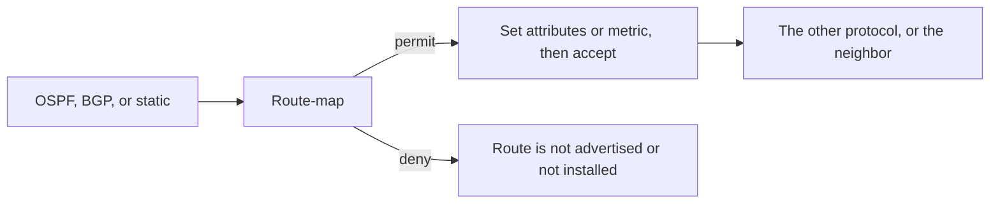

# Routing policy

Longest match and administrative distance, from [static routing](01-static-routing.md), decide which route is used once it is in the table. Policy decides which routes are allowed into the table, which are advertised onward, and which BGP attributes they carry. [BGP](05-bgp.md) without a prefix-list is how a lab advertises a default to the Internet, or accepts one from a customer.

An [access list](08-acls.md) filters packets. The tools on this page filter **routes**.

## References

### Videos

- Keith Barker’s BGP playlist covers route-maps in context: [BGP tutorials](https://www.youtube.com/playlist?list=PLwQhJUHSLJFUO5YzFH2wveh2zcHUKj11w)

### Articles

- [How BGP really picks a path](https://www.practicalnetworking.net/stand-alone/bgp-oldest-path/) — attributes a route-map sets
- [PE-CE routing](../05-vpn-services/02-pe-ce-routing.md) — redistribution at the edge of a VPN

## Diagram



## Prefix-lists

A prefix-list matches the prefix and the length. It does not match a packet.

```text
R1(config)# ip prefix-list CUST seq 10 permit 10.1.0.0/16 ge 24 le 24
R1(config)# ip prefix-list CUST seq 20 permit 192.0.2.0/24
```

Sequence 10 matches prefixes whose first 16 bits are 10.1 and whose length is exactly 24. Sequence 20 matches that one /24 and nothing longer. `ge` is the shortest length you will accept. `le` is the longest. Without `ge` or `le`, the length must equal the number after the slash.

Two entries people invert:

| Entry | What it matches |
|-------|-----------------|
| `permit 0.0.0.0/0` | Only the default route |
| `permit 0.0.0.0/0 le 32` | Every prefix |

There is an implicit deny at the end. A prefix-list that permits the customer block and stops there denies every other advertisement, which is what you want on a peering session.

Apply it to a BGP neighbor:

```text
R1(config-router)# neighbor 203.0.113.2 prefix-list CUST out
```

`out` filters what you advertise. `in` filters what you accept. Do both. Trusting the other side to send only what they promised is how a customer injects the entire table, or how you leak yours.

## Route-maps

A route-map is an ordered list of clauses. Each clause is permit or deny, has optional `match` lines, and has `set` lines that run on a permit.

```text
R1(config)# route-map FROM-CUST permit 10
R1(config-route-map)# match ip address prefix-list CUST
R1(config-route-map)# set local-preference 200
R1(config)# route-map FROM-CUST permit 20
```

Clause 10 sets local preference on the customer prefixes. Clause 20 has no `match`, so it permits everything else and changes nothing. Without clause 20, the implicit deny at the end of a route-map drops every other route. That is the same shape as an ACL, and it is the usual reason “the neighbor is Established and the table is empty.”

`deny` in a route-map means “do not advertise” or “do not redistribute,” not “set the BGP community called deny.” Nothing is set on a denied route.

Apply route-maps on the neighbor (`route-map FROM-CUST in`) or on a redistribute statement. `in` changes how you treat received routes. It does not change what the neighbor sends. Local preference is the right kind of attribute to set on the way in. AS-path prepending is the right kind to set on the way out.

## Redistribution

Redistribution copies routes from one protocol into another. It does not make them neighbors. The metric does not survive. OSPF cost and BGP local preference are different languages, so you set a metric the destination protocol understands.

```text
R1(config)# router bgp 65000
R1(config-router)# redistribute ospf 1 route-map OSPF-INTO-BGP
```

On Cisco IOS, redistributing OSPF into BGP takes internal (intra-area and inter-area) routes unless you add `match external`. External OSPF routes stay out until you say so.

The other direction needs `subnets`, or IOS redistributes only classful summaries and your /24s vanish:

```text
R1(config)# router ospf 1
R1(config-router)# redistribute bgp 65000 subnets route-map BGP-INTO-OSPF
```

Those BGP routes enter OSPF as **external** type 5 LSAs. The default metric is 20, and the default type is **E2**: the metric stays 20 inside OSPF, and internal cost is not added. E1 adds the cost to the ASBR. E2 is why a far-away redistributed route can look exactly as good as a nearby one. Set the type on purpose when there are two injection points.

Connected and static routes are not in OSPF until you redistribute them or include the interfaces in the OSPF process. `redistribute static` does not include the default route unless `default-information originate` (OSPF) or `default-originate` (BGP) is also there.

### Worked example: a loop at two boundaries

R1 and R2 both redistribute OSPF into BGP and BGP into OSPF, because two exit points felt safer.

1. OSPF knows 10.1.1.0/24 as an internal route, AD 110.
2. R1 advertises it into BGP. R2 learns it from BGP.
3. eBGP’s administrative distance is 20, which beats OSPF’s 110. R2 installs the BGP copy and points at R1.
4. R2 redistributes that BGP route back into OSPF as an external.
5. R1 may now prefer a path that leaves OSPF, crosses BGP, and comes back, or the prefix flaps.

The distances did what the [AD table](01-static-routing.md) said they would. The design is the problem.

Break the loop with policy, not with hope:

- Tag routes when they are redistributed, and deny that tag on the way back in.
- Or redistribute in one direction only, and let BGP carry the external prefixes on purpose, which is the service-provider pattern in the [MPLS note](../04-mpls/01-architecture-ldp-and-labels.md): the IGP carries loopbacks, BGP carries everything else.

A route-map that matches a tag and denies it is the whole fix. Write the deny clause before the permit-all clause.

## Communities, as tags you can send

A BGP **community** is a stamp on a route, carried to neighbors if you send communities (`neighbor x send-community`). It is not a step in the best-path algorithm by itself. A neighbor matches the community and then sets local preference, or decides not to advertise the route further. That is how one route-map at the edge replaces a custom filter on every router. Agree on the numbers before you depend on them. An undefined community is just an integer the other network ignores.

## Check yourself

1. What does `ip prefix-list X permit 0.0.0.0/0` match, and what extra syntax matches every prefix?
2. A route-map has one permit clause that matches your customer prefix-list and sets local preference. There is no second clause. What happens to other BGP routes when the map is applied inbound?
3. Why does `redistribute bgp 65000` under OSPF, without `subnets`, drop your /24s on IOS?
4. eBGP AD is 20 and OSPF AD is 110. Why does that matter at a router that redistributes both ways?
5. Is a community compared in BGP best-path selection the way local preference is?

## Answers

1. Only the default route. `permit 0.0.0.0/0 le 32` matches every prefix.
2. They are denied by the implicit deny at the end of the route-map, so they are not installed from that neighbor. Add an empty permit clause if the rest should pass through unchanged.
3. Without `subnets`, IOS redistributes classful networks only. A /24 is a subnet of a classful block and is skipped. Add `subnets`.
4. A route that left OSPF and came back from eBGP is preferred over the original OSPF route, because 20 beats 110 for the same prefix. That preference is how mutual redistribution forms a loop. Filter or tag the routes you already originated.
5. No. A community is a tag. Best path looks at local preference, AS path, MED, and the rest of the BGP decision. The community matters when a route-map matches it and sets one of those.
