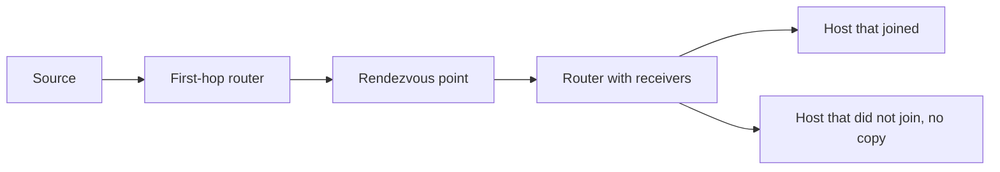

# Multicast

Unicast sends to one address. A broadcast forces every host in the VLAN to look. Multicast sends one packet and lets only the hosts that asked for it receive a copy. OSPF hellos, IPv6 neighbor discovery, and a stream that many receivers watch are the same mechanism at different scopes.

You already depend on it. OSPF speaks to `224.0.0.5`, and a switch that treats that frame badly looks like “OSPF is down” when the IP configuration is fine.

## References

### Videos

- Keith Barker’s multicast introductions, in his broader [CCNA playlist](https://www.youtube.com/playlist?list=PLQQoSBmrXmrysEaVNia7KVwf85qATIi1V) and in standalone multicast sessions if you search his channel for PIM

### Articles

- [RFC 1112, host extensions for IP multicast](https://datatracker.ietf.org/doc/html/rfc1112)
- [OSPF](03-ospf.md) — the first multicast group you actually configure around

## Diagram

Sparse mode starts with the rendezvous point so the source and the receivers can find each other without flooding the whole network.

## Addresses

IPv4 multicast is `224.0.0.0/4`. The Ethernet destination is a multicast MAC, `01:00:5e` plus the low 23 bits of the group. More than one group can hash to the same MAC. That is a detail. The operational split is this:

| Range | Who receives it |
|-------|-----------------|
| 224.0.0.0/24 | Link local. Routers do not forward these. `224.0.0.1` all hosts, `224.0.0.2` all routers, `224.0.0.5` all OSPF routers, `224.0.0.6` OSPF designated routers. |
| 224.0.1.0 upward, through 239.255.255.255 | Groups that may be routed. 239.0.0.0/8 is administratively scoped, the private range of multicast. |

IPv6 has no broadcast. `ff02::/16` is link-local multicast, including `ff02::1` (all nodes) and the solicited-node groups in the [IPv6 note](../01-fundamentals/15-ipv6.md). The rules below are the IPv4 story. The IPv6 story is the same shape with different addresses.

## IGMP: the host asks

A host joins a group with **IGMP**. The router on the LAN periodically asks “who still wants this?” Hosts that do answer. A host that leaves (IGMPv2 and v3) can say so instead of waiting for a timeout.

The router now knows which groups have listeners on which interface. It does not yet know how to reach the source. That is PIM’s job.

On a switch, multicast is a MAC the switch was not taught as a unicast. Without help, the switch floods it inside the VLAN, and every PC pays for a stream nobody joined. **IGMP snooping** listens to the joins and forwards the group only to ports that asked, plus the port toward the router. Catalyst switches enable snooping by default. If a group works when snooping is disabled and fails when it is enabled, the switch has not learned which port the router is on. `show ip igmp snooping mrouter` should show the uplink. A VLAN with no mrouter port and snooping on is a silent black hole for everything except the link-local groups the switch special-cases.

## PIM sparse mode

**PIM** builds the forwarding tree between routers. Dense mode floods and then prunes. You will read about it and you should not design with it. Sparse mode forwards only where someone joined.

Sparse mode needs a **rendezvous point (RP)**. Every router agrees which router the RP is (static configuration, or a discovery protocol). The agreement matters more than the mechanism. Two routers with different RP addresses will not build one tree.

- Receivers cause their router to send a PIM join for `(*, G)` toward the RP. G is the group.
- The source’s router tells the RP that S exists, and encapsulates the first packets toward the RP.
- The RP already knows which branches have receivers, so it forwards down those branches.
- The last-hop router can then join the source directly, building an `(S, G)` shortest-path tree, and stop hairpinning through the RP.

You do not need the encapsulation format memorized. You need to know that a receiver-only router with no route to the RP will never build the shared tree, and a source-only site with no route to the RP will never register.

### Reverse path forwarding

Multicast accepts a packet only if it arrived on the interface this router would use to **reach the source** (or the RP, for the shared tree). That is the **RPF** check. Unicast forwarding asks “which way is the destination?” Multicast asks “did this arrive from the direction of the source?”

A packet that fails RPF is dropped, even if the destination group is valid. The usual cause is two paths, and unicast routing back to the source points out a different interface than the one the stream came in on. Fix the routing, or pick the interface on purpose. Adding a second PIM neighbor does not fix an RPF failure. `show ip rpf <source>` is the command that names the interface the router insists on.

OSPF and EIGRP multicasts do not need an RP. They use 224.0.0.0/24, which is not routed, and they only have to flood one hop. If OSPF is stuck and you are looking at PIM, stop. Check the link, the hello match, and whether a switch in the middle is dropping `224.0.0.5`. PIM is for groups you intend to route.

### Worked example

A video source 10.1.1.10 sends to 239.1.1.1. Receivers are on a LAN behind R4. The RP is R2. Unicast routing already works.

1. A laptop joins 239.1.1.1. R4 learns the join by IGMP.
2. R4 sends a PIM join toward R2 for `(*, 239.1.1.1)`.
3. The source’s router registers with R2. R2 forwards the stream toward R4.
4. R4 forwards it only onto the LAN, and IGMP snooping limits it to the laptop’s port.
5. R4’s RPF toward 10.1.1.10 must agree with the interface the stream arrives on once the shortest-path tree cuts over. If R4’s unicast route to 10.1.1.10 points elsewhere, the stream dies at the cutover and the shared tree had looked fine. That timing fools people into blaming the application.

No IGMP join means step 2 never happens. The source can be sending perfectly into a network that has no tree. Multicast debugging starts at the receiver’s join, then the RP both ends agree on, then RPF.

## Check yourself

1. Why does an OSPF hello to 224.0.0.5 not need a rendezvous point?
2. What does IGMP do that PIM does not?
3. IGMP snooping is on, no port is the mrouter, and a routed group fails inside the VLAN. Why?
4. A multicast packet arrives on Gi0/2. The unicast route to the source points out Gi0/1. What does the router do, and what is that check called?
5. Two routers both run sparse mode and each was configured with a different RP address. Will a receiver on one and a source on the other find each other?

## Answers

1. 224.0.0.5 is in 224.0.0.0/24, which routers do not forward. The hello only has to reach routers on that link. PIM and an RP are for groups that must cross routers.
2. IGMP is the host-to-router join on a LAN. PIM is the router-to-router tree. A join that never leaves the LAN is an IGMP problem. A join that never reaches the source’s network is a PIM or routing problem.
3. Snooping will not flood the group to every port, and it has nowhere to send the join toward a router. The group is dropped instead of delivered. Check `show ip igmp snooping mrouter`.
4. It drops the packet. The RPF check requires the packet to arrive on the interface used to reach the source.
5. No. Sparse mode meets at the RP. Different RP addresses are two different meeting points, and the tree is not shared.
