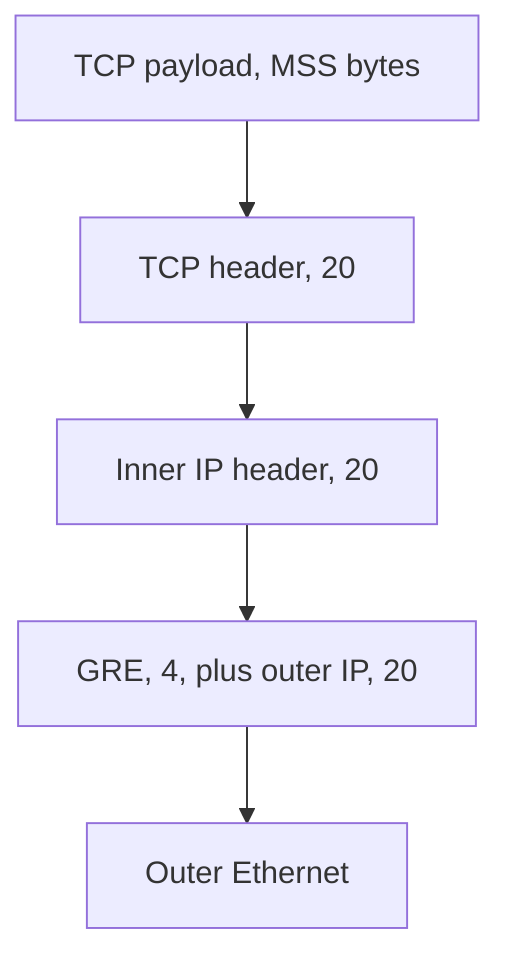

# MTU, path MTU discovery, and tunnels

The [IPv4 header](../01-fundamentals/10-ipv4-header.md) defined the DF bit and showed a router fragmenting a packet. This note is the failure you actually get: a tunnel adds headers, the packet no longer fits, DF is set, and ICMP saying so is filtered. Small pings work. The session hangs. MPLS labels and VXLAN are the same arithmetic with a different header.

## References

### Videos

- [Packet Traveling series finale](https://www.practicalnetworking.net/series/packet-traveling/packet-traveling-series-finale/) — encapsulation at each hop, which a tunnel adds one more of

### Articles

- [RFC 1191, path MTU discovery](https://datatracker.ietf.org/doc/html/rfc1191)
- [RFC 2784, GRE](https://datatracker.ietf.org/doc/html/rfc2784)
- [EVPN](../05-vpn-services/04-evpn.md) — VXLAN as the data-center case of this overhead
- [MPLS](../04-mpls/01-architecture-ldp-and-labels.md) — one 4-byte shim per label

## Diagram



The physical link limits the outer frame. Every header above the payload is stolen from the MSS the application thought it had.

## MTU and MSS

**MTU** is the largest IP packet the link will carry, usually **1500** on Ethernet. The Ethernet header and FCS sit outside that number.

**MSS** is the largest TCP payload in one segment. With a 20-byte IP header and a 20-byte TCP header, MSS is 1500 − 40 = **1460**. [TCP reliability](../01-fundamentals/17-tcp-reliability.md) uses that number. Jumbo frames raise the MTU, often to 9000, and the MSS rises with it only if the endpoints learn the new limit.

IPv6 routers do not fragment a packet in flight. The source must fit the path. IPv4 routers may fragment only when DF is clear. Modern TCP sets DF and expects to be told if the packet is too big.

## Path MTU discovery

A router that cannot forward a packet because it exceeds the next MTU and DF is set drops it and sends **ICMP type 3 code 4**, “fragmentation needed,” including the MTU it wanted. The source shrinks its packets and tries again.

If some firewall drops all ICMP, the error never arrives. The source keeps sending 1500-byte packets into a 1476-byte tunnel. The handshake is small, so it succeeds. The first full-size segment vanishes. The application hangs, and `ping` with the default 56 bytes of payload still works.

Test with a large ping and the don’t-fragment flag:

```text
R1# ping 192.0.2.2 size 1500 df-bit
```

If size 1400 with DF works and size 1500 with DF fails, the path MTU is in between. Then find the hop that should have sent ICMP, and allow type 3 code 4. Allowing all ICMP is broader than this problem requires. Blocking all of it is how the black hole is built.

`ip tcp adjust-mss` on a router interface rewrites the MSS option in TCP handshakes passing through, so the endpoints agree on a payload that fits even when discovery is broken. It does not help UDP. It is a clamp, not a larger pipe.

## GRE, the smallest overlay

A **tunnel** carries one packet inside another. The **underlay** is the network that forwards the outer header. The **overlay** is the inner packet, which thinks it has a direct link. [EVPN](../05-vpn-services/04-evpn.md) uses those two words for VXLAN and MPLS. GRE is the same split with the headers visible.

GRE adds a 4-byte header and a new 20-byte outer IPv4 header, 24 bytes, when no optional GRE fields are set. A 1500-byte inner packet becomes 1524 bytes on the wire before Ethernet. IOS therefore sets a GRE tunnel’s IP MTU to **1476** so the inner packet is shrunk before encapsulation. The physical interface can stay at 1500.

```text
R1(config)# interface tunnel 0
R1(config-if)# ip address 10.0.0.1 255.255.255.252
R1(config-if)# tunnel source 192.0.2.1
R1(config-if)# tunnel destination 198.51.100.1
R1(config-if)# ip tcp adjust-mss 1436
```

1436 is 1476 minus 40 bytes of inner TCP and IP headers. The outer source and destination are real underlay addresses the IGP, or a static route, must already know how to reach. The tunnel subnet 10.0.0.0/30 is the overlay. A routing protocol running on Tunnel0 advertises overlay prefixes. Those protocol packets are themselves carried inside GRE.

If the underlay route to 198.51.100.1 points back out Tunnel0, the tunnel recurses into itself and goes down. The underlay must be learned from physical interfaces. This is the same rule as an MPLS P router that must reach a PE loopback without using the customer’s routes.

### IPsec, only the model

**IPsec** encrypts and authenticates IP packets. **IKE** negotiates the keys. **ESP** (IP protocol 50) carries the data.

| Mode | Outer header | What is protected |
|------|--------------|-------------------|
| Transport | The original IP header stays | The payload. Used between two hosts. |
| Tunnel | A new outer IP header | The entire original packet, header included. This is site-to-site. |

ESP overhead depends on the cipher, the IV, and the integrity check. It is not one constant the way GRE’s 24 bytes is. Budget on the order of another 50 bytes or more, then measure with the DF ping. A common design puts GRE inside IPsec so that multicast and a routing protocol (which GRE can carry) are encrypted (which ESP can do). Plain IPsec tunnel mode between two routers does not, by itself, give you a clean multicast neighbor.

Do not treat a sample crypto map from an old blog as current syntax. IKEv2 and vendor templates move. The headers and the MTU do not. When the tunnel is up and large transfers hang, it is this note, not the IKE policy, until the DF ping says otherwise.

[NAT](09-nat.md) in the middle of IPsec changes a header ESP may have authenticated, or hides the addresses IKE expected. That combination has its own traversal rules. Get the tunnel up without NAT in the path before you debug both.

## MPLS and VXLAN, the byte count

| What you added | Bytes | What has to give |
|----------------|-------|------------------|
| One MPLS label | 4 | A customer packet of 1500 plus two labels (transport and VPN) is 1508. A core MTU of 1500 drops or fragments it. |
| GRE | 24 | Tunnel IP MTU 1476, or MSS 1436. |
| VXLAN | 50 is the usual planning number (outer IP, UDP, VXLAN header, inner Ethernet) | The underlay must be larger than 1500 if the tenant MTU is still 1500. Fabrics set the underlay to 9000 and stop counting. |

PHP on the second-to-last MPLS hop removes the transport label early. The core links before that hop still carry the full stack. Raising the core MTU is the fix. Fragmenting customer traffic in the core is the failure.

VXLAN’s underlay is IP reachability of VTEP loopbacks, often across a leaf-spine of routed links. If those links are MTU 1500 and the tenant sends 1500, the encapsulated frame does not fit. The symptom is the same DF hang, between two VMs that ping with a short packet and fail a file copy.

### Worked example

A GRE tunnel is up. `ping 10.0.0.2` from R1 works (the default ping is small). `ping 10.0.0.2 size 1500 df-bit` fails. `ping 10.0.0.2 size 1476 df-bit` works.

The path MTU of the overlay is 1476. TCP endpoints that still negotiate MSS 1460 produce a 1500-byte packet, which does not fit, and DF keeps the tunnel from fragmenting it. Set `ip tcp adjust-mss 1436` on both tunnel interfaces, or fix PMTUD so the ICMP error gets back to the PCs. Then repeat the large ping from a PC, not only from the router. A ping sourced on the tunnel interface can take a different path through the encapsulation than a transit packet. Trust the transit test.

## Check yourself

1. What is the MSS on a 1500-byte MTU with 20-byte IP and TCP headers and no options?
2. Which ICMP message is path MTU discovery waiting for, and what fails if it is filtered?
3. Why is a GRE tunnel’s IP MTU 1476 when the physical Ethernet MTU is 1500?
4. A customer sends a 1500-byte IP packet into an MPLS VPN that pushes two labels. Why is a core MTU of 1500 too small?
5. The underlay route to a GRE destination is learned through the tunnel itself. What happens?

## Answers

1. 1460 bytes of TCP payload.
2. ICMP type 3 code 4, fragmentation needed, with the next-hop MTU. If it is dropped, the sender keeps emitting packets that will never fit. Small packets work and full-size transfers hang.
3. GRE adds 4 bytes and a new 20-byte outer IPv4 header. 1500 − 24 = 1476. The inner packet is limited so the outer packet still fits the physical MTU.
4. Each label is 4 bytes. Two labels make 1508 bytes of MPLS-encapsulated packet before the outer Ethernet header. The core link cannot accept it at MTU 1500. Raise the core MTU, or the edge will have to fragment or drop.
5. Encapsulation recurses. The tunnel source has no real underlay path, and the tunnel does not stay up as a way to carry its own transport. Learn the tunnel destination from a physical interface.
