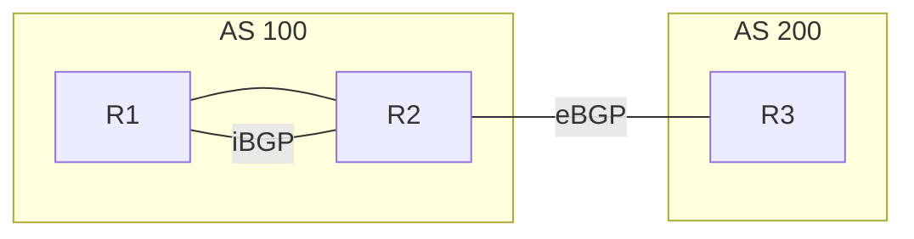

# BGP

BGP is a path-vector protocol. It carries prefixes between autonomous systems and, inside one network, between routers that must apply policy the IGP should not know about. An IGP finds a short path. BGP selects a path you can defend with policy: which customer, which peer, which exit.

## References

### Videos

- [Keith Barker, BGP tutorials](https://www.youtube.com/playlist?list=PLwQhJUHSLJFUO5YzFH2wveh2zcHUKj11w)

### Articles

- [How BGP really picks a path](https://www.practicalnetworking.net/stand-alone/bgp-oldest-path/) — the tie-breaks after the famous attributes, including oldest path
- [RFC 4271, BGP-4](https://datatracker.ietf.org/doc/html/rfc4271)

## Diagram



R2 and R3 are in different autonomous systems, so that session is **eBGP**. R1 and R2 share AS 100, so that session is **iBGP**. The prefix R3 advertises must be carried from R2 to R1 by iBGP, or R1 will never learn it. The IGP does not carry customer prefixes in a service-provider design. The IGP only makes sure R1 can reach R2’s loopback so the iBGP session stays up.

## Sessions

| | eBGP | iBGP |
|--|------|------|
| AS numbers | Different | Same |
| Default TTL | 1, so the peer is one hop away | 255 |
| Next hop | Set to the advertising router | Left unchanged by default |
| Re-advertisement | A route from an eBGP peer is advertised to other peers | A route learned from iBGP is **not** advertised to another iBGP peer |

The last row is the split-horizon rule. It prevents an iBGP loop. It also means a full mesh, or a route reflector.

A **route reflector** is allowed to re-advertise iBGP routes to its clients. Clients peer with the reflector, not with each other. The cluster ID stops a loop if you have more than one reflector. In a VPN network the reflector carries VPNv4 or EVPN the same way. See [L3VPN](../05-vpn-services/l3vpn.md).

**Next hop.** R3 advertises 203.0.113.0/24 to R2. R2’s iBGP advertisement to R1 still says next hop R3, unless R2 is configured with `next-hop-self`. R1 then needs an IGP route to R3’s address, which is often not in the IGP at all. `next-hop-self` rewrites the next hop to R2’s loopback, which the IGP does know. Use it on route reflectors and on the edge router that learned the eBGP route.

## Best path, the part you use

Cisco’s decision, shortened to the comparisons that change a design. Lower or “more preferred” at each step wins, and later steps are not looked at.

1. Highest **weight** (Cisco, local to the router, not advertised).
2. Highest **local preference** (advertised inside the AS). This is how you pick an exit.
3. Prefer a path this router originated.
4. Shortest **AS path**.
5. Lowest origin type (IGP before EGP before incomplete).
6. Lowest **MED**, compared for paths from the same neighboring AS. This is how a neighbor asks you to enter on a particular link.
7. eBGP over iBGP.
8. Lowest IGP cost to the next hop.
9. Oldest path, then router ID, then neighbor address. The Practical Networking article is about why “oldest” exists and how it surprises a lab that comes up in a different order than yesterday.

Memorize 1, 2, 4, and 6. They are the knobs. The rest explain a path you did not expect.

**Local preference example.** AS 100 has two exits to the Internet, east and west. You want outbound traffic to leave west. On the west edge, set local preference 200 on routes learned there. On the east edge, leave the default 100. Every iBGP speaker prefers local preference 200, so the west exit wins even if the AS path out east is shorter.

**AS path prepending.** You want the rest of the Internet to stop using your east exit toward you. Prepend your own AS several times on advertisements out east. Remote ASes see a longer AS path and prefer west. You cannot make them obey. You can only make your path look worse.

## State machine

Idle, Connect, Active, OpenSent, OpenConfirm, Established.

**Active does not mean the session is up.** Active means BGP is trying to connect and has not succeeded. Established is the only healthy state. A session that flips between Active and Idle is usually TTL (eBGP to a non-adjacent IP without `ebgp-multihop`), a wrong neighbor address, an ACL, or a mismatched AS number.

## Minimal configuration

```text
R2(config)# router bgp 100
R2(config-router)# neighbor 10.0.23.3 remote-as 200
R2(config-router)# neighbor 1.1.1.1 remote-as 100
R2(config-router)# neighbor 1.1.1.1 update-source loopback 0
R2(config-router)# neighbor 1.1.1.1 next-hop-self
R2(config-router)# network 198.51.100.0 mask 255.255.255.0
```

`network` advertises a prefix only if it is already in the routing table, with that mask. It does not create a connected route. iBGP sessions should source from a loopback so one link failure does not tear the session down. The IGP must be able to reach that loopback.

`show ip bgp summary` shows the state and the prefix count. `show ip bgp 198.51.100.0/24` shows every candidate path and which one won, with the attributes. Read that output before you add another route map.

## Check yourself

1. A router has two iBGP neighbors and no route reflector. It learns a prefix from one of them. Does it tell the other?
2. What does local preference select: the way into your AS, or the way out?
3. An eBGP session to a directly connected peer stays in Active. TTL is the default. Name one likely cause.
4. Why do service providers refuse to put customer prefixes in OSPF or IS-IS?
5. R1 prefers a path with local preference 100 and AS path length 2 over a path with local preference 90 and AS path length 1. Why?

## Answers

1. No. iBGP split horizon. Add a route reflector or a full mesh.
2. The way out. Local preference is internal policy for outbound traffic. MED and AS-path prepending influence the way in.
3. The neighbor address is wrong, the neighbor is not actually on-link, an ACL drops TCP 179, or the remote AS in the config does not match. “Active” itself only means the TCP session is not up.
4. Customer prefixes churn and they are numerous. Putting them in the IGP makes every core router recompute SPF when a customer link flaps. BGP is built for that policy and that scale. The IGP only tracks the core loopbacks.
5. Local preference is compared before AS path length. 100 beats 90 and the shorter AS path is never considered.
