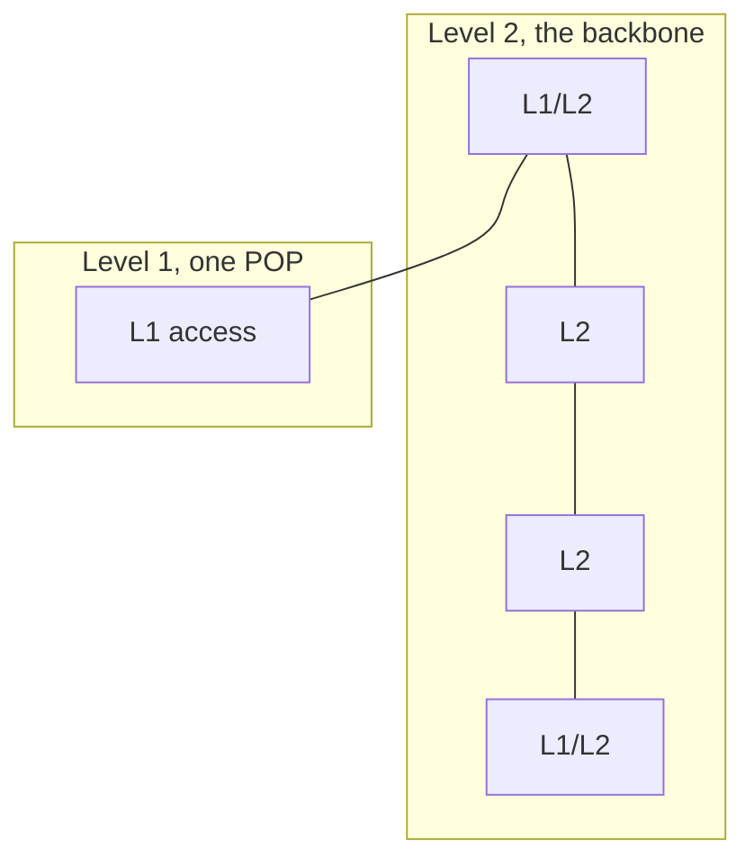

# IS-IS

IS-IS is the link-state IGP most service-provider cores actually run. It was built for ISO CLNS and extended with TLVs to carry IPv4 and IPv6. The design consequence: the adjacency does not depend on IP, one protocol carries both address families, and new data is added as a TLV instead of a new protocol version. OSPF can do the job. IS-IS is the one you will read in an SP design doc.

## References

### Videos

- [IS-IS basics for humans](https://www.youtube.com/watch?v=jWdD8SCwzHk) (~31 minutes)

### Articles

- [Juniper Open Learning, JNCIS-SP](https://learningportal.juniper.net/juniper/user_activity_info.aspx?id=EDU-JUN-WBT-JOL-JNCIS-SP) — IS-IS and OSPF modules. Free, requires a JNCIA-Junos login.
- [RFC 1195, IS-IS for IP](https://datatracker.ietf.org/doc/html/rfc1195)

Deeper labs than this note are usually a vendor course. The level here is enough to read a core design and a `show` command.

## Diagram



Level 2 is the backbone, analogous to OSPF area 0 but not identical. Level 1 is a pocket that defaults upward to the nearest L1/L2 router. An L1/L2 router attaches that pocket to the backbone.

## Levels

| Level | Floods LSPs | Forwards toward |
|-------|-------------|-----------------|
| Level 1 | Inside its area | Prefixes in the area, and a default to the nearest L1/L2 router |
| Level 2 | Across the backbone | Every prefix the backbone knows |
| Level 1/2 | Both | Attaches an area to the backbone |

A level 1 router does not learn the backbone’s full topology. It learns local prefixes and “the exit is that way.” That is the scaling move. A level 2 router must be continuous: the L2 domain has to be connected, the same way OSPF area 0 has to be contiguous.

## The NET address

IS-IS identifies a router with a Network Entity Title, not an IP router ID.

```text
49.0001.1921.6800.1001.00
|--| |--| |-------------| |-|
AFI  area   system ID      NSEL
```

- **49** is the AFI used for private addressing.
- **0001** is the area. Routers with the same area can be level 1 neighbors.
- **1921.6800.1001** is the 6-byte system ID. People often encode a loopback: 192.168.1.1 becomes `1921.6800.1001`.
- **00** is the N-selector. On a router it is 00.

The system ID must be unique in the domain. The area ID groups level 1 routers.

## DIS, not DR

On a broadcast LAN, IS-IS elects a **designated intermediate system**. It creates a pseudonode so the LAN is a single object in the SPF graph, which is the same idea as an OSPF DR. Differences you will be asked about:

- There is no backup DIS. If the DIS dies, a new one is elected. The adjacency between the other routers was already there.
- Priority defaults higher, and highest priority wins. A tie uses the highest MAC, not an IP router ID.
- Hello padding and timers differ from OSPF. Do not assume a 10/40 hello just because OSPF uses one. IS-IS defaults are 10 seconds hello and a hold time of 30 on many implementations, and they can be mismatched more loosely than OSPF because the hold time is advertised rather than required to be identical. Still, make them consistent in a design.

Point-to-point interfaces have no DIS. Core links should be point-to-point.

## TLVs, and why operators care

An IS-IS LSP is a set of type-length-value fields. IPv4 reachability, IPv6 reachability, traffic-engineering bandwidth, and segment-routing SIDs were all added as TLVs. The adjacency stayed the same. OSPFv2 could not carry IPv6, so OSPFv3 is a second protocol. IS-IS carries both in one process (multi-topology IS-IS exists when you want separate SPF trees for v4 and v6).

That is the practical reason a core that will run MPLS traffic engineering and segment routing is IS-IS: the TE extensions and the SR extensions are TLVs on the IGP you already have. See [RSVP-TE](../06-traffic-engineering/rsvp-te.md) and [SR-MPLS](../06-traffic-engineering/sr-mpls.md).

## Configuration sketches

IOS, one level 2 core link and a loopback:

```text
R1(config)# router isis CORE
R1(config-router)# net 49.0001.0100.1001.0001.00
R1(config-router)# is-type level-2-only
R1(config)# interface loopback 0
R1(config-if)# ip address 10.0.0.1 255.255.255.255
R1(config-if)# ip router isis CORE
R1(config)# interface gigabitEthernet 0/0
R1(config-if)# ip address 10.0.12.1 255.255.255.252
R1(config-if)# ip router isis CORE
R1(config-if)# isis network point-to-point
```

Junos, the same idea:

```text
set interfaces ge-0/0/0 unit 0 family inet address 10.0.12.1/30
set interfaces lo0 unit 0 family inet address 10.0.0.1/32
set protocols isis interface ge-0/0/0.0 point-to-point level 1 disable
set protocols isis interface lo0.0
```

`level 1 disable` on the core interface keeps that adjacency at level 2. Forgetting it on a POP router builds a level 1 adjacency across the core and leaks a default in a direction you did not mean.

## OSPF and IS-IS, side by side

| | OSPF | IS-IS |
|--|------|-------|
| Runs on | IP (protocol 89) | Layer 2 (its own PDU) |
| Backbone | Area 0 | Level 2 |
| Area border | ABR, on the router | Level boundary, also on the link |
| Broadcast helper | DR and BDR | DIS, no backup |
| IPv6 | OSPFv3, separate | TLVs in the same IS-IS |
| Extend with | New LSAs, and often a new version | TLVs |
| Cost | Bandwidth-derived by default | Default metric is often 10 everywhere until you set it |

The last row causes real outages of judgment: an untouched IS-IS network treats a 1 Gbps link and a 100 Gbps link as equal. Set metrics from bandwidth, or set them from a latency policy, but do not leave the default if the core is not uniform.

## Check yourself

1. What does the NSEL of a router’s NET have to be?
2. Why can two IS-IS routers form an adjacency when their interface IPs are misconfigured, when OSPF would refuse?
3. Does electing a DIS change which router forwards packets?
4. A level 1 router needs to reach a prefix that exists only on the far side of the backbone. What route does it use?
5. Why was IS-IS easier to extend for segment routing than OSPFv2 was for IPv6?

## Answers

1. 00.
2. IS-IS adjacencies are layer 2. IP configuration is carried in TLVs after the adjacency exists. OSPF will not come up if the subnet does not match.
3. No. Like an OSPF DR, the DIS is a control-plane role so the LAN is one node in SPF.
4. The default route toward the nearest L1/L2 router, which then uses level 2.
5. IS-IS adds capabilities as TLVs inside the same protocol. IPv6 could not be added to OSPFv2, so OSPFv3 is a different protocol.
