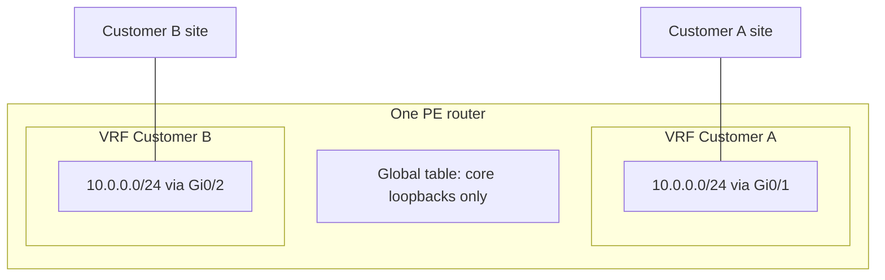

# VRF

A VRF (virtual routing and forwarding instance) is a separate routing table and a separate forwarding table on one router. Interfaces are assigned to a VRF. The same prefix can exist in two VRFs with different next hops, because they are not the same route. L3VPN is what happens when those tables are carried across a network with BGP. You need the local object first.

## References

### Videos

- Search “VRF” on [Orhan Ergun’s channel](https://www.youtube.com/@OrhanErgunCCDE).

### Articles

- [NetworkLessons, MPLS L3 VPN explained](https://networklessons.com/mpls/mpls-layer-3-vpn-explained) — the VRF, RD, and RT section
- [Juniper, route distinguisher and route target](https://www.juniper.net/documentation/us/en/software/junos/multicast/topics/concept/ng-mvpn-concepts-terminology.html)

## Diagram



Customer A and customer B both use 10.0.0.0/24. That is legal. Each VRF has its own table. The global table is the core, used by the IGP and by BGP sessions between PEs. Customer routes do not go in the global table.

## What is inside a VRF

- A routing table (the VRF RIB).
- A forwarding table (the VRF FIB).
- Interfaces bound to it.
- Optionally a route distinguisher and route targets, which matter only once BGP carries the routes. They do nothing for two hosts on the same PE.

Binding an interface removes it from the global table. On IOS, `ip vrf forwarding` also **clears the IP address**. You configure the address again after the bind. Forgetting that is the usual first lab failure: the interface is in the VRF and has no address, so the customer ping dies at the PE.

```text
R1(config)# ip vrf CUST-A
R1(config-vrf)# rd 65000:1
R1(config-vrf)# route-target export 65000:1
R1(config-vrf)# route-target import 65000:1
R1(config)# interface gigabitEthernet 0/1
R1(config-if)# ip vrf forwarding CUST-A
R1(config-if)# ip address 10.0.0.1 255.255.255.0
```

Modern IOS-XE uses `vrf definition` and an address family. The idea is the same. IOS-XR and Junos configure the VRF under the routing instance and put the interface in it. Do not mix the syntax in one lab.

Ping and traceroute follow the table you name:

```text
R1# ping vrf CUST-A 10.0.0.10
R1# show ip route vrf CUST-A
```

A ping with no `vrf` keyword looks in the global table, does not find 10.0.0.10, and fails even though the customer is up. That false failure wastes hours.

## RD and RT

These two numbers are the ones people swap.

**Route distinguisher.** Prepended to a prefix when it is placed in MP-BGP, so 10.0.0.0/24 from customer A and 10.0.0.0/24 from customer B become different VPNv4 routes. Format is often `ASN:number` or `IP:number`. The RD does **not** decide who receives the route. Two sites of the same customer can even use different RDs. Using one RD per VRF per PE is normal.

**Route target.** An extended community attached to the route. A VRF **exports** routes with one or more RTs and **imports** routes whose RT matches its import list. Same RT on export and import, as in the config above, builds a full mesh: every site of that customer learns every other site. Different RTs build a hub and spoke: spokes export an RT that only the hub imports, and import an RT that only the hub exports.

```text
Hub-and-spoke, spoke VRF
  route-target export 65000:101
  route-target import 65000:100

Hub VRF
  route-target export 65000:100
  route-target import 65000:101
```

Spokes do not import each other’s RT, so they do not learn each other’s prefixes. Traffic between spokes goes to the hub because that is the only next hop they have. The RD is irrelevant to that policy.

## VRF without MPLS

You can use a VRF on a single router to keep a management network or a customer handoff out of the global table. No labels, no BGP. The moment those routes must reach another PE, you are in [L3VPN](../05-vpn-services/l3vpn.md): MP-BGP carries the VPNv4 route, and MPLS (or another tunnel) carries the packet.

Leaking a route from a VRF into global, or between VRFs on the same box, is a separate policy (`export map`, or a route leaking configuration). Do not leak by putting the customer interface back in the global table.

## Check yourself

1. Two VRFs each contain 10.1.1.0/24. Are these the same route?
2. What does `ping 10.1.1.1` do if that address exists only in VRF CUST-A?
3. Which object makes two identical customer prefixes different inside BGP: the RD or the RT?
4. Which object decides which VRF installs a BGP route?
5. You add `ip vrf forwarding CUST-A` and the customer gateway address disappears. What happened?

## Answers

1. No. Each VRF has its own table. The prefixes look the same and they are not the same route.
2. It looks in the global table, misses, and fails. Use `ping vrf CUST-A 10.1.1.1`.
3. The route distinguisher.
4. The route target import policy on that VRF.
5. IOS removes the IP address when the interface changes VRF. Configure the address again after the bind.
