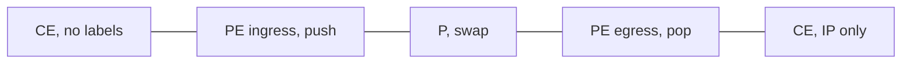

# MPLS architecture, LDP, and labels

MPLS forwards on a short label instead of looking up the IP destination at every hop. The core routers do not need the customer’s routes. They only need a path to the edge router that does. That split is the whole architecture: an IGP in the core, labels distributed by LDP (or segment routing), and services added at the edge.

## References

### Videos

- [What is MPLS?](https://networklessons.com/mpls) and the videos linked from the [LDP tag](https://networklessons.com/tag/ldp)
- [Keith Barker, advanced MPLS core concepts](https://www.youtube.com/watch?v=jE--F6GRCTg) — long, use as a reference
- [CBT Nuggets, describe MPLS operations](https://www.cbtnuggets.com/it-training/skills/describe-mpls-operations) — free previews; the full course is paid
- Juniper JNCIS-SP, MPLS fundamentals module, from [Open Learning](https://learningportal.juniper.net/juniper/user_activity_info.aspx?id=EDU-JUN-WBT-JOL-JNCIS-SP)

### Articles

- [RFC 3031, MPLS architecture](https://datatracker.ietf.org/doc/rfc3031/)
- [Nokia MPLS course syllabus](https://www.nokia.com/networks/training/src/courses/mpls/) — a topic checklist; the course is paid
- [NetworkLessons LDP articles](https://networklessons.com/tag/ldp)

## Diagram



**CE** is the customer edge. It speaks IP, OSPF, eBGP, or static routes. It does not understand labels.

**PE** is the provider edge. It faces the customer and the core. It pushes a label on the way in and pops the service label on the way out.

**P** is a core router. It swaps the transport label and never looks at the customer prefix.

## The shim

A label sits between the Ethernet header and the IP header. Ethernet type `0x8847` means “MPLS unicast.” The shim is 32 bits:

| Field | Bits | Meaning |
|-------|------|---------|
| Label | 20 | Value 16 and above are ordinary labels. 0 is IPv4 explicit null. 2 is IPv6 explicit null. 3 is implicit null. |
| EXP / TC | 3 | Class of service, copied from DSCP when you care about QoS. |
| S | 1 | Bottom of stack. 1 means the next header is not another label. |
| TTL | 8 | Decremented at each hop, same purpose as IP TTL. |

A **stack** is more than one shim. The outer label gets the packet across the core. An inner label tells the egress PE which service or which VRF the packet belongs to. P routers swap only the outer label. See [L3VPN](../05-vpn-services/01-l3vpn.md) for the two-label case. This note is the one-label case: forwarding an IP packet across the core.

## FEC, LIB, LFIB

A **FEC** (forwarding equivalence class) is a set of packets that take the same path and get the same label treatment. With LDP, each IGP prefix is a FEC. Every packet toward PE2’s loopback is the same FEC, whichever customer it came from.

**LIB** is the label information base: every label binding this router has heard. **LFIB** is the forwarding table: the one incoming label that is actually installed, and what to do with it. Same relationship as the BGP table versus the routing table. More candidates exist than the ones used.

Actions:

| Action | Who | What leaves the router |
|--------|-----|------------------------|
| Push | Ingress PE | An unlabeled packet gains a label |
| Swap | P | The incoming label is replaced with the next hop’s label |
| Pop | Penultimate or egress | The label is removed |

## LDP

LDP (RFC 5036) distributes those bindings. The usual mode on Cisco is **downstream unsolicited**: a router advertises a label for each IGP prefix it knows, without being asked. The neighbor it advertises to is the one that will send it packets, so labels are advertised downstream, opposite the direction of traffic.

LDP neighbors form over TCP port 646, and they discover each other with UDP hellos to `224.0.0.2`. The LDP router ID should be a loopback that the IGP advertises as a /32. If the router ID is not reachable, or two routers pick an ID from an interface that goes down, the session drops and every label disappears. The IGP can still be converged. That split — IGP up, LDP down — is a classic blackhole: IP to the loopback works, labeled packets do not.

```text
PE1(config)# ip cef
PE1(config)# mpls label protocol ldp
PE1(config)# interface gigabitEthernet 0/0
PE1(config-if)# mpls ip
PE1(config)# mpls ldp router-id loopback 0 force
```

Check the session before you check a single label:

```text
PE1# show mpls ldp neighbor
PE1# show mpls forwarding-table
```

## PHP, worked example

PE1, P, and PE2. IGP loopbacks 1.1.1.1, 2.2.2.2, 3.3.3.3. A packet arrives at PE1 for a destination that PE1 resolves via 3.3.3.3.

1. PE2 is the egress for its own loopback, so it advertises **implicit null (label 3)** for 3.3.3.3. Label 3 is a signal, not a label that is pushed on the wire.
2. P is the penultimate hop. It installs a pop for that FEC.
3. PE1 is told by P to use some real label, call it 200, to reach 3.3.3.3.
4. PE1 **pushes** 200 and sends the packet to P.
5. P **pops** 200, because its LFIB says pop, and sends a plain IP packet to PE2.
6. PE2 does one IP lookup. It does not look up a label and then look up the IP.

That pop-one-hop-early is **penultimate hop popping**. It exists so the egress router does one lookup instead of two. The cost is that the egress never sees the EXP bits. If QoS at the egress must see them, the egress advertises **explicit null (0)** instead. The penultimate hop swaps to 0 rather than popping, and the egress pops 0 and can still read EXP.

## End-to-end, service-provider view

A packet from a customer enters a PE. The PE decides the egress PE from the service (a VRF route, a pseudowire, an EVPN route). It pushes the service label, then the transport label for the egress PE’s loopback. Every P router swaps the transport label along the IGP shortest path. PHP removes the transport label. The egress PE reads the service label and finishes the job.

Nothing in the core has a customer route. If the IGP path changes, LDP labels change with it, and the service labels stay valid because they only need to arrive at the same egress PE. That independence is why you can add VPNs without touching P routers.

## Check yourself

1. Does a CE router push MPLS labels?
2. What is label 3, and does it appear on the wire?
3. IGP routes are present and `ping` to the far loopback works, but a labeled service is blackholed. What session do you check?
4. Why does PHP exist?
5. Which label in a two-label stack does a P router swap?

## Answers

1. No. The CE speaks IP to the PE. Labels start at the ingress PE.
2. Implicit null. It is a binding that means “pop,” not a shim the previous router sends.
3. The LDP session (`show mpls ldp neighbor`), and then the LFIB. IP reachability does not prove a label exists.
4. So the egress PE does a single lookup. The hop before it removes the transport label.
5. The outer, transport label. The inner service label stays until the egress PE.
