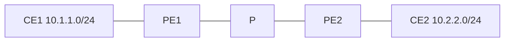

# L3VPN

An L3VPN is a customer routing table that exists on more than one PE. Each PE keeps the customer in a VRF. MP-BGP carries the routes between PEs as VPNv4 (or VPNv6) prefixes. MPLS carries the packets, with a transport label to reach the egress PE and a VPN label to select the VRF. The core never learns the customer’s prefixes. [RFC 4364](https://datatracker.ietf.org/doc/rfc4364/) is the specification. This note is the picture you want in your head before you read it line by line.

## References

### Videos

- [Configure Cisco MPLS L3 VPNs, Keith Barker](https://www.fiberopticvideos.com/watch.php?vid=1c115ba28)
- Cisco Live, search “The CCIE Candidate’s Introduction to MPLS L3VPN Networks” in the [on-demand library](https://www.ciscolive.com/on-demand/on-demand-library.html?search=The+CCIE+Candidate%27s+Introduction+to+MPLS+L3VPN+Networks) (free account)
- [L3 VPN explained](https://networklessons.com/mpls/mpls-layer-3-vpn-explained) and [configuration](https://networklessons.com/mpls/mpls-layer-3-vpn-configuration)

### Articles

- [RFC 4364, BGP/MPLS IP VPNs](https://datatracker.ietf.org/doc/rfc4364/)
- [RD versus RT, part 1 (PDF)](https://www.sunsetlearning.com/wp-content/uploads/2016/11/L3VPNs-route-target-and-route-distinguisher-Part-1.pdf)
- [Juniper, RD and RT](https://www.juniper.net/documentation/us/en/software/junos/multicast/topics/concept/ng-mvpn-concepts-terminology.html)

Read [VRF](../03-routing/vrf.md), [BGP](../03-routing/bgp.md), and [MPLS and LDP](../04-mpls/architecture-ldp-and-labels.md) first.

## Diagram



Control plane, PE1 toward PE2:

1. CE1 tells PE1 about 10.1.1.0/24 (static, OSPF, or eBGP). The route lands in VRF CUST.
2. PE1 attaches the RD, so the prefix becomes `65000:1:10.1.1.0/24`, and attaches the export RT.
3. PE1 advertises that VPNv4 route to PE2 (directly, or through a route reflector) with a **VPN label**, and with next hop PE1’s loopback.
4. PE2 imports the route into VRF CUST because the RT matches. The next hop is PE1’s loopback, which must be reachable in the global IGP, and there must be an LDP (or SR) label for it.

Data plane, a packet from CE2 to 10.1.1.10:

1. CE2 sends an IP packet to PE2.
2. PE2 looks up 10.1.1.10 in the VRF. The result is “VPN label V, transport label T toward PE1.”
3. PE2 pushes V, then T, and sends the packet to P.
4. P swaps T. It does not look at V and it has no VRF.
5. The hop before PE1 pops T (PHP).
6. PE1 receives a packet with label V, pops it, selects VRF CUST, and forwards the IP packet to CE1.

## The two labels

| Label | Advertised by | Looked up by | Purpose |
|-------|---------------|--------------|---------|
| Transport, outer | LDP or segment routing | P routers | Deliver the packet to the egress PE’s loopback |
| VPN, inner | MP-BGP with the VPNv4 route | Only the egress PE | Pick the VRF, and often the outgoing CE interface |

If the VPN label is missing, the egress PE does not know which customer the packet belongs to. Overlapping 10.0.0.0/8 networks make a guess impossible. The label is the demultiplexer.

If the transport label is missing, the packet cannot cross the core as MPLS. A common broken state: the VPNv4 route is in the BGP table and **not** in the VRF, because the next hop (the other PE’s loopback) has no labeled path. `show bgp vpnv4 unicast all` shows the route as inaccessible. Fix LDP or the IGP. Do not clear BGP first.

## Configuration outline

The PE-CE conversation itself is [PE-CE routing](pe-ce-routing.md). The core pieces on each PE:

```text
PE1(config)# ip vrf CUST
PE1(config-vrf)# rd 65000:1
PE1(config-vrf)# route-target both 65000:1
PE1(config)# router bgp 65000
PE1(config-router)# neighbor 2.2.2.2 remote-as 65000
PE1(config-router)# neighbor 2.2.2.2 update-source loopback 0
PE1(config-router)# address-family vpnv4
PE1(config-router-af)# neighbor 2.2.2.2 activate
PE1(config-router-af)# neighbor 2.2.2.2 send-community extended
PE1(config-router)# address-family ipv4 vrf CUST
PE1(config-router-af)# redistribute connected
```

`send-community extended` is not optional. Route targets are extended communities. Without that keyword the RT is stripped, the other PE has nothing to import, and the route never enters the VRF. This is the second classic failure, after LDP.

A route reflector for VPNv4 must also activate the `vpnv4` address family and send extended communities. Reflecting IPv4 unicast does not reflect VPNv4.

## What the core is spared

P has no VRF, no VPNv4, and no customer prefix. It runs the IGP and LDP. Adding customer 400 does not change P’s configuration. That is the operational point of the design. If a design doc proposes putting customer routes in the core IGP, it is not this design.

## Check yourself

1. Which protocol carries the VPN label, and which carries the transport label when the core uses LDP?
2. A P router receives a customer packet with two labels. Which one does it swap?
3. Two customers both advertise 10.1.1.0/24. What keeps their VPNv4 routes from colliding?
4. The route is in BGP on PE2 and missing from `show ip route vrf CUST`. Name two causes.
5. Why must the egress PE’s loopback be a /32 in the IGP?

## Answers

1. MP-BGP carries the VPN label with the VPNv4 route. LDP carries the transport label for the PE loopback.
2. The outer transport label. The VPN label stays under it.
3. The route distinguisher. The route target decides which VRF imports them, which should be different customers’ VRFs, so they still do not mix.
4. The RT was not sent (extended community missing) or does not match the import. Or the next hop is not reachable with a label, so BGP refuses to install it.
5. So the whole PE is one FEC. LDP then binds one label to that exact prefix. A shorter prefix can attract a label that points somewhere else, and PHP and the VPN lookup stop lining up.
