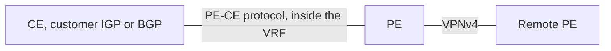

# PE-CE routing

The PE-CE link is ordinary IP routing into a VRF. The customer does not run MPLS. The PE redistributes what it learns from the customer into MP-BGP, and redistributes what MP-BGP imported back toward the customer. The choice of protocol is about operations and loop prevention, not about the core.

## References

### Videos

- [L3 VPN configuration](https://networklessons.com/mpls/mpls-layer-3-vpn-configuration) includes the PE-CE handoff
- Keith Barker’s L3VPN walkthrough: [Configure Cisco MPLS L3 VPNs](https://www.fiberopticvideos.com/watch.php?vid=1c115ba28)

### Articles

- [MPLS L3 VPN PE-CE OSPF](https://networklessons.com/mpls/mpls-layer-3-vpn-pe-ce-ospf) — the pattern applies to the other protocols
- [RFC 4364](https://datatracker.ietf.org/doc/rfc4364/) section 4 discusses PE-CE and the OSPF details
- [RFC 4577, OSPF as a PE-CE protocol](https://datatracker.ietf.org/doc/html/rfc4577)

The VPN itself is [L3VPN](l3vpn.md). The table the routes land in is a [VRF](../03-routing/vrf.md).

## Diagram



One direction is “customer tells this PE.” The other direction is “BGP tells this PE, and this PE tells the customer.” Both directions have to be configured. A site that can ping its local PE and cannot reach another site often has only one of them.

## Which protocol

| PE-CE | When it fits | Watch for |
|-------|----------------|-----------|
| Static | One prefix, or a default, at a small site | The return route. A static on the PE does not create the route on the CE. |
| eBGP | The usual service-provider choice | The customer has its own AS. Prefix limits and filters belong here. |
| OSPF | The customer wants one OSPF domain across sites | Down bit, domain ID, and sham links if a backdoor exists. |
| EIGRP | A Cisco customer already running EIGRP | Cost and AS number must be carried in BGP communities so the remote site looks internal. |

eBGP wins when you can choose, because the boundary is explicit: one session, a prefix limit, an AS path you can filter.

### eBGP into the VRF

```text
PE1(config)# router bgp 65000
PE1(config-router)# address-family ipv4 vrf CUST
PE1(config-router-af)# neighbor 10.0.0.2 remote-as 65010
PE1(config-router-af)# neighbor 10.0.0.2 activate
```

The customer’s AS is 65010. Routes learned here are VRF routes. Redistribution into VPNv4 is automatic for BGP routes in the VRF once the VPNv4 address family exists. Routes learned from OSPF or from `connected` are not. Those need `redistribute`.

On the way back, the remote site’s prefix arrives as a VPNv4 route, is imported into the VRF, and BGP advertises it to the CE because it is a BGP route. No extra redistribute is required for that direction when both sides are BGP.

Set a prefix limit on the neighbor. A customer that accidentally advertises a full table into your VRF will import it into every other site of that VPN.

### OSPF into the VRF

```text
PE1(config)# router ospf 10 vrf CUST
PE1(config-router)# redistribute bgp 65000 subnets
PE1(config)# router bgp 65000
PE1(config-router)# address-family ipv4 vrf CUST
PE1(config-router-af)# redistribute ospf 10
```

The PE becomes an ABR from the customer’s point of view. Routes that crossed the VPN are advertised back into OSPF as inter-area (type 3) routes. Two loop-prevention rules, from RFC 4577, do the real work:

- The **down bit** is set on those type 3 LSAs. A PE that receives a type 3 with the down bit set does not import it back into BGP. That stops a route from bouncing PE to CE to PE forever.
- The **domain ID** marks which OSPF process the route came from. Matching domain IDs keep the route inter-area. A mismatch makes it an external, and the preference changes.

A **sham link** is a fake OSPF adjacency across the VPN, used only when a site also has a backdoor link to another site and you need the VPN path to look intra-area so it can compete with that backdoor. Do not configure one by habit. Most VPNs do not have a backdoor.

## A worked reachability check

Site A prefix 10.1.1.0/24, site B prefix 10.2.2.0/24, both in VRF CUST.

| Check | Where | Healthy result |
|-------|--------|----------------|
| CE route to the local PE | CE | Connected or IGP neighbor up |
| Prefix in the VRF | PE, `show ip route vrf CUST` | 10.1.1.0/24 via the CE |
| VPNv4 advertisement | PE, `show bgp vpnv4 unicast all` | RD-prefixed route, RT set, VPN label allocated |
| Import on the far PE | Far PE, same command, then the VRF table | 10.1.1.0/24 via the other PE’s loopback |
| Label for that next hop | Far PE, `show mpls forwarding-table` | A label, or implicit null, for the other PE’s /32 |
| Return route | Both directions | 10.2.2.0/24 makes the same trip in reverse |

Walk top to bottom and stop at the first miss. The miss is the fault. A later miss is usually a consequence.

## Check yourself

1. Does the CE run LDP?
2. Why is eBGP the default recommendation for a provider handoff?
3. What does the OSPF down bit stop?
4. A prefix learned from the CE by OSPF never shows up as VPNv4. Which command is missing?
5. When is a sham link actually required?

## Answers

1. No. The PE-CE link is IP. Labels are imposed by the PE toward the core.
2. The AS boundary is the policy point: prefix limits, filters, and a clear owner for each route.
3. A PE from taking a route it already advertised into OSPF and redistributing it back into BGP.
4. `redistribute ospf` under `address-family ipv4 vrf`. BGP does not automatically take OSPF routes.
5. When two sites have a backdoor OSPF adjacency and the VPN path must compete with it as an intra-area route. Without a backdoor, type 3 routes across the VPN are enough.
