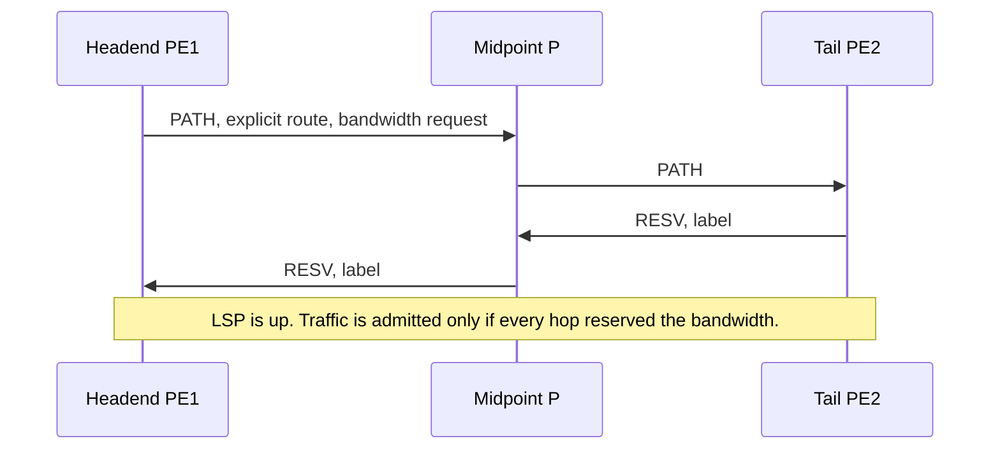

# RSVP-TE

LDP follows the IGP shortest path and reserves nothing. RSVP-TE builds a path you asked for, reserves bandwidth on it, and can protect it with a backup. The path is an LSP with state on every hop. That state is the feature and the cost.

## References

### Videos

- [RSVP-TE operation in MPLS-TE](https://www.youtube.com/watch?v=LzkKaRATJyw)
- [MPLS-TE explicit tunnel, Arash Deljoo](https://www.youtube.com/watch?v=X8aVxnbJOVw)

### Articles

- [NetworkLessons, MPLS TE RSVP-TE](https://networklessons.com/mpls/mpls-te-rsvp-te)
- [RFC 3209, RSVP-TE](https://datatracker.ietf.org/doc/html/rfc3209)
- [RFC 4090, fast reroute extensions](https://datatracker.ietf.org/doc/html/rfc4090)

The labels underneath are the same MPLS shim as [MPLS and LDP](../04-mpls/01-architecture-ldp-and-labels.md). The IGP has to be extended (OSPF TE or IS-IS TE) so every router knows the bandwidth and the affinities of every link.

## Diagram

**PATH** travels downstream, headend toward tail, and asks for the reservation. **RESV** travels back upstream and hands each hop the label to use toward the tail. This is the opposite direction from the way people first imagine a signaling protocol, and it matches LDP’s “labels come from downstream.”

## What the headend decides

The headend runs **CSPF**: shortest path on a copy of the topology that has had links removed if they lack the bandwidth, or if their affinity bits do not match the tunnel’s request. The result is an explicit route object (ERO), a list of hops. RSVP then signals that list.

The database CSPF uses is the **traffic-engineering database**, filled by the IGP’s TE extensions, not the ordinary routing table. If IS-IS has the prefix but TE is not enabled on a link, CSPF will not use that link. The tunnel fails or takes a surprising path. `show mpls traffic-eng topology` (IOS) is the picture CSPF saw.

Two ways to build the ERO:

- **Dynamic.** CSPF computes it. This is the normal operational mode.
- **Explicit path.** You name the hops. Useful for a lab and for a path CSPF will never choose. Fragile when a named hop goes away.

## Roles

| Role | Which router | State |
|------|----------------|-------|
| Headend | Where the tunnel starts, usually the ingress PE | Holds the tunnel interface, runs CSPF, imposes the TE label |
| Midpoint | Every P along the ERO | Stores the reservation and the label swap |
| Tail | Egress PE | Terminates the LSP |

A TE LSP is unidirectional. The return traffic needs its own tunnel, or it follows the IGP and takes a different path. Asymmetric TE is a normal source of “the traceroute looks wrong.”

## Bandwidth and preemption

Each link advertises reservable bandwidth. A tunnel that asks for 5 Gbps is admitted only if every hop has 5 Gbps left in the priority it uses. Admission is not a shaper. If you admit 5 Gbps and then send 9, the extra is not policed by RSVP. RSVP only decided whether the reservation fit.

Setups have a priority and a holding priority. A more important tunnel can preempt a less important one. Use that for a small set of classes, not as a default, or a new tunnel will tear down a live one.

## Fast reroute

Waiting for the headend to notice a failure, recompute CSPF, and signal a new PATH is too slow for a core link. **Fast reroute** installs a local backup before the failure.

| Style | What is pre-signaled | What it protects |
|-------|----------------------|------------------|
| One-to-one detour | A backup LSP around the next hop, per protected LSP | That one LSP |
| Facility backup | One bypass tunnel around a link or a node, shared by many LSPs | A link, or the whole next router |

Facility backup is what scales. The point of local repair (PLR) is the router just before the failure. It swaps onto the bypass as soon as the link drops, then the headend does **make-before-break**: it signals a new best path, moves traffic, and tears the old one down. The local repair is milliseconds. The global reoptimization is seconds and should not be what customers feel.

Nokia’s FRR coverage in the NRS II prep videos, linked from [SRC self-paced training](https://www.nokia.com/networks/training/src/self-paced/), is the vendor-specific walkthrough if that is the platform.

## What you pay

Every midpoint holds state per LSP. A full mesh of TE tunnels between N edge routers is `N*(N-1)` unidirectional LSPs, each with state on every hop. That is the scaling wall RSVP-TE hits, and the reason [SR-MPLS](02-sr-mpls.md) pushes the path decision to the headend and leaves the core with only IGP state.

## Check yourself

1. Which message carries the label, PATH or RESV?
2. CSPF cannot see a link that IS-IS is using for ordinary IP. What is missing?
3. Why is a TE LSP not a return path for the traffic it carries?
4. What is the difference between facility backup and a new CSPF run at the headend?
5. RSVP admitted 2 Gbps and the application sends 4. Does RSVP drop the extra?

## Answers

1. RESV, traveling upstream from the tail toward the headend.
2. Traffic-engineering extensions on that link, so the link enters the TE database. The ordinary IGP route is not enough.
3. The LSP is unidirectional. Return traffic needs another LSP or it will follow the IGP.
4. Facility backup is already signaled and switches locally at the router before the break. A new CSPF run happens afterward, at the headend, to settle on a fresh best path.
5. No. The reservation is an admission check, not a policer.
