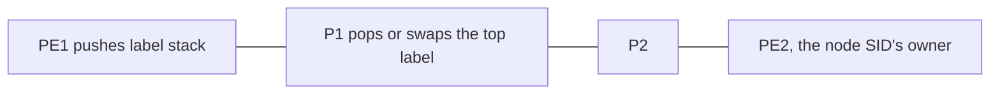

# Segment routing, SR-MPLS

Segment routing encodes a path as a stack of instructions, called segments. In SR-MPLS each instruction is an MPLS label. The core routers do not hold per-LSP state. They already know what each label means because the IGP advertised it. The headend decides the path by pushing the right stack. That is the scaling answer to [RSVP-TE](01-rsvp-te.md).

## References

### Videos

- [Introduction to segment routing, Cisco Community](https://community.cisco.com/t5/video/gallerypage/video-id/6064655138001) (~64 minutes)
- [Segment Routing community live](https://community.cisco.com/t5/videos-service-provider/video-introducci%C3%B3n-a-segment-routing/ba-p/5288954)

### Articles

- [RFC 8402, segment routing architecture](https://datatracker.ietf.org/doc/html/rfc8402)
- [Cisco dCloud, MPLS segment routing introduction lab](https://community.cisco.com/t5/service-providers-knowledge-base/cisco-mpls-segment-routing-introduction-lab-v1-is-now-available/ta-p/3636002)

## Diagram

A **prefix SID** (node SID) means “forward along the IGP shortest path to this router.” An **adjacency SID** means “forward out this specific link,” even if the shortest path would use another link.

## Node SID

Each router picks an index and the domain agrees a label range, the **SRGB**. A common default is 16000–23999. The label on the wire is `SRGB base + index`. If every router uses the same SRGB, the label is the same on every hop, which makes a capture readable. Different SRGBs are legal and painful: the same index is a different label on each hop.

PE2’s loopback has index 2, SRGB base 16000, so the node SID is label 16002. Any router that pushes 16002 is telling the network “shortest path to PE2.” Transit routers swap 16002 to the label their neighbor expects for the same index. There is no RSVP session and no LDP binding for that FEC. IS-IS or OSPF carried the index.

Using the node SID alone, with no extra labels, is the SR replacement for LDP shortest-path forwarding. Many networks run this first and only add a deeper stack when they need a path that is not the shortest one.

## A stack that is not the shortest path

PE1 wants to reach PE2 via P2, and the IGP shortest path would be via P9.

1. Push PE2’s node SID.
2. Push P2’s node SID on top of it.

The top label sends the packet along the shortest path to P2. P2 pops its own node SID (PHP) and reveals PE2’s node SID. From P2 the shortest path to PE2 is the one you wanted. You steered with two instructions and no state on P1 or P9.

An adjacency SID is how you pin one hop when a node SID is too coarse: “leave P2 out the link toward PE2, not out the other equal-cost link.” Adjacency SIDs are local to the advertising router. Only the neighbors that heard the advertisement know that label. They are not domain-wide the way a node SID is.

## TI-LFA

RSVP fast reroute pre-signals backup tunnels. **Topology-independent loop-free alternate** (TI-LFA) computes, from the IGP, a repair label stack that sends traffic around a failed link or node on the post-convergence path. The backup is a stack, not an RSVP LSP. The guarantee people buy it for: the repair path is the path the IGP will converge to, so traffic is not sent somewhere that will loop while SPF runs.

TI-LFA needs the extra SIDs (adjacency SIDs in particular) and a depth of label stack the hardware can push. A platform that can push only a few labels cannot express an arbitrary repair. That limit belongs in a design doc.

## What stays in the core

| | LDP | RSVP-TE | SR-MPLS |
|--|-----|---------|---------|
| Path | IGP shortest | CSPF, signaled | Whatever stack the headend pushed |
| State on P routers | A label per IGP prefix | A label and a reservation per LSP | The IGP’s SIDs, shared by all traffic |
| Bandwidth reservation | No | Yes | Not by itself. Combine with a controller or with RSVP if you still need admission. |
| Steering a single flow | Hard | A tunnel | A stack, or a color and a policy |

Segment routing does not reserve bandwidth. If the requirement is “admit this only if 5 Gbps is free,” RSVP-TE or a controller that tracks bandwidth still has a job. SR removes the soft state. It does not by itself do admission control.

## Check yourself

1. What does a node SID instruct a transit router to do?
2. Why is a common SRGB across the domain worth the coordination?
3. You need the packet to arrive at P2 before it is forwarded to PE2, and the shortest path from here to PE2 does not touch P2. What do you push?
4. Does SR-MPLS reserve bandwidth the way RSVP does?
5. What does TI-LFA install in place of an RSVP bypass tunnel?

## Answers

1. Forward the packet on the IGP shortest path toward the router that owns that prefix.
2. The label for a given index is the same on every hop, so a stack and a packet capture stay readable. Mismatched SRGBs mean each hop rewrites the index into a different label.
3. PE2’s node SID, with P2’s node SID on top. The top label gets the packet to P2. P2 then follows PE2’s node SID.
4. No. It encodes a path. Admission control is a separate function.
5. A precomputed label stack that follows the path the IGP will use after the failure.
