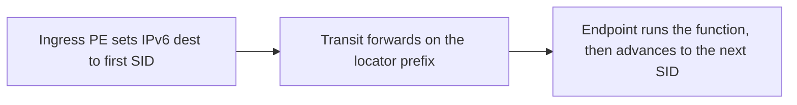

# SRv6

SRv6 is segment routing with IPv6 addresses as the instructions. A segment identifier is an IPv6 address. The packet is an IPv6 packet whose destination, and an optional routing header, is the list of segments. There is no MPLS shim. Read [SR-MPLS](02-sr-mpls.md) first. The architecture in [RFC 8402](https://datatracker.ietf.org/doc/html/rfc8402) covers both. [RFC 8986](https://datatracker.ietf.org/doc/html/rfc8986) is the SRv6 network-programming spec.

## References

### Videos

- [Cisco SRv6 explained](https://www.youtube.com/watch?v=c24v8CUDvzI)

### Articles

- [RFC 8402, segment routing architecture](https://datatracker.ietf.org/doc/html/rfc8402)
- [RFC 8986, SRv6 network programming](https://datatracker.ietf.org/doc/html/rfc8986)
- [RFC 8754, the segment routing header](https://datatracker.ietf.org/doc/html/rfc8754)

## Diagram



The high bits of a SID are a **locator**, a prefix the IGP advertises, so ordinary IPv6 forwarding brings the packet to the right router. The low bits are a **function**: what that router should do when the packet arrives. Forwarding and behavior are packed into one address.

## Locator and function

```text
2001:db8:0:2:0100::
|------------| |--|
locator /64     function
```

The locator `2001:db8:0:2::/64` is advertised by one router. Any packet whose destination matches that prefix arrives there by the IGP. The function `0100` might mean END (swap to the next SID and continue) or END.X (forward out a specific adjacency) or END.DT4 (decapsulate and look up an IPv4 VRF). The numbers are local policy, advertised in the IGP so the headend knows which address to push.

Functions you will see in a design:

| Function | Behavior |
|----------|----------|
| END | This node is a midpoint. Copy the next SID into the destination and forward. |
| END.X | Forward out one specific link. The SRv6 version of an adjacency SID. |
| END.DT4 | Strip the SRv6 header and look up the inner IPv4 packet in a VRF. This is the L3VPN egress. |
| END.DX2 | Strip the header and emit an Ethernet frame on an attachment circuit. The L2VPN egress. |

The function is why people call it network programming. The packet names the operation, not only the next hop.

## The routing header

A single SID needs no extension header. The IPv6 destination is that SID. A path of several SIDs uses the **segment routing header** (SRH). The destination address is the active SID. The header holds the rest of the list and a pointer. When a node finishes its function, it copies the next SID from the list into the destination and decrements the pointer. Transit routers that are not endpoints do ordinary longest-prefix-match on the destination. They do not have to understand the SRH. That is how an SRv6 domain can cross a plain IPv6 core, as long as the locator prefixes are routed and nobody filters the routing header.

## uSID

A full SID is 128 bits. A stack of four is a large header. **Micro-SIDs (uSID)** pack several short instructions into one IPv6 address. The endpoint consumes the next few bits and shifts the rest, so one destination address can hold a short path. You will see this in any hardware discussion, because header size is the usual objection to SRv6. Know that uSID exists to shrink the stack. The locator-plus-function idea does not change.

## When it is the right tool

SRv6 fits a network that is willing to be IPv6 end to end in the core and wants one forwarding plane for transport and for services. VPN behavior becomes a function on a SID instead of an MPLS service label.

It is the wrong tool when the core is MPLS, the hardware does not process an SRH at line rate, or the operational team has no IPv6 underlay. SR-MPLS gives the same source-routing model on the MPLS data plane those platforms already have. Do not run both in one domain without a reason you can write down.

## Check yourself

1. What part of a SID makes the packet reach the right router, and what part tells that router what to do?
2. Does every transit router have to parse the segment routing header?
3. Which function is the SRv6 equivalent of popping a VPN label and doing a VRF lookup?
4. What problem does uSID address?
5. A core that is MPLS-only and has no IPv6 forwarding. Which segment-routing data plane matches it?

## Answers

1. The locator is routed by the IGP. The function is the instruction the endpoint runs.
2. No. Routers that are not the active endpoint forward on the IPv6 destination alone.
3. END.DT4 for an inner IPv4 packet.
4. Header size. Several instructions fit in one 128-bit address so the stack stays small enough for the hardware.
5. SR-MPLS. SRv6 needs IPv6 forwarding of the locator prefixes.
