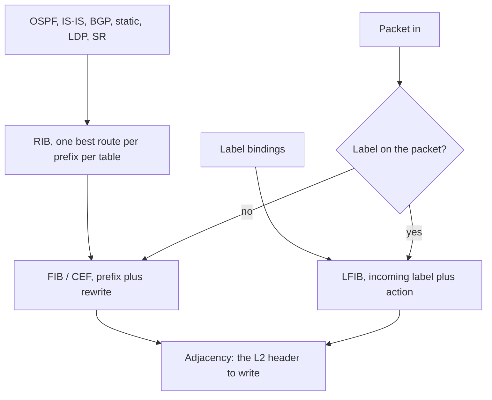

# RIB, FIB, and LFIB

The control plane decides. The data plane forwards. Mixing those two up is how a “the route is there” ticket goes on for a day. This note is the pipeline every later VPN and MPLS note assumes.

## References

### Videos

- [Packet Traveling](https://www.youtube.com/watch?v=rYodcvhh7b8)
- Keith Barker’s MPLS L3VPN and BGP material, linked from [L3VPN](../05-vpn-services/l3vpn.md)

### Articles

- [Host to host through a router](https://www.practicalnetworking.net/series/packet-traveling/host-to-host-through-a-router/)
- [RFC 3031](https://datatracker.ietf.org/doc/rfc3031/) for the LFIB
- [MPLS L3 VPN explained](https://networklessons.com/mpls/mpls-layer-3-vpn-explained) for the VPN version of this pipeline

## Diagram

A packet is forwarded by the FIB or the LFIB, never by a routing protocol. If the protocol is still computing and the FIB has the old answer, traffic follows the old answer. That is also why a route-processor switchover can keep forwarding: the FIB was already programmed. See [high availability](../08-operations/high-availability.md).

## The tables

**RIB.** The routing table. Every protocol installs candidates. One best route per prefix is selected (administrative distance, then the protocol’s metric). `show ip route` is the RIB. A VRF has its own RIB. The global table is just the RIB that is not in a VRF.

**FIB.** The forwarding information base, Cisco CEF. It is the RIB flattened for lookup, plus a pointer to the adjacency that says how to build the outgoing layer-2 header. `show ip cef` is the FIB. Hardware copies this into ASICs or the line card. A route in `show ip route` and missing from `show ip cef` is a programming failure, not a routing-protocol failure.

**Adjacency.** The rewrite. Next hop 10.0.12.2 on Gi0/0 becomes “destination MAC of 10.0.12.2, source MAC of Gi0/0, VLAN tag if any.” CEF glean means the prefix is known and the MAC is not: the router will ARP, and until the ARP returns, traffic to that neighbor is punted or dropped. A FIB entry with no adjacency is a common “I have a route and nothing forwards” case. Check the ARP or neighbor cache.

**LFIB.** The label forwarding table. Incoming label, outgoing label or pop, outgoing interface, and the same kind of rewrite. `show mpls forwarding-table`. It is programmed from LDP, RSVP-TE, or segment routing, not from the IP RIB directly. The IP RIB says which FEC exists. The label protocol says which label represents it.

## Lookup order

1. If the frame is MPLS (`0x8847`), look up the **top label** in the LFIB. Swap, pop, or drop. Do not look at the IP header unless the label action says to.
2. If the frame is IP, look up the destination in the FIB for the table that applies (global, or the VRF the interface or the VPN label selected).
3. Longest prefix match inside that one table.
4. Attach the adjacency rewrite and send.

A VPN packet on the egress PE is both steps. The LFIB pop of the VPN label selects the VRF. The FIB lookup inside that VRF selects the CE next hop. One packet, two tables, in that order. [L3VPN](../05-vpn-services/l3vpn.md) is this paragraph with names on the labels.

## Control plane versus data plane, on one failure

BGP withdraws a prefix. The RIB deletes it. CEF removes the FIB entry. Until that removal is pushed to the line card, the card still forwards on the old next hop. On a small router you will not notice. On a distributed platform a stale FIB entry is a real bug class: the route is gone in the RIB and the traffic is still leaving. `show ip cef` on the line card, not only on the route processor, is the comparison.

The other direction: the FIB is fine and the protocol is down. Nonstop forwarding keeps the FIB while BGP or OSPF restarts. Traffic flows. New information is not learned until the protocol is back. Do not declare the network healthy from a ping alone during a restart, and do not declare it broken from a protocol that is still in GR.

## Check yourself

1. A prefix is in `show ip route` and absent from `show ip cef`. Which table does a transit packet use?
2. What does a glean adjacency mean?
3. A P router receives an MPLS packet. Does it consult the IP FIB?
4. On an egress PE, which lookup selects the VRF?
5. Why can forwarding continue while the routing process restarts?

## Answers

1. The FIB. If CEF has no entry, the packet is not forwarded as the RIB suggests. Find out why the FIB was not programmed.
2. The next hop’s MAC is unknown. The router needs ARP or NDP before it can rewrite the frame.
3. Not for the top label. The LFIB action is swap or pop. The IP header is inspected only if the label is popped and the packet is IP-routed at that hop.
4. The VPN label in the LFIB. The VRF FIB is the second lookup.
5. The FIB and LFIB are already installed in the data plane. Restarting the control plane does not erase them if the platform supports nonstop forwarding.
