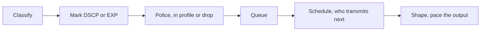

# QoS

QoS decides which packets wait, which are dropped, and which are sent first when a link is full. It does not create bandwidth. On a service-provider network the usual model is DiffServ: mark a packet once, and let every hop apply a behavior to that mark. MPLS carries the mark in the EXP bits of the label.

## References

### Videos

- Keith Barker, QoS overview, in the [CCNA playlist](https://www.youtube.com/playlist?list=PLQQoSBmrXmrysEaVNia7KVwf85qATIi1V)

### Articles

- The Juniper JNCIS-SP outline includes the QoS topics. Course login: [JNCIS-SP](https://learningportal.juniper.net/juniper/user_activity_info.aspx?id=EDU-JUN-WBT-JOL-JNCIS-SP).
- [RFC 2474, DSCP](https://datatracker.ietf.org/doc/html/rfc2474)
- [RFC 3270, MPLS and DiffServ](https://datatracker.ietf.org/doc/html/rfc3270) — uniform, pipe, and short-pipe

## Diagram

Not every hop does every step. Trust boundaries classify and mark. Core hops schedule on the mark they already trust. Edges shape toward a customer contract.

## Marks

The IPv4 and IPv6 DSCP is 6 bits. Values you should recognize:

| DSCP | Name | Treatment people intend |
|------|------|-------------------------|
| 0 | Default / BE | Best effort |
| 46 | EF | Expedited forwarding, voice, a small priority queue |
| 34, 36, 38 | AF41–AF43 | A class with increasing drop probability |
| 26, 28, 30 | AF31–AF33 | Another class, same idea |
| 8, 16, 24, 32, 40, 48 | CS1–CS6 | Class-selector values, compatible with the old IP precedence |

AF drop precedence means “inside this class, drop me before my neighbors when the queue is deep.” It does not mean the class is more important than a higher EF. EF is the priority class. If you put bulk traffic in EF, the priority queue starves everything else. EF is for a rate you can bound.

On an MPLS label the 3 EXP bits (now called Traffic Class) hold the mark. Three bits cannot carry a full DSCP. The PE maps DSCP to EXP on ingress. How that mapping interacts with the customer’s original DSCP is the **tunnel mode**:

| Mode | Customer DSCP | Scheduling in the core | At the egress |
|------|---------------|------------------------|---------------|
| Uniform | May be remarked | EXP, and the remark follows the packet out | The packet leaves with the remarked DSCP |
| Pipe | Preserved | EXP | The egress schedules on EXP, then restores or keeps the customer DSCP |
| Short-pipe | Preserved | EXP, except the egress PE schedules on the customer DSCP | Customer mark is what the egress queue sees |

Pipe is what a provider uses when the customer’s marks must survive the core and the core still needs its own scheduling. Uniform is what you use when the network is one trust domain and a remark should stick. Pick one in the design and make every PE agree. A mix remarks customer voice to best effort in one direction only.

## Tools, and what each one does not do

**Classification** matches fields: interface, DSCP, EXP, ACL, or a deeper inspection. Do it at the trust boundary. A core router should not have to reclassify customer packets hop by hop.

**Policing** measures a rate and drops or remarks the excess immediately. It does not smooth traffic. A policer on a customer handoff enforces the contract.

**Shaping** measures a rate and delays the excess. Use it when the next hop polices and you would rather queue than be dropped, for example a fast interface handing off to a slower virtual circuit or a policed service.

**Queuing and scheduling** pick the next packet when the link is busy. Low-latency queuing puts a policed priority queue (the EF traffic) ahead of class-based weighted queues. If the priority class is not policed, it is no longer a priority queue. It is a way for one class to take the link.

**WRED** drops some packets before the queue is full so TCP flows slow down instead of all synchronizing and dropping together. It acts on the AF drop precedence. It does nothing useful for UDP, which does not slow down.

## A small design

A PE, customer handoff, voice and data on one /30 or one VLAN.

1. Trust the customer’s DSCP only if the contract says they mark correctly. Otherwise classify voice with an ACL or a known UDP port range and mark EF yourself.
2. Police EF to the contracted voice rate. Remark or drop the excess so a customer cannot fill the priority queue.
3. Put the rest in a data queue. Shape the whole interface to the contracted rate if the physical link is faster than the service.
4. Map EF to a high EXP for the core, in pipe mode if the customer DSCP must be unchanged when the packet leaves your network.

Write the numbers in the design doc. “Enable QoS” is not a design.

## Check yourself

1. Does QoS add bandwidth to a congested link?
2. What is the difference between a policer and a shaper?
3. Why must the priority queue be rate-limited?
4. In pipe mode, whose mark does the core use, and whose mark does the customer see at the far PE?
5. Why is WRED a poor tool for a UDP video stream?

## Answers

1. No. It chooses an order and a drop policy for the bandwidth you have.
2. A policer drops or remarks excess now. A shaper delays excess and sends it later.
3. Unpoliced priority traffic transmits whenever it has a packet, and the other queues wait. A police keeps EF to the rate that class was promised.
4. The core schedules on EXP. The customer DSCP is preserved and is what leaves the far side.
5. WRED assumes the sender will slow down when packets disappear. UDP does not. You drop video frames and the sender keeps the same rate.
