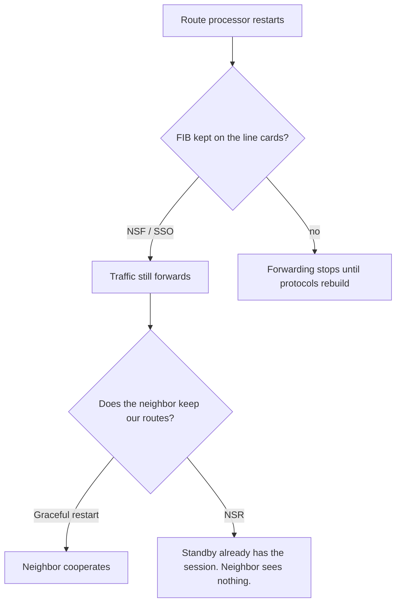

# High availability

High availability is which failures the forwarding plane survives, and which failures the neighbors have to help with. The names are easy to swap. The distinction that matters: does traffic keep flowing, and does the neighbor have to cooperate.

## References

### Videos

- Juniper JNCIS-SP high-availability module, from [Open Learning](https://learningportal.juniper.net/juniper/user_activity_info.aspx?id=EDU-JUN-WBT-JOL-JNCIS-SP)

### Articles

- The HA guide for the platform you run. The mechanisms below are the common ones. Timers and command names differ on Nokia SR OS, Junos, and IOS-XR.
- [RFC 5880, BFD](https://datatracker.ietf.org/doc/html/rfc5880)
- [RFC 4724, BGP graceful restart](https://datatracker.ietf.org/doc/html/rfc4724)

## Diagram

## Detecting the failure: BFD

Routing hello timers are seconds. A link that fails without dropping carrier (a switched path, a silent fiber cut in one direction) is invisible until hellos expire. **BFD** is a small, frequent hello dedicated to liveness. OSPF, IS-IS, and BGP all subscribe to the same BFD session instead of shortening their own hellos to the point where the control plane drowns.

Use it on core links and on PE-CE sessions where a second of blackhole is too long. Do not turn it on every VLAN of a campus by habit. A shared switch that punts BFD can drop the hellos under load and declare every session down at once.

## Route processor switchover

**SSO** (stateful switchover) keeps a hot standby route processor with the configuration and the forwarding state. **NSF** (nonstop forwarding) means the line cards keep using the FIB and LFIB while the new processor starts. Traffic continues for the prefixes that were already installed. New routes are not learned until the protocols recover.

NSF without a way to refresh the RIB is a timer: eventually the stale FIB entries are deleted. Something has to rebuild the RIB first.

**Graceful restart.** The restarting router asks its neighbors, in the protocol, to keep the routes they learned from it and to keep forwarding toward it. The neighbors advertise that cooperation. When the router comes back it relearns the database and signals that restart is over. If the neighbor does not support graceful restart, it deletes the routes as soon as the session drops, and the rest of the network converges away from a router that was still forwarding. GR is a contract. Both sides must implement it. BGP, OSPF, IS-IS, and LDP each have their own version.

**NSR** (nonstop routing) does not ask the neighbor. The standby processor has been mirroring the protocol state, including the TCP sequence numbers for BGP, so the session does not drop. The neighbor never enters GR. NSR is the one you want when the neighbor is another provider and you cannot depend on their software. It costs more state on the standby. Not every protocol on a platform is NSR-capable. A design that says “NSR” and a protocol that is only GR will still bounce that protocol’s neighbors.

| Mechanism | Forwarding continues | Neighbor must help | Session stays up |
|-----------|----------------------|--------------------|------------------|
| Nothing | No | — | No |
| NSF + GR | Yes, while the FIB is held | Yes | No, then it restarts |
| NSF + NSR | Yes | No | Yes |

## What still breaks

- A line card crash loses the interfaces on that card. SSO does not move those links.
- A FIB that was wrong before the switchover is still wrong after it.
- GR has a restart timer. If the router is not back in time, neighbors delete the stale routes and traffic shifts.
- Asymmetric failures: one direction of a link dies, BFD catches it, and a protocol with a long hello would not have. Confirm BFD is actually negotiated (`show bfd neighbors`) and not merely configured on one side.

## Check yourself

1. What does BFD replace when it is paired with OSPF?
2. Graceful restart requires cooperation from whom?
3. Why would a peering session with another provider be NSR rather than GR?
4. Does SSO save traffic that was using a line card that just crashed?
5. NSF keeps forwarding. What is lost until the protocol finishes recovering?

## Answers

1. The need to run very short OSPF hellos for fast failure detection. OSPF subscribes to BFD and keeps its own hellos slower.
2. The neighbors. They must keep the restarting router’s routes and still support the GR capability. A neighbor without GR withdraws.
3. You do not control the other provider’s code. NSR keeps the session up without their help. GR only works if they implemented it and enabled it.
4. No. Those interfaces are gone. SSO protects the route processor, not a dead line card.
5. New information. The FIB is a snapshot. Prefixes that change during the restart are stale until the RIB is rebuilt and pushed.
