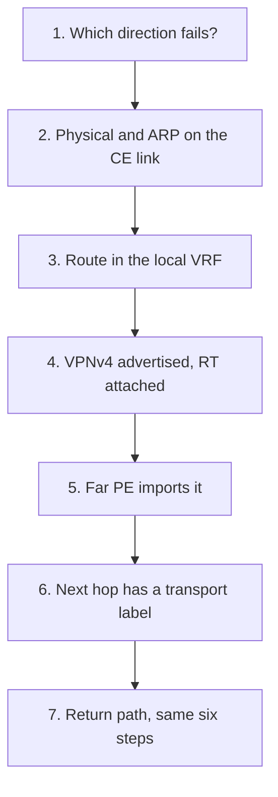

# Troubleshooting

Troubleshooting is a sequence you can repeat, not a pile of show commands. Start at the layer that is actually broken, confirm one fact, then move one step toward the destination. The list below is the one to copy into a lab notebook and into a design review. It assumes a customer ping across an [L3VPN](../05-vpn-services/01-l3vpn.md). The same order works for a campus ping if you stop before the labels.

## References

### Videos

- NetworkLessons configuration lessons (verify each step before the next), starting from [What is MPLS?](https://networklessons.com/mpls)
- [Life of a packet, day 12 lab](https://www.youtube.com/watch?v=bfsEqDeHbpI) — the habit of following one packet

### Articles

- [Host to host through a router](https://www.practicalnetworking.net/series/packet-traveling/host-to-host-through-a-router/)
- Build the checklist from [L3 VPN explained](https://networklessons.com/mpls/mpls-layer-3-vpn-explained) and from [RFC 4364](https://datatracker.ietf.org/doc/rfc4364/)

## Diagram



Do not start at step 6 because the ticket says “MPLS is down.” Most tickets that say MPLS are a missing return route or a VRF ping typed without the VRF name.

## The rules

- **One direction at a time.** “Ping fails” is two failures until you prove the return path works. A traceroute from each end is the separator.
- **Name the table.** Global, VRF, or LFIB. A command in the wrong table is not evidence.
- **Stop at the first missing fact.** Everything after it is a guess.
- **Change one thing, then test again.** Two changes make a success unexplainable.

## Checklist

Replace the names with the VPN you are in.

| Step | Command, IOS-shaped | You are looking for |
|------|---------------------|---------------------|
| CE link up | `show ip interface brief` | The PE-CE interface up/up, correct address, correct VRF |
| Customer can ARP | `show ip arp vrf CUST` | The CE’s MAC, not Incomplete |
| Local route | `show ip route vrf CUST` | The destination prefix, or at least the route toward the far site |
| BGP has it | `show bgp vpnv4 unicast all 10.2.2.0/24` | RD, RT, VPN label, next hop = far PE loopback |
| Community actually sent | `show bgp vpnv4 unicast all neighbors 2.2.2.2 advertised-routes` | The prefix, and the neighbor was activated under `address-family vpnv4` with extended communities |
| Far import | same BGP command on the far PE, then `show ip route vrf CUST` | The prefix is in the VRF, not only in BGP |
| Transport | `show mpls forwarding-table 1.1.1.1` | A label or Pop for the egress PE /32 |
| LDP session | `show mpls ldp neighbor` | Operational, on the core links |
| IGP | `show ip route 1.1.1.1` | The /32, learned by IS-IS or OSPF, not a default route |
| Return | Repeat from the other PE | The source prefix is present on the far side |

Ping from the PE inside the VRF, sourced from the customer-facing address:

```text
PE# ping vrf CUST 10.2.2.1 source 10.1.1.1
```

A ping from the global table, or a ping the PE sources from an address the far VRF does not know, fails in a network that is otherwise fine.

## A worked blackhole

Symptom: CE1 cannot ping CE2. PE1 can ping PE2’s loopback.

1. `show ip route vrf CUST` on PE1 shows 10.2.2.0/24. The route is present. Not a PE-CE problem on PE2’s advertisement into BGP, or it would be missing here. Keep going.
2. The route’s next hop is 2.2.2.2. `show mpls forwarding-table 2.2.2.2` has no entry. `show ip route 2.2.2.2` does.
3. `show mpls ldp neighbor` on the core link toward the next P is down. IGP is up.

The packet is IP-routable to the loopback and has no transport label. The PE drops it rather than send a customer packet unlabeled into the core (the default, and the safe one). Fix the LDP session: router ID reachable, `mpls ip` on both ends of the link, no ACL on UDP 646 or TCP 646. The VPN configuration was never the fault.

The mirror image is also common: LDP is up, and `show bgp vpnv4 unicast all` on the far PE shows the prefix with no RT. The near PE forgot `send-community extended`. The route crossed BGP and could not be imported.

## What to write down

For a ticket, record four lines before you change anything:

- Source address and VRF, destination address and VRF.
- The last device that had the route, and the command that proved it.
- The first device that did not, and the command that proved the absence.
- Whether the return path was tested.

That is a better note than a page of `show running-config`.

## Check yourself

1. A VRF ping works and a global ping to the same address fails. Is the VPN down?
2. The VPNv4 route is on the far PE and not in the VRF. Give two causes.
3. Why does a missing LDP label blackhole an L3VPN when a normal IP ping to the loopback still works?
4. You fix the RT and the LDP session at the same time, and the ping starts working. What do you not know?
5. Where in the order do you test the return path?

## Answers

1. No. The global table is not supposed to have the customer prefix. The VRF ping is the test.
2. The route target does not match the VRF’s import, or it was stripped because extended communities were not sent. Also a next hop that is not labeled, which keeps BGP from installing the route.
3. IP to the loopback uses the IP FIB. The VPN packet needs a transport label in the LFIB. Those are different tables. See [RIB, FIB, and LFIB](../07-forwarding/01-rib-fib-lfib.md).
4. Which of the two changes fixed it. Re-introduce them one at a time in a lab, or you will “fix” the next ticket by doing both.
5. After the forward path is proven, or immediately if you do not yet know which direction fails. A one-way failure is still a failure.
