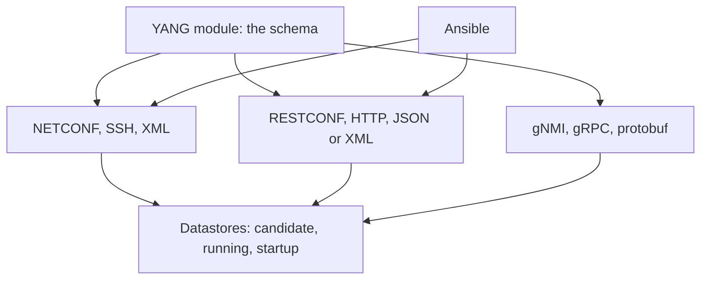

# YANG, NETCONF, RESTCONF, and gNMI

The CLI notes in [the command line](../01-fundamentals/command-line.md) are how a person configures one router. A program needs a schema and a stable operation. YANG is the schema. NETCONF, RESTCONF, and gNMI are three ways to read and write data that fits the schema. Ansible is how a lot of teams call those operations without writing a client from scratch.

## References

### Videos

- [Cisco DevNet, network programmability basics](https://developer.cisco.com/video/net-prog-basics/00-intro/intro/) — NETCONF, RESTCONF, YANG, Ansible
- [YANG, NETCONF, RESTCONF, gNMI playlist](https://www.youtube.com/playlist?list=PLpGt4hh32rCp_ocLmYAKlf3q3TqSJl6Mh)
- [David Bombal and Hank Preston, NETCONF and YANG](https://davidbombal.com/yang-netconf-restconf-demos-which-cisco-devices-are-supported-part-1/)

### Articles

- [DevNet course notes and labs](https://github.com/CiscoDevNet/netprog_basics)
- [RFC 7950, YANG 1.1](https://datatracker.ietf.org/doc/html/rfc7950)
- [RFC 6241, NETCONF](https://datatracker.ietf.org/doc/html/rfc6241)
- [RFC 8040, RESTCONF](https://datatracker.ietf.org/doc/html/rfc8040)
- [gNMI specification](https://github.com/openconfig/reference/blob/master/rpc/gnmi/gnmi-specification.md)

## Diagram



The same YANG path can be carried three ways. Pick the transport the device actually implements. Do not assume all three exist because the data model is published.

## YANG

A YANG module names a tree of configuration and state. Leaves have types. Lists have keys. A path looks like a filesystem:

```text
/interfaces/interface[name='GigabitEthernet0/0']/description
```

OpenConfig (`openconfig-interfaces`) is a vendor-neutral model. Native models (`Cisco-IOS-XR-ifmgr-cfg`, Juniper’s configuration hierarchy exposed as YANG) cover features OpenConfig has not standardized. IETF models sit between them. A real device speaks a mix. The first call in any project is “which model does this platform implement for this feature,” not “write the JSON.”

`pyang` or the device’s own schema listing (`<get-schema>` in NETCONF, or a capabilities exchange) shows the tree. Editing against a guessed path is how you push a config the box rejects after you have already shut a session.

## Datastores

| Datastore | Contents |
|-----------|----------|
| candidate | A private copy you edit. It does not affect forwarding. |
| running | What the device is doing now. |
| startup | What it will load after reboot, on platforms that have one. |

The safe edit is: lock candidate, edit, validate, commit, unlock. A commit that fails leaves running untouched. A script that writes straight to running, one leaf at a time, leaves the box half-changed when the third call fails. Candidate plus commit is the point of NETCONF. Use it.

## NETCONF

NETCONF runs over SSH. The payload is XML. Operations you need:

| Operation | Effect |
|-----------|--------|
| `get` | Read state and config |
| `get-config` | Read a datastore |
| `edit-config` | Merge, replace, or delete nodes in a datastore |
| `commit` | Copy candidate to running |
| `validate` | Check candidate without committing |
| `lock` / `unlock` | Stop another session from editing the same datastore |

A replace on `/interfaces` replaces the whole interface list. A merge changes the leaves you sent. Confusing them wipes a router. Say the operation out loud before you run it, and try it on a lab VRF first.

## RESTCONF

RESTCONF is the same datastores over HTTP. GET reads. PATCH and PUT write. JSON is the usual body. URLs follow the YANG path. It is easier to call from a language that already has an HTTP library, and it is a poorer fit for a huge candidate config with locks. Use it for small reads and for devices that do not expose a comfortable NETCONF stack. Headers matter: `Accept: application/yang-data+json`.

## gNMI

gNMI is gRPC. Two modes change how you operate:

- **Get** is a snapshot, like a show command.
- **Subscribe** is a stream. The device pushes changes (on change, or on a sample interval) instead of you polling every 10 seconds.

Telemetry is the reason gNMI shows up in a modern design. Polling `show interface` from a thousand routers is how you melt a route processor. A subscription for interface counters and BGP neighbor state, with the device pushing only changes, is the replacement. gNOI is the companion for operations that are not configuration (reboot, ping, certificate install). Do not overload a Set call to fake an operational command the model does not have.

## Ansible, as the caller

Ansible is not a fourth protocol. A playbook calls NETCONF or the vendor module, which calls the device. The module you want is the one that speaks the datastore, not a module that pastes CLI.

```yaml
- name: Set a VRF description
  netconf_config:
    host: "{{ inventory_hostname }}"
    datastore: candidate
    commit: true
    content: |
      <config>
        <native xmlns="http://cisco.com/ns/yang/Cisco-IOS-XE-native">
          <vrf>
            <definition>
              <name>CUST</name>
              <description>customer A</description>
            </definition>
          </vrf>
        </native>
      </config>
```

This is an illustration of candidate plus commit, not a template to paste onto a different platform. The namespace changes per vendor. The habit does not: candidate, validate, commit, and a playbook that is idempotent so a second run sends the same intended state instead of appending another copy.

CLI scraping (`show ip route | include`) breaks when a column shifts. A YANG leaf has a name. Prefer the leaf. Keep a CLI backup only for the feature the image has not modeled yet, and mark it as debt.

## Check yourself

1. What does YANG define, the transport or the schema?
2. Why is a commit of a candidate safer than editing running one leaf at a time?
3. Which gNMI mode replaces polling?
4. What does a replace operation on a list do that a merge does not?
5. Name one thing OpenConfig will not cover on a given router, and what you use instead.

## Answers

1. The schema. NETCONF, RESTCONF, and gNMI are transports for data that fits a YANG module.
2. A failed commit does not change forwarding. A failed third RPC against running leaves the first two edits in place.
3. Subscribe. The device pushes samples or changes.
4. Replace removes list entries you did not include. Merge updates the entries you sent and leaves the others.
5. Vendor-specific features that are not in the OpenConfig model. Use the native YANG module for those leaves.
